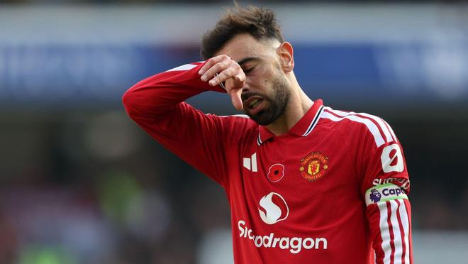

诺丁汉森林3-1击败曼城，把曼联送进了积分榜倒数三名，这也是曼联在赛季这一阶段40年来首次一天结束时身处英超降级区。

森林的这场胜利让曼城遭遇联赛三连败，也意味着曼联在至少踢了9场联赛后，首次处于顶级联赛降级区。这是自1986年11月以来的第一次，当时他们在踢完15场后排名第21位。

如果桑德兰周日击败切尔西，而水晶宫在塞尔赫斯特公园球场对利物浦避免失利，并且曼联在当天稍晚主场面对阿斯顿维拉前，卡里克的球队就会在迎战埃梅里的球队之前跌到英超垫底。

曼联面对维拉时，球队自8月30日主场5-2击败升级球队伊普斯维奇以来，已经连续未能在联赛取胜。

卡里克和他的球员们本赛季已经创下俱乐部史上最差的英超开局，这也是曼联40年来最糟糕的开局。

1986年11月，在那段糟糕开局之后，主帅罗恩-阿特金森被解雇，弗格森在老特拉福德接替了他。

卡里克近期主帅位置承受着巨大压力，尽管曼联周二在欧冠3-2击败罗马缓解了这位45岁主帅的压力，但他的未来仍不明朗。若输给维拉，这位前曼联中场可能就会走到尽头。

卡里克周五表示，他希望曼联对罗马的惊天逆转能激励球队继续前进。

“显然，这是积极的反应，”卡里克谈到球队自周二以来的氛围时说，“当然，我们不会因此一下子就飘了起来。

“我已经从球员身上看到了足够多的东西。我知道我们的能力。我已经说过很多次了。我非常清楚我们能做到什么，我们都知道。你们也从不同角度看到了。你知道我们作为一支球队能做到什么，我们作为一支球队，作为一支球队。我们一直都在证明这一点。

“只是最近证明得还不够多，但我们知道这一点一直都在。小伙子们训练得非常好。我不是为了说而说。如果他们没有做到，我也会说出来。”

特别声明：以上内容(如有图片或视频亦包括在内)为自媒体平台“网易号”用户上传并发布，本平台仅提供信息存储服务。

Notice: The content above (including the pictures and videos if any) is uploaded and posted by a user of NetEase Hao, which is a social media platform and only provides information storage services.

大眼睛看看 2026-11-07 03:26:21

懂球帝 2026-11-08 18:57:09

懂球帝 2026-11-08 18:47:34

一个香蕉说球 2026-11-08 10:37:42

懂球帝 2026-11-08 18:57:10

懂球帝 2026-11-08 18:47:34

爱足球的谢宇宁 2026-11-08 10:40:50

足球印象CC 2026-11-06 21:01:18

懂球帝 2026-11-08 17:10:08

蜡笔足球 2026-11-08 06:57:42

小轲搞笑解说 2026-11-06 01:00:37

领略非凡 2026-11-07 20:17:51

一路荒凉如歌aa 2026-11-07 02:06:59

一个香蕉说球 2026-11-08 10:38:17

懂球帝 2026-11-08 17:10:07

雷叔聊球 2026-11-08 03:29:00

足球印象CC 2026-11-07 15:59:15

转会窗ProMax 2026-11-06 13:30:57

旧梦难寻c 2026-11-07 05:05:36

雷叔聊球 2026-11-07 03:32:00

墨史轩 2026-11-08 01:03:10

足球印象CC 2026-11-06 06:11:09

一个香蕉说球 2026-11-06 01:33:27

懂球帝 2026-11-08 19:19:42

咪咕体育 2026-11-07 08:31:17

6个果子说球 2026-11-08 08:00:37

惊鸿照影b 2026-11-07 07:35:57

心开动漫 2026-11-07 04:28:29

一路荒凉如歌a 2026-11-08 02:23:38

孤酒老巷QA 2026-11-08 14:57:43

青川入画 2026-11-08 01:54:42

蜡笔足球 2026-11-06 11:33:19

杨柳青青w 2026-11-08 04:42:25

足球故事GOAL 2026-11-05 22:21:13

川麻喵喵 2026-11-07 00:39:10

陈赩爱体育 2026-11-08 06:11:02

何老师呀 2026-11-08 04:46:49

白沙体育 2026-11-07 11:44:20

全球风情大揭秘 2026-11-08 15:42:00

人间闲散客 2026-11-08 00:10:23

## 配图

图：足球（网易体育 · 2026-11-08）

## 来源

- [网易体育 · 原文](https://www.163.com/dy/article/LB6IH2LJ0549BAP0.html)
