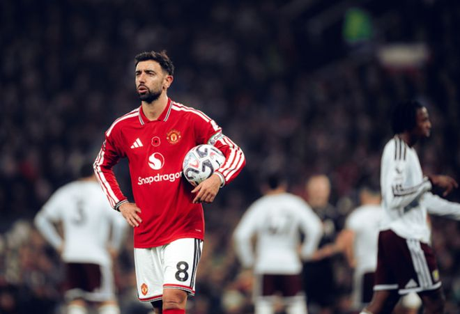

在北京时间11月9日结束的英超第10轮最后1场对决中，曼联坐镇主场4-4战平阿斯顿维拉。

上半场，维拉开场4分钟取得2球领先。曼联依靠B费点射和蒂莱曼斯弑旧主扳平。下半场，维拉再次开场8分钟内由麦金和格雷茨卡连进2球取得领先，齐尔克泽和多尔古补时连扳2球，帮助曼联绝平。

曼联遭遇联赛8轮不胜（5平3负）。10轮战罢，曼联1胜5平4负仅积8分，位列降级区，排名倒数第3位。而维拉则10轮积13分，排名第10位。

开场仅1分钟，麦金弧顶分球，阿利松射门打穿拉门斯小门，维拉1-0领先曼联，取得梦幻开局。

第4分钟，阿利松射门被拉门斯扑出，杰克逊机敏补射破门，维拉梦幻开局，4分钟连进2球，2-0领先曼联。

第36分钟，库尼亚被布巴卡尔·卡马拉铲倒，主裁判罚点球。B费主罚命中，曼联扳回一球，1-2维拉。

第44分钟，马兹拉维倒三角传球，蒂莱曼斯抽射破门，曼联2-2扳平。

下半场开场，达洛特送点，麦金点射破门，维拉3-2再次领先曼联。

第53分钟，约罗头球顶向自家球门，格雷茨卡混战中破门，曼联2-4落后。

补时阶段，替补登场的齐尔克泽扳回一城，曼联3-4维拉。

第97分钟，替补登场的多尔古读秒绝平，曼联4-4维拉。

第10分钟，杰克逊接到直塞形成单刀，约罗顽强回追将球破坏。

第24分钟，库尼亚兜射直奔球门右侧，铃木彩艳腾空而起将球扑出底线。

第43分钟，蒂莱曼斯分球，阿玛德跟进左脚射门，铃木彩艳再次神扑将球化解。

半场补时第1分钟，达洛特被直塞打穿，拉门斯出击，阿利松闯入禁区右脚挑射，皮球打偏。

第89分钟，芒特凌空抽射击中横梁。

曼联首发：1-拉门斯、3-马兹拉维、15-约罗、5-马奎尔（46'26-海文）、2-达洛特（66'13-多尔古）、18-蒂莱曼斯（66'7-芒特）、37-梅努、16-阿玛德（66'31-莱西）、8-B费、10-库尼亚、19-姆伯莫（83'11-齐尔克泽）

替补未出场：12-达尔洛、4-德里赫特、17-安德雷·桑托斯、38-杰克·弗莱彻

阿斯顿维拉首发：1-铃木彩艳、3-林德洛夫、4-贝利斯、14-保·托雷斯、22-马特森、8-布巴卡尔·卡马拉、27-格雷茨卡（78'35-若昂·戈麦斯）、47-阿利松（71'6-巴克利）、7-麦金（71'53-海明斯）、44-曼赞比（78'19-姆巴耶）、11-杰克逊（86'39-马乔）

替补未出场：40-比佐特、5-明斯、48-凯巴·西塞、10-布恩迪亚

特别声明：以上内容(如有图片或视频亦包括在内)为自媒体平台“网易号”用户上传并发布，本平台仅提供信息存储服务。

Notice: The content above (including the pictures and videos if any) is uploaded and posted by a user of NetEase Hao, which is a social media platform and only provides information storage services.

英超德甲才疯狂 2026-11-09 06:46:18

足球印象CC 2026-11-06 21:01:18

足球印象CC 2026-11-08 20:59:59

足球印象CC 2026-11-09 08:08:01

一个香蕉说球 2026-11-08 10:38:17

孤单是寂寞的毒 2026-11-09 03:01:33

白沙体育 2026-11-09 13:40:39

陈赩爱体育 2026-11-09 02:02:26

嗨皮看球 2026-11-09 18:07:10

足球印象CC 2026-11-09 17:02:21

孤酒老巷QA 2026-11-07 20:12:05

懂球帝 2026-11-09 18:07:46

全力说体育 2026-11-09 09:20:31

一个香蕉说球 2026-11-08 10:37:42

风筝视频 2026-11-09 07:34:04

独特l 2026-11-09 10:27:31

墨史轩 2026-11-08 01:03:10

狍子歪解体坛 2026-11-09 02:58:01

众生的世界观 2026-11-09 02:53:45

狍子歪解体坛 2026-11-09 03:00:15

海浪星体育 2026-11-09 10:31:51

杨柳青青w 2026-11-08 04:42:25

阿甘Jackie 2026-11-07 05:29:12

一路荒凉如歌a 2026-11-08 02:23:38

薛艳艳爱生活 2026-11-09 12:32:09

新华社 2026-11-09 14:01:26

白沙体育 2026-11-09 12:32:43

无聊的候 2026-11-09 01:55:01

神秘研究院 2026-11-09 12:31:38

舌尖探店官 2026-11-09 04:30:42

雷叔聊球 2026-11-08 03:29:00

何老师呀 2026-11-08 04:46:49

山晚望晴r 2026-11-09 04:00:07

蜡笔足球 2026-11-08 06:57:42

马三看世界 2026-11-09 03:01:44

全球风情大揭秘 2026-11-08 15:42:00

人间闲散客 2026-11-08 00:10:23

一个香蕉说球 2026-11-08 10:39:17

涛哥侃球 2026-11-09 17:29:56

爱足球的谢宇宁 2026-11-08 10:40:50

## 配图

图：足球（网易体育 · 2026-11-09）

## 来源

- [网易体育 · 原文](https://www.163.com/dy/article/LB8RRFTG0529CA1F.html)
