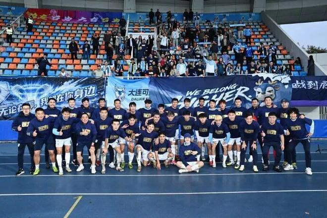

周二，中足联公布一系列“新政”，包括2028赛季中甲扩军到18队，中甲将试点特有球员政策。

首先，2028赛季中甲将从16队增加到18队，中超（16队）、中乙（24队）保持不变。在2027赛季，中甲将降级1.5队，中乙升级3.5队，两级联赛将进行一个附加赛。同时，B队允许继续冲甲，同一家俱乐部不得有两支队伍参加同一级别的联赛。

其次，在2027赛季，中甲将试点特有球员政策，将原有的港澳台地区球员政策调整为特有球员政策。特有球员可以为港澳台地区球员，也可以为最后一次转会至中国时不满22周岁，但不能为守门员位置的外籍球员。同时，中超外援政策保持不变。

第三，在2027赛季，主客场双循环对阵将由对称调整为不对称。即首循环第N场对阵对手与次循环第N场对手不同。第四，亚冠参赛球队可以在注册窗口更换亚冠专属外援，但总注册人数不超过2人。

特别声明：以上内容(如有图片或视频亦包括在内)为自媒体平台“网易号”用户上传并发布，本平台仅提供信息存储服务。

Notice: The content above (including the pictures and videos if any) is uploaded and posted by a user of NetEase Hao, which is a social media platform and only provides information storage services.

懂球帝 2026-11-10 17:45:31

乒烧泳球 2026-11-10 19:15:54

体育全天候 2026-11-10 16:27:32

弓立军 2026-11-09 01:08:49

咪咕体育 2026-11-09 17:49:46

新华社 2026-11-08 15:46:13

Leslie潘伟力 2026-11-08 21:11:01

聚焦事件 2026-11-08 04:39:39

猫熊说体育 2026-11-08 17:37:55

乒烧泳球 2026-11-10 18:37:14

我很乖 2026-11-10 03:23:17

篮球过人技巧 2026-11-08 18:20:45

阿嬍体育评论 2026-11-09 03:44:28

小通哥说事 2026-11-08 18:18:34

界面新闻 2026-11-10 15:05:55

中安在线 2026-11-10 17:05:00

原谅你 2026-11-10 05:06:28

小通哥说事 2026-11-08 17:18:52

时光瘦了j 2026-11-09 09:33:40

猫熊说体育 2026-11-08 17:51:10

蜡笔足球 2026-11-08 19:11:11

米奇兔 2026-11-09 09:59:10

小椰子专栏呀 2026-11-09 02:08:03

日在落日打怪 2026-11-10 02:21:19

Leslie潘伟力 2026-11-10 18:48:27

重庆视点 2026-11-09 14:06:40

体坛速报局 2026-11-08 19:37:45

咪咕体育 2026-11-09 17:50:01

现代快报 2026-11-08 07:02:52

凉了时光人 2026-11-10 07:12:33

图述数说 2026-11-08 19:43:43

徐骧老表哥 2026-11-09 23:58:38

精彩背后的故事 2026-11-10 03:42:51

慕名而来只为你 2026-11-10 03:08:42

足球名场面 2026-11-10 05:45:20

一溪风月w 2026-11-09 06:50:24

过期少女致幻录 2026-11-10 17:25:28

蜡笔足球 2026-11-08 16:35:51

酒话醉人 2026-11-09 11:20:16

魔法污 2026-11-09 17:03:39

## 配图

图：足球（网易体育 · 2026-11-10）

## 来源

- [网易体育 · 原文](https://www.163.com/dy/article/LBD2DCJ80552LYH5.html)
