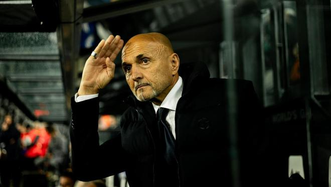

《米兰体育报》报道，尤文图斯对阵威尼斯的比赛对于斯帕莱蒂来说将是一场具有历史意义的比赛。这位托斯卡纳教练将迎来他在意甲联赛的第600场执教，他是历史上第六位达到这一里程碑的教练。

值得一提的是，他将面对他曾执教过的球队，那是在1999-2000赛季，当时他仍相对年轻，处于上升期。这位来自切塔尔多的教练于1997年8月31日在恩波利的主教练席上首次亮相意甲，当时他们在主场1-3输给了罗马。让我们看看还有哪些教练此前曾达到过这一里程碑。

最后是尼尔斯-利德霍尔姆。这位瑞典教练在1988-1989赛季执教罗马期间达到了意甲执教600场的里程碑。他最终以总共635场的执教纪录结束了他的执教生涯。

加斯佩里尼也在努力提高在意甲执教场次的绝对纪录。亚特兰大主教练将在下一轮达到649场，他在上赛季，即2020年8月23日罗马对阵博洛尼亚的比赛中达到了600场执教的里程碑。

乔瓦尼-特拉帕托尼的第600场执教是在他1995年执教卡利亚里之初达成的。这位教练来到撒丁岛时，已经在AC米兰、尤文图斯（两度执教）和国际米兰积累了599场执教经验。他在卡利亚里的经历仅仅21场比赛后就结束了，原因是他的辞职。他总共在意甲执教了689场。

内雷奥-罗科在1971-1972赛季执教AC米兰期间达到了600场执教里程碑。这位教练（最终以教练和技术总监的身份共执教747场）当时正处于职业生涯的巅峰，他的意甲生涯始于1947年执教的特里斯蒂纳。

卡洛-马佐内在1999年9月19日执教佩鲁贾时达到了600场执教里程碑，他最终以在意甲总共792场执教的纪录结束了职业生涯：在那场比赛中，他面对国际米兰，最终蓝黑军团在翁布里亚以2-1获胜。在那一刻，马佐内超越了内雷奥-罗科，成为了该类别的纪录保持者。

特别声明：以上内容(如有图片或视频亦包括在内)为自媒体平台“网易号”用户上传并发布，本平台仅提供信息存储服务。

Notice: The content above (including the pictures and videos if any) is uploaded and posted by a user of NetEase Hao, which is a social media platform and only provides information storage services.

懂球帝 2026-11-18 23:15:12

懂球帝 2026-11-18 22:43:53

懂球帝 2026-11-18 15:11:31

懂球帝 2026-11-18 20:47:09

张硜卤说体育 2026-11-15 14:26:21

懂球帝 2026-11-19 05:37:05

懂球帝 2026-11-18 22:11:11

脑洞编剧小剧场 2026-11-18 02:52:10

懂球帝 2026-11-19 02:26:08

懂球帝 2026-11-18 22:41:03

懂球帝 2026-11-19 05:47:06

懂球帝 2026-11-19 05:58:10

懂球帝 2026-11-19 04:21:08

刘家桥 2026-11-19 05:55:09

海浪星体育 2026-11-16 11:09:26

一个香蕉说球 2026-11-17 23:17:55

懂球帝 2026-11-19 03:50:09

千山暮雪h 2026-11-18 03:57:15

懂球帝 2026-11-18 22:43:51

奇聞空间 2026-11-18 12:32:02

精彩背后的故事 2026-11-17 03:00:33

老王日常犯傻 2026-11-18 02:50:55

张二要自律 2026-11-19 02:25:12

奥力给趣笑堂 2026-11-18 10:49:39

懂球帝 2026-11-18 21:39:17

懂球帝 2026-11-19 06:31:52

左脚爆射得分 2026-11-17 17:55:46

浣溪爱球 2026-11-17 12:02:31

足球故事GOAL 2026-11-17 20:06:59

精彩一网打尽 2026-11-18 08:55:33

精彩一网打尽 2026-11-16 15:29:28

心开动漫鑫鑫 2026-11-17 01:26:26

懂球帝 2026-11-18 16:26:07

浮云过影r 2026-11-19 04:31:52

胡莱克修斯 2026-11-19 00:40:33

懂球帝 2026-11-19 06:19:05

王飬吃吃喝喝 2026-11-17 02:54:31

人间闲散客 2026-11-17 02:35:43

生活浩浩乐 2026-11-19 01:23:41

米奇兔 2026-11-18 14:37:35

## 配图

图：足球（网易体育 · 2026-11-19）

## 来源

- [网易体育 · 原文](https://www.163.com/dy/article/LC3218CI0549BAP0.html)
