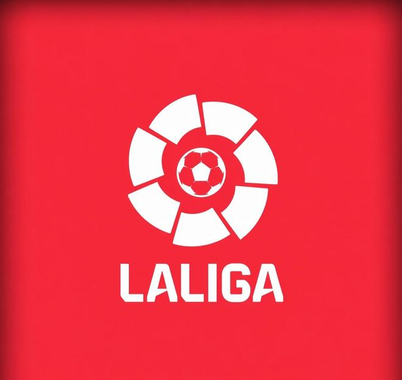

2026/27赛季欧战新一轮比赛结束，其中西甲8支球队的表现泾渭分明，只有巴萨皇马取得了胜利，其他球队则是1平5负。

西甲8队本轮欧战战绩（括号内为球队当前的欧战积分榜排名）

欧冠 巴塞罗那[5]3-0阿斯顿维拉

欧冠 雅典AEK2-3皇家马德里[2]

欧冠 马德里竞技[23]0-2拜仁慕尼黑

欧冠 多特蒙德2-1皇家贝蒂斯[11]

欧冠 比利亚雷亚尔[28]0-6巴黎圣日耳曼

欧联 皇家社会[20]1-1里昂

欧联 塞尔塔[27]1-2圣吉罗斯联合

欧协联 赫塔费[31]0-1布莱顿

赛程过半后，只有巴萨皇马位于直接晋级区，马竞、贝蒂斯、皇家社会位于附加赛区，比利亚雷亚尔、塞尔塔和赫塔费则分别在欧冠、欧联、欧协联位于被淘汰的区域。

特别声明：以上内容(如有图片或视频亦包括在内)为自媒体平台“网易号”用户上传并发布，本平台仅提供信息存储服务。

Notice: The content above (including the pictures and videos if any) is uploaded and posted by a user of NetEase Hao, which is a social media platform and only provides information storage services.

足球印象CC 2026-11-05 06:02:18

懂球帝 2026-11-06 06:28:29

泪之魂y 2026-11-05 01:54:42

懂球帝 2026-11-06 04:43:21

夜里的海d 2026-11-05 01:49:05

锦升体娱 2026-11-06 00:34:27

精彩背后 2026-11-05 12:01:55

一纸情书s 2026-11-04 06:29:32

福酱的小时光 2026-11-06 05:51:59

全力说体育 2026-11-05 11:11:13

一个香蕉说球 2026-11-03 16:12:27

为了更好 2026-11-06 04:30:30

路遇小美好 2026-11-04 07:51:38

球事百科吖 2026-11-06 06:35:26

狍子歪解体坛 2026-11-04 05:02:12

浣溪爱球 2026-11-05 10:38:40

用伤口豢养白鸽z 2026-11-05 05:28:09

沙溪解说 2026-11-05 03:16:02

懂球帝 2026-11-06 05:35:11

小兔子的快乐 2026-11-05 04:12:02

足球印象CC 2026-11-05 20:30:04

我们的足球记忆 2026-11-05 22:28:19

精彩背后的故事 2026-11-06 04:25:05

精彩背后 2026-11-05 08:36:16

烟寒若雨s 2026-11-05 09:46:28

阿超他的体育圈 2026-11-04 06:12:41

神秘研究院 2026-11-05 10:41:55

球事百科吖 2026-11-06 06:36:26

转会窗ProMax 2026-11-05 10:35:50

懂球帝 2026-11-06 03:51:14

罗氏看球 2026-11-04 09:27:29

猫熊说体育 2026-11-05 08:44:20

懂球帝 2026-11-06 06:39:31

勿忘初心l 2026-11-05 02:59:39

北极生活说 2026-11-05 16:59:39

七堇年a 2026-11-06 02:25:17

吕甒极限手工 2026-11-06 03:57:59

懂球帝 2026-11-05 20:09:45

无人倾听无人倾听 2026-11-06 05:46:08

足球印象CC 2026-11-04 07:12:51

## 配图

图：足球（网易体育 · 2026-11-06）

## 来源

- [网易体育 · 原文](https://www.163.com/dy/article/LB1ISROC0549BAP0.html)
