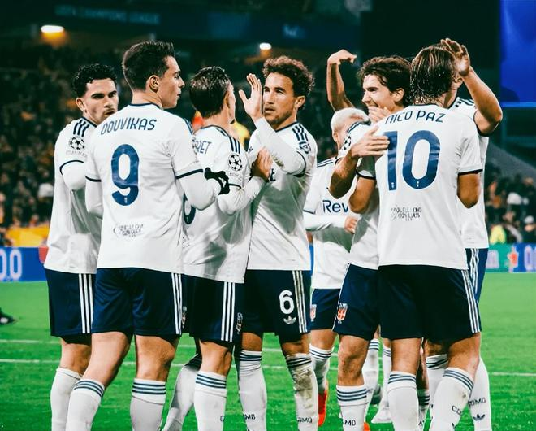

11月5日凌晨，欧冠联赛阶段第4轮的一场焦点大战中，意甲球队科莫在客场9-1大胜法甲球队朗斯。在法布雷加斯的带领下，科莫正在上演黑马神话。更大的奇迹正在等着他们。

科莫2年前还在征战意乙。2024年夏天，他们升入意甲。也就是在那个时候，小法成为了该队的主帅。过去2个赛季，科莫在意甲的表现一直很稳定。同时，科莫老板很舍得花钱，今夏他们花费6600万欧从皇马永久签下了帕斯。

目前，科莫全队身价已接近6亿欧，这为他们本赛季的崛起打下了基础。今日对阵朗斯，科莫火力全开，疯狂打进9球，创造历史，成为了欧冠史上第一支在客场打进9球的球队，也让朗斯承受了巨大的羞辱。

上一轮欧冠联赛，科莫刚刚4-1打爆了曼联。各项赛事最近6场比赛，科莫保持全胜，且打进了22球，只丢4球，攻防两端的发挥都超级完美。11月9日，科莫将客场挑战国米，齐沃此刻估计压力很大。

科莫阵中名气最大的球星是年仅22岁的帕斯，他在4轮欧冠中打进3球助攻5球，独造8球。帕斯目前身价8000万欧，预计很快就会突破1亿欧。据悉，皇马拥有8000万欧的回购权。明年夏天，皇马大概率会对其“下手”。

在意甲和欧冠的积分榜上，科莫暂时都排名第4。谁能想到，他们2年前还在意乙征战、7年前还在第四级别联赛混迹。

特别声明：以上内容(如有图片或视频亦包括在内)为自媒体平台“网易号”用户上传并发布，本平台仅提供信息存储服务。

Notice: The content above (including the pictures and videos if any) is uploaded and posted by a user of NetEase Hao, which is a social media platform and only provides information storage services.

钉钉陌上花开 2026-11-05 06:21:53

足球狗说 2026-11-05 05:55:36

侧身凌空斩 2026-11-05 06:00:19

追梦聊球 2026-11-05 00:12:21

风过乡 2026-11-05 05:57:41

懂球帝 2026-11-05 02:43:24

语妍视频剪辑 2026-11-02 10:19:10

篮坛第一线 2026-11-05 06:20:19

懂球帝 2026-11-05 05:33:06

农村丑爸记录生活 2026-11-03 01:47:00

泪之魂y 2026-11-05 01:54:42

懂球帝 2026-11-05 04:00:00

涩会小阿敏 2026-11-05 04:49:28

用伤口豢养白鸽z 2026-11-05 05:28:09

足球印象CC 2026-11-05 06:02:18

罗氏看球 2026-11-02 13:32:01

勿忘初心l 2026-11-05 02:59:39

暗香暗香 2026-11-05 06:03:13

一纸情书s 2026-11-04 06:29:32

精彩背后的故事 2026-11-04 04:35:06

侧身凌空斩 2026-11-05 05:58:36

足球印象CC 2026-11-02 20:30:06

足球印象CC 2026-10-31 20:31:22

沙溪解说 2026-11-05 03:17:20

全球风情大揭秘 2026-11-05 04:50:58

懂球帝 2026-11-04 17:23:50

沙溪解说 2026-11-05 03:16:02

家禽搞笑事务所 2026-11-05 02:21:56

一路荒凉如歌a 2026-11-03 02:18:56

绿荫杂谈视频播客 2026-11-03 16:38:17

全力说体育 2026-11-02 09:16:27

马三看世界 2026-11-04 19:06:17

罗吹终结者 2026-11-04 16:13:57

夜里的海d 2026-11-05 01:49:05

足球人物往事 2026-11-01 22:32:59

翻车选手小李 2026-11-05 01:03:57

一路荒凉如歌a 2026-11-05 02:31:20

显微镜下的人性 2026-11-05 05:24:20

AI小屋的日常随笔 2026-11-02 22:27:13

精彩背后 2026-11-02 08:34:54

## 配图

图：足球（网易体育 · 2026-11-05）

## 来源

- [网易体育 · 原文](https://www.163.com/dy/article/LAV0PUG505566VBM.html)
