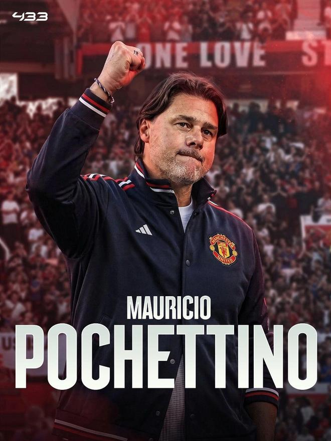

曼联已经与毛里西奥·波切蒂诺达成个人协议，后者将成为球队下一任主教练。现在，俱乐部正在与美国足协讨论波切蒂诺及其教练组的解约事宜，双方还需要就阿根廷人是否继续带队打完美国国家队这个国际比赛日的两场比赛进行协商。

卡里克在周三继续带领曼联球员训练，周四可能还要这么做，之后球队将开始放假，暂时不需要教练。预计卡里克两天内将接到自己下课的正式通知，俱乐部首席执行官奥马尔·贝拉达和足球总监贾森·威尔考克斯将从摩纳哥归来，他们在那里与老板吉姆·拉特克里夫爵士进行了例行的高层会晤。

英媒披露，大股东格雷泽家族已经同意聘请波切蒂诺执教，作为美国人，他们熟悉波帅。俱乐部联合主席之一的阿夫拉姆·格雷泽周三晚通过视频通话批准换帅，现在，曼联将与美国队解决波切蒂诺的离职手续，随后将官宣卡里克被解雇、波切蒂诺上任。

解雇卡里克及其团队的成本约为500万英镑，其中卡里克本人将获得大约340万英镑。而挖角波切蒂诺大约需要740万英镑（1000万美元），那是他与美国队续约协议里的违约金；加上其教练团队的离职补偿，曼联总计需要花费900万英镑。

这样一来，弗爵退休之后曼联更换教练的总成本，将超过1亿英镑。弗爵本人非常支持波切蒂诺执教，后者10年来4次被接洽，双方过去进行过6次接洽，现在第7次终于实现合作。

54岁的波切蒂诺将执教曼联视为一个不可拒绝的重要机会，只要得到正式邀请，他必定接受。为表诚意，波切蒂诺愿意保持现有的收入水平到曼联执教，这意味着他与卡里克一样，年薪将是500万英镑，与在美国执教时的600万美元年收入持平。过去执教托特纳姆热刺时，波切蒂诺的年薪最高时达850万英镑。

同时，波切蒂诺告诉曼联，为了表达尊重美国足协，他需要俱乐部主动联系美国队。消息人士表示，美国足协早已对主帅离职做好了心理准备和应对计划，例如，他们有意邀请本赛季离开曼城的瓜迪奥拉执教！

美国队周日和下周二将分别与海地进行中北美及加勒比海国家联赛四分之一决赛两回合赛事，波切蒂诺可能不带队。但如果有需要，他被认为也可能继续打完这两战。因为曼联的国脚球员下周四才归队集结，正好在美国队两场比赛之后。有曼联球迷对这样的安排表示不满，因为球队下一场英超是做客安菲尔德对利物浦，只有两三天时间准备，他们认为波切蒂诺的首战可能凶多吉少。

美国足协以时间冲突为由，取消了原本安排在周四的球员媒体交流活动，有报道称，这么做是为了避免国脚被问及关于主帅的问题。消息人士告诉ＢＢＣ英国广播公司，波切蒂诺执教曼联的条件已基本谈妥。意大利转会专家法布里济奥·罗马诺的说法则是：即将here we go！

罗马诺说：「曼联已与波切蒂诺就其担任新主帅一事，达成了原则性协议。目前俱乐部仍在与美国足协方面谈判，因为需要支付1000万美元的解约费，才能签下波切蒂诺。谈妥后，接下来就是办理正式手续。一切就绪后，就是here we go。」

特别声明：以上内容(如有图片或视频亦包括在内)为自媒体平台“网易号”用户上传并发布，本平台仅提供信息存储服务。

Notice: The content above (including the pictures and videos if any) is uploaded and posted by a user of NetEase Hao, which is a social media platform and only provides information storage services.

念洲 2026-11-12 18:46:45

体育吐槽 2026-11-11 17:33:01

彼岸雨露j 2026-11-12 02:22:22

一个香蕉说球 2026-11-10 19:42:53

体坛周报 2026-11-12 14:36:19

懂球帝 2026-11-12 18:41:07

体坛周报 2026-11-12 18:51:11

陈赩爱体育 2026-11-11 18:41:05

卡灵顿分析师 2026-11-12 19:30:43

一个香蕉说球 2026-11-10 20:24:22

界面新闻 2026-11-12 18:47:44

罗克 2026-11-12 11:47:18

足球人物志 2026-11-12 09:46:48

之乎者也小鱼儿 2026-11-12 19:32:35

懂球帝 2026-11-12 18:31:15

左脚爆射得分 2026-11-12 11:26:04

咪咕体育 2026-11-12 03:11:05

一个香蕉说球 2026-11-10 20:23:41

一个香蕉说球 2026-11-10 20:24:21

原谅你 2026-11-10 05:02:38

深情鱼摆摆 2026-11-10 14:18:45

足球印象CC 2026-11-12 08:47:01

疯狂阿滨 2026-11-11 23:26:56

左脚爆射得分 2026-11-12 11:38:02

摸鱼佬临风 2026-11-12 03:32:51

足球印象CC 2026-11-10 19:11:23

咪咕体育 2026-11-12 03:08:05

左脚爆射得分 2026-11-10 11:25:06

足球印象CC 2026-11-09 17:02:21

足球印象CC 2026-11-12 16:01:08

你是佛的弟子 2026-11-10 03:29:35

流萤Zz 2026-11-12 04:13:02

夏的世界 2026-11-11 12:35:52

老王日常犯傻 2026-11-12 00:42:56

青树柠檬q 2026-11-11 09:18:30

罗吹终结者 2026-11-11 18:38:28

小王趣味社 2026-11-10 00:21:05

小山的篮球 2026-11-12 12:32:52

火星猪同学 2026-11-10 05:48:59

罗吹终结者 2026-11-12 16:23:18

## 配图

图：足球（网易体育 · 2026-11-12）

## 来源

- [网易体育 · 原文](https://www.163.com/dy/article/LBH0JLV30529999M.html)
