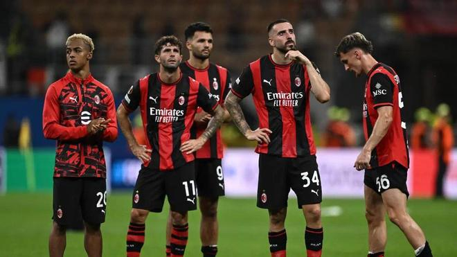

前意甲球员法比奥-巴扎尼在接受米兰新闻网采访时，谈到了AC米兰在欧联杯赛场上的表现。

谈到AC米兰在欧洲赛场上的挣扎，巴扎尼表示：“在我看来，AC米兰没能保持足够的紧迫感。无论派出什么阵容，像对阵费伦茨瓦罗斯时那样的开局都是不可接受的。这不仅仅是场上11名球员的问题，而是整支球队都表现得过于被动。球队刚刚在德比战中取胜，三天后却出现这样的表现，这并不好。此外，AC米兰一旦进行轮换，确实更难维持高强度的竞争。我认为球队在欧联杯上的问题出在心理层面。转会市场方面，球队需要一名前锋和一名中后卫。具体还要视情况而定，也许现在再引进一名边锋也会有帮助。萨勒马克尔斯和丘库埃泽都需要很长时间才能复出，引进边锋至少可以避免让穆萨继续踢一个并不适合他的位置。”

特别声明：以上内容(如有图片或视频亦包括在内)为自媒体平台“网易号”用户上传并发布，本平台仅提供信息存储服务。

Notice: The content above (including the pictures and videos if any) is uploaded and posted by a user of NetEase Hao, which is a social media platform and only provides information storage services.

晚风知我意21 2026-11-15 04:55:09

懂球帝 2026-11-14 20:39:23

懂球帝 2026-11-15 04:19:07

足球印象CC 2026-11-12 08:47:01

懂球帝 2026-11-14 15:51:18

懂球帝 2026-11-14 22:07:20

足球印象CC 2026-11-13 08:04:55

懂球帝 2026-11-15 03:05:05

咪咕体育 2026-11-14 12:21:09

索朗的故事 2026-11-15 02:36:09

懂球帝 2026-11-14 18:52:25

星河漫山野 2026-11-15 05:17:31

篮坛第一线 2026-11-15 03:35:59

神秘研究院 2026-11-14 11:29:49

超喜欢我 2026-11-15 00:58:57

凉城若梦h 2026-11-14 00:13:17

左脚爆射得分 2026-11-14 11:27:51

生活超有趣 2026-11-14 14:34:24

懂球帝 2026-11-15 05:11:35

懂球帝 2026-11-15 00:56:05

米奇兔 2026-11-13 13:58:52

懂球帝 2026-11-14 22:59:08

薛艳艳爱生活 2026-11-14 11:20:35

体坛观察猿 2026-11-15 05:02:35

看你像个宝 2026-11-13 17:37:56

艾辰体娱 2026-11-14 14:18:37

猫熊说体育 2026-11-14 19:01:28

懂球帝 2026-11-15 04:51:07

冷饭说球 2026-11-14 11:24:58

一个香蕉说球 2026-11-13 04:55:42

米奇兔 2026-11-14 13:02:11

薛艳艳爱生活 2026-11-14 11:40:38

狍子歪解体坛 2026-11-13 06:27:05

懂球帝 2026-11-14 22:17:08

懂球帝 2026-11-15 06:15:12

狍子歪解体坛 2026-11-15 04:05:06

猫熊说体育 2026-11-14 20:21:52

狍子歪解体坛 2026-11-14 11:38:37

一个香蕉说球 2026-11-13 04:55:30

狍子歪解体坛 2026-11-13 06:25:09

## 配图

图：足球（网易体育 · 2026-11-15）

## 来源

- [网易体育 · 原文](https://www.163.com/dy/article/LBOOR4EP0549BAP0.html)
