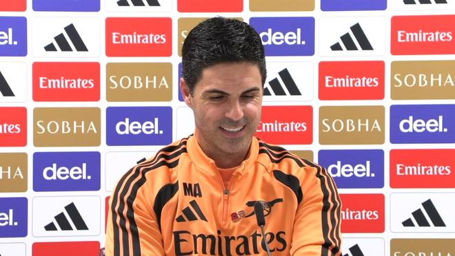

北京时间11月2日00:30，阿森纳将在英超第9轮客场挑战利物浦。在媒体禁言期满之后，阿森纳主教练阿尔特塔的赛前新闻发布会最后一部分保密内容被公开。

嗨，米克尔，我们再回到安菲尔德球场的话题，几年前你曾经在训练场边放置音响播放球场噪音对吧？那已经是很多年前的事了，对吗？

是的，那是很多年前的事了，确实是这样。

但是展望即将到来的这场比赛，核心关键是不是要尽量剥离和压制那种情绪呢？你过去在场边也曾经和尤尔根-克洛普发生过争执，此前格拉尼特-扎卡也曾和特伦特-亚历山大-阿诺德发生过口角，瞬间点燃了安菲尔德全场主场球迷的狂热气氛，所以现在是不是需要尽量收敛这种情绪，尝试让场面保持得尽可能平静呢？

是的，我们确实认为那种过度的情绪对球队产生了不利和负面的影响，是的。只要是对球队有利的事，我们都会竭尽全力去落实。

我刚才也在回顾上个赛季的比赛，在安菲尔德的Kop看台上曾经有一条横幅，上面写着“总是做伴娘，永远做不成新娘”，但是这一次你们已经是冠军了，你是否觉得这赛季球队得到了对手应有的尊重呢？在赢得冠军之后，外界看你们的眼光是不是有所不同了？

我一直觉得，无论是在球场上的言行举止还是赛前的沟通态度，对手对待我们始终保持着充分的尊重。我们对待任何一个对手也是完全相同的，无论他们是不是冠军，这都是足球的一部分，也是我们恪守的职责。

米克尔，我可以问问关于德克兰-赖斯的情况吗？我只是……显而易见的是，周日的比赛是一场极其关键的重头戏，像这样的大战，他在阵中扮演着多么重要的角色呢？另外，你如何评价他自从世界杯结束之后在本赛季的整体状态？

好吧，我认为他的表现一直非常稳定而且持续。我必须再次强调，我们每年向他提出的要求和标准是非常苛刻的，要始终维持在这样的高水平极其困难。但他确实做到了，这完全归功于他自身的努力。大牌球星就是为大战而生的，我们非常清楚，要想从那个客场带走三分，我们需要德克兰以及其他所有小伙子们拿出什么样的卓越表现。

目前球队几乎所有的核心球员都完成了长期续约，他是下一个有待续约的对象，你是否有信心能在最近顺利敲定他的新合同？

是的，我的直觉和感受是他在阿森纳过得非常开心。每次我和他交流沟通的时候，他都明确表示希望能够在这里长期效力。因此，完成续约只是一个时间问题。

嗨，米克尔，上周在对阵埃弗顿的比赛结束之后，我们曾经讨论过你拿到的黄牌以及在场边技术区的表现，我认为，无论这种看法是否客观合理，外界以及敌对球迷往往会将这种场边激情和你的形象联系在一起，我不知道你对此有什么感想，但是在我看来，这似乎始终是一个被反复讨论的热门话题，你觉得这公平吗？你又是如何看待这种外界视角的呢？

我不知道这算不算公平或者不公平，每个人都有自己的观点和看法。但事实是，在整个上赛季，我没有因为累积黄牌而被停赛过任何一场比赛，我会继续尽我最大的努力去控制好自己。我认为现在的裁判监管规则正在变得越来越严格和苛刻，我在场边的那些反应绝不是有意识去做的。如果是刻意为之的话，我肯定不会那么做。我只是在竭尽全力……去帮助我的球队，尽可能地为场上的队员们提供支持，去赢得比赛，这就是我唯一的目的。至于外界的看法，很大程度上可能取决于你内心深处到底热爱和支持哪支球队的队徽。

在我看来，相比于你刚接手球队的时候，这些年来你其实已经变得平静和克制得多了，当然，极少数特定比赛的特殊时刻除外，相比刚执教的时候，你自己是否也有同感呢？

我也不太确定，可能我得好好回顾一下过去。我唯一的诉求就是展现出球员们在通往胜利道路上最需要的那个版本的自己，无论球队需要什么，我都会在那个特定的当下做出我认为正确的举措，去尽可能提升赢得这场比赛的概率，这就是我的核心目标。

特别声明：以上内容(如有图片或视频亦包括在内)为自媒体平台“网易号”用户上传并发布，本平台仅提供信息存储服务。

Notice: The content above (including the pictures and videos if any) is uploaded and posted by a user of NetEase Hao, which is a social media platform and only provides information storage services.

懂球帝 2026-11-01 01:40:45

澜归序 2026-10-31 10:30:05

星河漫山野 2026-11-01 06:25:32

喊山的姑娘 2026-11-01 04:59:47

林间小温柔 2026-11-01 00:21:36

懂球帝 2026-10-31 18:40:47

元气满分吖 2026-11-01 03:26:52

懂球帝 2026-10-31 16:55:22

输在感情刀 2026-10-31 03:09:18

懂球帝 2026-10-29 01:56:01

细心分析 2026-11-01 04:42:51

赛场速报局 2026-11-01 00:27:16

雷叔聊球 2026-11-01 03:17:00

CR7足球频道 2026-10-31 17:32:30

足球印象CC 2026-10-31 18:01:12

绿荫杂谈视频播客 2026-10-30 10:29:25

咪咕体育 2026-10-31 04:30:29

罗吹终结者 2026-10-30 16:55:05

露露聊球 2026-10-30 02:26:02

足球印象CC 2026-10-31 16:02:16

旧纸讲非遗 2026-11-01 01:20:04

艾辰体娱 2026-10-28 11:11:05

足球印象CC 2026-10-31 20:31:22

脑洞编剧小剧场 2026-11-01 02:54:13

足球印象CC 2026-10-29 17:59:37

足球印象CC 2026-10-30 16:02:02

足球印象CC 2026-10-31 10:59:39

姜武 2026-10-31 15:18:55

显微镜下的人性 2026-10-31 04:23:04

足球周刊 2026-10-31 11:20:05

精彩背后的故事 2026-10-31 03:34:47

八度科普 2026-10-30 11:21:40

体育吐槽 2026-10-30 10:06:37

懂球帝 2026-10-31 08:07:12

元气满分吖 2026-11-01 06:10:57

篮球过人技巧 2026-10-30 16:38:17

蜡笔足球 2026-10-29 07:29:39

学术漫游者 2026-10-30 00:35:52

墨史轩 2026-10-31 01:47:07

懂球帝 2026-10-31 02:48:05

## 配图

图：足球（网易体育 · 2026-11-01）

## 来源

- [网易体育 · 原文](https://www.163.com/dy/article/LAKMSM9G0549BAP0.html)
