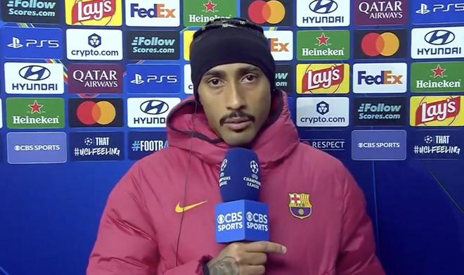

欧冠联赛阶段第4轮，巴塞罗那主场3-0战胜阿斯顿维拉，梅开二度的拉菲尼亚当选全场最佳。赛后，拉菲尼亚接受CBS体育采访，原本节目主持人准备向他表示祝贺，并谈论他在巴萨年轻阵容中的领袖作用。然而，拉菲尼亚随后表示，自己当天并不想谈论足球。他谈到了特内里费球员赫苏斯-德米格尔不幸离世的消息，并向其家人表达慰问。

主持人：拉菲尼亚，首先祝贺你们今晚在主场球迷面前赢下比赛。我们很想问问你，你显然是这支球队中经验更丰富的核心之一。你自己打进了两球，对于这支充满年轻天才的球队而言，你是一位领袖人物。带领这支年轻的队伍，你享受其中吗？

拉菲尼亚：我用西班牙语回答吧，因为我的英语不……不是特别好，我更想用西班牙语说。对你们来说可以吗？

主持人：当然可以，你边说我边试着翻译。

拉菲尼亚：不，没什么。我今天说实话是一个非常悲伤的日子。就我个人而言，我不想谈论足球。我向你们表示歉意，因为虽然我接受了连线，而且说实话我也很喜欢来到这里，但我我想向赫苏斯(德米格尔)的家人送上很多力量与支持。他们今天醒来就得知了他不幸离世的噩耗。我想对赫苏斯说，无论他在哪里，愿他都能找到自己的归途。

总之，我认为对于他的家人来说，现在是一个极其艰难的时刻。我只想向他们送去力量，把足球稍微放在一边。今天我真的不想聊任何关于足球的事情。

主持人：我们完全理解，我们非常感谢，我们也向你道歉。对不起，你显然在个人层面上受到了极大的触动。亨利：不，我想对拉菲尼亚说几句，请允许我说两句。你知道吗？你最后说的这些，是比一项体育运动更重要的事情。这项大家都深爱的运动，足球，但你展现出了一个真正的大写的人。这才是最重要的。主持人：在这样一个时刻，你依然愿意来到节目连线，我们真的感激不尽。我可以问你一下，在今天这样的日子、在这样的情况下，去踢一场足球比赛有多艰难吗？

拉菲尼亚：对我来说，对我而言说实话真的非常艰难。今天早上我醒来看到新闻后就跟我妻子聊过，显然我感觉很不好，心里感到有些难受。归根结底，这是一位同行，而这种事……这种事可能发生在任何人身上，不是吗？可能会发生在我身上，发生在今天在场上踢球的任何一名球员身上。

而且无论如何，这是一位和我同龄的球员，所以我不知道是不是因为这个原因，它对我的触动更大了。今天这一整天我都没能缓过来，也许是因为那个新闻，但这对我个人来说真的触动很大。

主持人：在今天这样的日子里，你依然愿意接受我们的连线采访，我们真的感激不尽。非常感谢你，你真的太体贴了。大家能一起向他表示感谢吗？亨利：这是我最喜欢的回答、最喜欢的采访。这是我今年迄今为止最喜欢的一段采访。多棒的一个人啊。谢谢你，谢谢你，拉菲尼亚。谢谢。

特别声明：以上内容(如有图片或视频亦包括在内)为自媒体平台“网易号”用户上传并发布，本平台仅提供信息存储服务。

Notice: The content above (including the pictures and videos if any) is uploaded and posted by a user of NetEase Hao, which is a social media platform and only provides information storage services.

足球狗说 2026-11-04 06:01:08

钉钉陌上花开 2026-11-04 06:06:25

我的护球最独特 2026-11-04 06:06:14

懂球帝 2026-11-04 06:07:01

侧身凌空斩 2026-11-04 05:55:12

智慧教育空间站 2026-11-02 08:25:57

精彩背后 2026-11-03 17:05:32

第X个想法 2026-11-03 11:20:46

艾辰体娱 2026-11-03 10:48:39

足球印象CC 2026-10-31 20:31:22

足球印象CC 2026-11-03 17:33:49

足球印象CC 2026-11-02 19:29:52

足球印象CC 2026-11-03 17:00:38

足球印象CC 2026-11-03 15:59:33

足球印象CC 2026-11-03 20:29:48

足球印象CC 2026-11-02 20:30:06

华人生活网 2026-11-04 06:26:13

足球印象CC 2026-11-03 11:25:45

足球印象CC 2026-11-03 18:00:23

米奇兔 2026-11-01 21:54:58

足球印象CC 2026-11-02 19:59:30

一个香蕉说球 2026-11-03 16:12:27

足球印象CC 2026-11-02 19:00:09

生活超有趣 2026-11-02 15:36:37

左脚爆射得分 2026-11-03 11:02:04

足球狗说 2026-11-04 06:26:38

足球印象CC 2026-11-03 19:59:36

足球印象CC 2026-11-03 15:00:01

足球印象CC 2026-11-02 18:21:42

绿荫杂谈视频播客 2026-11-03 16:38:17

一个香蕉说球 2026-11-03 16:12:38

足球印象CC 2026-11-03 18:29:47

懂球帝 2026-11-04 05:45:48

体坛观察猿 2026-11-04 06:03:14

Bobo字幕组 2026-11-03 22:44:22

懂球帝 2026-11-04 04:52:48

薛艳艳爱生活 2026-11-02 16:44:53

足球故事GOAL 2026-11-03 12:59:13

陈赩爱体育 2026-11-01 07:19:38

爱足球的谢宇宁 2026-11-01 07:03:51

## 配图

图：足球（网易体育 · 2026-11-04）

## 来源

- [网易体育 · 原文](https://www.163.com/dy/article/LASDRR2Q0549BAP0.html)
