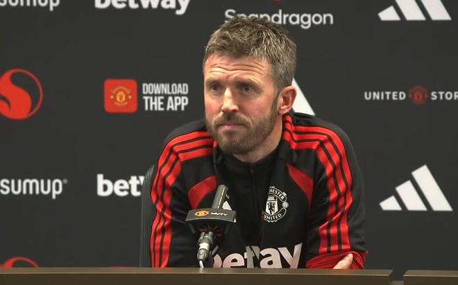

英超第10轮，曼联将主场对阵维拉。曼联主帅卡里克赛前新闻发布会暂时保密部分的内容在禁言期结束后现已公开。卡里克谈到了马特乌斯-库尼亚的场上位置、自己的执教前景、球队下周的训练安排、球员的心理状态以及球队本赛季表现缺乏稳定性的问题。

记者：嗨，迈克尔。我想问一下关于马特乌斯(库尼亚)的情况。显然他在周二晚上的比赛中起到了相当大的作用。你之前提到调整了他的场上位置。你认为他在目前这支球队中最适合的位置是哪里？因为很显然，他是在鲁本(阿莫林)执教时期被签下的，原本是要胜任双前腰之一的角色，而现在球队基本不再采用那套打法了。你认为他的最佳位置究竟在哪？另外他能否延续那样的表现？毕竟他在下半场踢出了极高的比赛强度和侵略性。

卡里克：是的，他当然必须把那样的表现延续下去。你知道，他那场踢得非常出色，非常接近他的最佳水准，而那正是我们希望看到的水平——不仅是他个人，也不仅仅是他，而是全队都需要达到这个水平。不过我认为，马特乌斯的优势就在于他能够胜任锋线上的多个不同位置。他为我们踢过左边路，上赛季他在那个位置表现得非常出色；他打过左路，也偶尔踢过中路；有时候他在左路和中路之间游弋。我认为这种自由度和灵活性非常适合他，但他在这几个位置上都能胜任，毫无疑问他都能踢。

记者：嗨，迈克尔。大家都理解，鉴于你目前的职位状态以及球队的现状，这依然是一个比较微妙的局面。俱乐部有没有明确告知你，下周你是否会继续带队？

卡里克：没有，没有。我完全是按照一切正常的状态在继续工作。

记者：那么下周的计划呢？我理解这对所有人都是一样的，那些没有入选国家队比赛的球员，那一周也会放假休息吗？

卡里克：我们目前还没有完全定下来，我们手头实际上……我的意思是，我现在还无法确定确切人数，因为有些入选情况还没有最终确认，留在队里的成年队一线队球员可能也就三四个左右。但不管怎样，我们下周肯定会安排训练，也许周末会放假。我们会看看具体情况如何发展，看哪些人留下来、哪些人和我们在一起，以及他们需要怎样的安排。不过下周肯定会进行训练。

记者：嗨，迈克尔。你在周二赛后几次提到，那场比赛的表现和结果对于带给球员们某种心气和感觉非常重要。我想你在俱乐部待了这么久，对球队经历的起起落落可能早就司空见惯了。但对于那些加盟时间没有那么长的球员，你是否觉得过去几周的压力让他们有些不堪重负？

卡里克：大家也都是普通人，球员也是有血有肉的人。尽管我们……好吧，我现在已经不再是职业运动员了，但作为一名追求顶尖表现的精英运动员，我们总是渴望无限接近完美。你永远无法做到绝对完美，但你总是希望将自己推向极限、在刀尖上踢球。伴随而来的，很大一部分在于你的心态、思维方式、自信心，以及内心的那种感觉。因此，学会应对这种压力是其中极为重要的一部分。

这样说可能有些老生常谈，但这确实是我们必须全盘考虑的事情。从我的角度来看，深入与球员沟通、了解他们的心理状态至关重要。这就是为什么我说，在体育运动中，拥有那种感觉和势头是非常关键的。比赛内的势头，以及日复一日、周复一周、一场又一场累积起来的势头，其影响力是巨大的。有时候你很难具体量化它到底从何而来，但我认为顺应自己的感觉和情绪，顺势而为，这非常重要。

接着你的肌肉记忆和心理记忆就会被唤醒，你会意识到，没错，就是这种感觉，比赛就应该这么踢。这时候你眼前看到的局面就会完全不同。这在某种程度上正好解释了球员或球队的状态起伏，为什么有时会有一段高光期，紧接着又会在另一段时间陷入挣扎。

这一切因素都需要融会贯通，但感觉、自信、情绪，甚至有时候是那种不需要思考的状态——你知道，当你处于最佳状态时，往往根本不需要去多想，你只需要信任彼此、全凭本能去踢球。我觉得我们在周二晚上的比赛中很大程度上做到了这一点。

记者：这是不是意味着，在经历了一段较长时间的不胜之后，首场胜利往往是最难拿下的？因为你的脑海里可能会积压很多消极的想法，而跨过第一场胜利这个坎之后，整个人是不是就稍稍卸下了重担？

卡里克：确实可能如此。我的意思是，这并不代表接下来的下一场比赛就会变得轻松，但我完全明白你的意思。情况确实可能这样，因为你会逐渐形成一种惯性，你会习惯看到某些局面，习惯去感受某些压力。反过来也是一样的道理，当你处于一波连胜当中时，只要你始终保持对胜利的饥渴感，你也会习惯那种赢球的感觉。所以是的，这种心理机制确实存在，但这绝不意味着我们在赢了一场比赛之后，就会理所当然地认为下一场会容易得多。足球从来都不是这么运转的。

记者：嗨，迈克尔。顺着前面这两个问题，我想说的是，在这一阶段你表现得非常沉稳坚定，但这难免会对你个人以及你的家庭带来一些负担。在接下来的两周国际比赛日期间，你会不会抽出一些时间来给自己放个假，多陪陪家人？

卡里克：嗯，其实和往常没有什么不同。通常来说并不会。我认为国际比赛日对于那些没有国家队任务的球员以及教练组工作人员来说，一直是一个重新充能、调整状态的节点。那些前往国家队报到的球员，他们换了一个全新的环境，也能借此转换心情。所以，确实存在调整的成分在里面。但我个人并不怎么需要这个，我现在的状态很好，完全没问题。

记者：在伯恩茅斯那场比赛之后发生了一切波折，随后你经历了一场失利，紧接着又赢了一场。在周日对阵阿斯顿维拉之后，进入接下来的这段时间，你心里是否会有任何程度的不确定感？

卡里克：不会，完全没有。无论发生什么，该来的总会来，在比赛层面上也是如此。我们所能做的就是做好充分的准备，去期待它。正如我在周二晚上所说的，当时我就非常期待那场比赛的到来，事实也确实如此。我再次重申，我绝不是在说客套话，我们真的很期待下一场比赛。在周二取胜的背景下回到主场作战，希望球迷们能来到现场，带着充沛的激情，对即将看到的比赛感到兴奋。我们必须在场上把这些展现出来。

记者：嗨，迈克尔。在战胜罗马之后，布鲁诺-费尔南德斯在你将他移出首发阵容后首次公开发言，他表示你的决定是完全正确的。关于此前科莫那场比赛引发的风波，他私底下有没有向你以及全队球员道过歉？

卡里克：关于什么风波？抱歉？

记者：就是他在科莫赛后针对你发表的那些言论，关于高位逼抢的批评。在私底下，他有没有向你和其他球员表示过歉意？

卡里克：我们内部一直在进行沟通和交流。正如我当时所说的，我认为我们需要正视某些问题，在球队运转顺畅时是这样，探讨我们在哪些方面作为一个整体需要提升时也是如此。有时候是单独谈话，有时候是全队一起讨论。我们总会开诚布公地去聊。至于这些讨论的具体内容到底是什么，你肯定也会理解，我希望保留在我们内部。但是我认为现在的情况已经很明朗了，我们正朝着正确的方向前进。对于布鲁诺对这支球队和这家俱乐部的付出，我从来没有过丝毫怀疑，我认为他本周的行动再次证明了这一点。

记者：我能再追问一个问题吗？本赛季至今球队还没有取得过两连胜。我知道背后可能有诸多原因，但如果让你只列举其中的一个核心原因，你认为是什么？毕竟相比上赛季的成绩，现在的下滑幅度确实相当大。

卡里克：是的，关键就在于缺乏稳定性，具体到单场比赛内部也是如此，缺乏稳定性。你要问是什么造成的？这可能包含很多方面，从来都不只是单一因素导致的。这涉及到临场决策、专注度的问题，有时候是某些阶段局势对我们不利，有时候则是我们自己没有做好、没能帮到自己。所以找借口没有任何意义，现实就是如此。好的一面在于，我们完全有能力通过努力去改变它。

特别声明：以上内容(如有图片或视频亦包括在内)为自媒体平台“网易号”用户上传并发布，本平台仅提供信息存储服务。

Notice: The content above (including the pictures and videos if any) is uploaded and posted by a user of NetEase Hao, which is a social media platform and only provides information storage services.

大眼睛看看 2026-11-07 03:26:21

懂球帝 2026-11-07 17:48:05

懂球帝 2026-11-08 05:20:26

青川入画 2026-11-08 01:51:40

球事百科吖 2026-11-08 06:20:55

毛豆何时归 2026-11-08 02:14:05

足球印象CC 2026-11-06 21:01:18

转会窗ProMax 2026-11-06 13:30:57

足球印象CC 2026-11-06 16:03:39

球事百科吖 2026-11-08 06:24:56

温柔且自由 2026-11-08 04:59:25

领略非凡 2026-11-07 20:17:51

火星猪同学 2026-11-05 11:21:40

咪咕体育 2026-11-07 08:31:17

转会窗ProMax 2026-11-05 10:35:50

足球印象CC 2026-11-06 06:11:09

赛场速报局 2026-11-08 05:06:34

一个香蕉说球 2026-11-06 01:33:27

足球印象CC 2026-11-07 15:59:15

墨史轩 2026-11-08 01:03:10

心开动漫 2026-11-07 04:28:29

阿甘Jackie 2026-11-07 05:29:12

一路荒凉如歌a 2026-11-08 02:23:38

足球故事GOAL 2026-11-05 22:21:13

青川入画 2026-11-08 01:54:42

百花缭乱a 2026-11-06 11:32:17

蜡笔足球 2026-11-06 11:33:19

你是佛的弟子 2026-11-08 03:35:38

雷叔聊球 2026-11-08 03:29:00

人间闲散客 2026-11-08 00:10:23

白沙体育 2026-11-07 11:44:20

何老师呀 2026-11-08 04:46:49

原谅你 2026-11-08 05:15:41

温心娱乐1 2026-11-06 14:59:30

坠入温柔晚风 2026-11-08 02:40:25

一个香蕉说球 2026-11-06 01:36:40

吴紒爱体育 2026-11-08 05:26:58

一路荒凉如歌aa 2026-11-07 02:06:59

懂球帝 2026-11-08 05:32:52

慢享生活集 2026-11-08 06:05:59

## 配图

图：足球（网易体育 · 2026-11-08）

## 来源

- [网易体育 · 原文](https://www.163.com/dy/article/LB6NV9KP0549BAP0.html)
