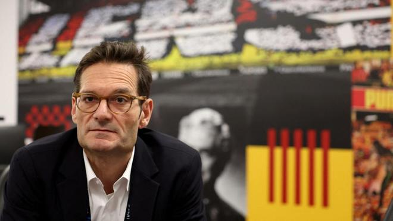

朗斯主席约瑟夫-乌古尔良在球队欧冠主场1-9惨败科莫后首次公开发声。他承认这场失利给俱乐部带来了沉重打击，但强调全队必须团结一致，不能相互指责，而应该尽快用场上表现作出回应。

乌古尔良说：“周三晚上，我们挨了非常、非常沉重的一巴掌。现在只有一种回应方式，那就是今晚在球场上作出回应。”

乌古尔良透露，他向球队传达了两条信息：“第一，绝不能再这样。事实上，我们已经把这句话写在更衣室里了。在博拉尔特球场，在自己的球迷面前，这样的表现是不可接受的。第二，在足球世界里，你们很幸运，因为几天后就有机会作出回应、实现反弹。必须抓住这个机会。”

这位朗斯主席同时强调，球队不应该寻找替罪羊，他本人也愿意承担责任。

“在这种时候，必须捂住耳朵。没有必要争论，没有必要站队，也没有必要寻找替罪羊。周三出现问题的是整个俱乐部，包括球员、主教练、体育管理层、俱乐部管理层，还有我自己。我承担全部责任。我们不会指责任何人，而是重新团结起来。”

乌古尔良还将这种团结精神与朗斯所在地区的历史联系起来。

“这或许就是这个地区的特点。我们经历过矿井瓦斯爆炸、矿山坍塌以及各种灾难。但在这样的时刻，人们不会忙着寻找责任人，重要的是大家一起渡过难关。”

尽管遭遇惨败，乌古尔良并不认为球队此前的成绩应该因此被全盘否定。他提醒外界，赢得法国超级杯的仍然是这支球队，几周前他们还击败了当时保持不败的里昂。

“我们必须弄清楚究竟发生了什么，从中吸取教训，然后向前看，而不是不断回头纠结如果当初做了其他选择，结果会不会不同。赢得法国超级杯的还是同一支球队，几周前他们还击败了当时保持不败的里昂。这不是一场灾难，我们只是需要让自己的表现更加稳定。”

他表示，现在最期待的是球员们拿出应有的态度和成绩。

“我期待球队作出回应，拿出骄傲和应有的表现。我们是来赢球的。我不相信短期内的临时反应。我们拥有一支实力很强的球队，球员们必须学会一起踢球。他们已经多次证明自己能够创造不可思议的表现。现在需要做的，就是一起训练、一起比赛。”

谈及球队近期的伤病问题，乌古尔良补充说，防线人员不整也给球队造成了很大影响。从赛季开始至今，朗斯始终无法排出固定的后防组合，这让球队付出了代价，但他强调，这绝不能成为1-9惨败的借口。

特别声明：以上内容(如有图片或视频亦包括在内)为自媒体平台“网易号”用户上传并发布，本平台仅提供信息存储服务。

Notice: The content above (including the pictures and videos if any) is uploaded and posted by a user of NetEase Hao, which is a social media platform and only provides information storage services.

极目新闻 2026-11-08 09:49:26

都市快报橙柿互动 2026-11-08 20:51:00

极目新闻 2026-11-08 08:52:40

上观新闻 2026-11-08 11:11:43

人民日报 2026-11-08 17:32:55

吉刻新闻 2026-11-08 12:03:05

证券时报 2026-11-08 21:29:02

深圳新闻网 2026-11-08 19:17:17

证券时报 2026-11-08 19:06:33

扬子晚报 2026-11-08 09:45:32

潇湘晨报 2026-11-08 18:04:18

农视网 2026-11-08 10:27:54

南方都市报 2026-11-06 08:33:38

澎湃新闻 2026-11-08 19:13:02

北京网络举报 2026-11-08 09:10:11

金台资讯 2026-11-09 06:15:11

金台资讯 2026-11-09 06:15:11

## 配图

图：足球（网易体育 · 2026-11-09）

## 来源

- [网易体育 · 原文](https://www.163.com/dy/article/LB9A3LQN0549BAP0.html)
