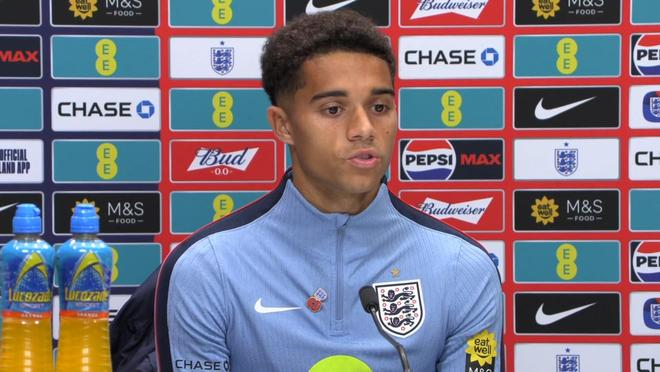

首次入选英格兰队的乔希-金出席了集训营的新闻发布会，在媒体禁言期满之后，新闻发布会的保密部分被公开，本文为该内容的上半部分。

嗨，乔希，你之前谈到过一些关于你的成长背景，你是一个在西伦敦长大的小伙子，而且你大半辈子都待在富勒姆，我想知道的是，这种长期稳定的连续性究竟带给了你什么？尤其是在当今这个年轻球员频繁转会、四处奔波的时代，这似乎并不多见……

是的，我认为这在我个人的成长和发展过程当中扮演了一个极其极其关键的部分。我认为身处富勒姆这样一家顶级俱乐部，而且它是一家真正让我感觉像家一样的俱乐部——我之前肯定也说过这样的话，但是它对我来说真的就像是第二个家。能够身处在那样的环境当中，这种长期的连续性对我的成长发展而言真的是太重要了。

我接触过很多教练，其中甚至有一些教练随着我的年龄梯队上升，连续好几年一直陪伴着我、执教我。我记得有一位教练叫查理-坦布尔，从U10少年队一直到U14青年队，他连续带了我整整五年。我认为能够拥有这种执教指导上的连续性，并且拥有一个你几乎可以称之为家的地方，对一个人的发展来说真的至关重要。

你之前也提到过一些在成长过程中参与的其他体育项目，我们还了解到你在学校里的学习成绩非常优秀，结合你的成长经历来看，足球似乎并不是你生活的全部，你并没有为了足球而牺牲放弃一切，你认为这一点是否也在某种程度上帮助你走到了今天的职业高度呢？

是的，我认为首先我必须感谢上帝，因为是他赐予了我目前所拥有的这些天赋。同时，我也必须归功于我的父母、我的家人以及我身边的所有人，感谢他们给了我这么好的教养和成长环境。他们为我提供了这样一个平台，让我能够去从事那些其他的体育运动，能够去富勒姆踢球，在我10岁的时候带我长途跋涉去纽卡斯尔踢客场比赛等等诸如此类的事。

所以我觉得很大一部分功劳都归属于我的家人，我对他们充满了感激之情。是的，我能对他们说的就只有深深的“谢谢”。我认为这是我整个人生旅程当中非常重要的一部分，但是很显然，能够走到今天这一步，需要一整个家庭团队的全力付出和支持。

嗨，乔希，首先祝贺你入选，承接刚才关于学业成绩的话题，如果你在学业和学术上非常成功的话，这在任何方面对你踢球和比赛有所帮助吗？

是的，我绝对是这么认为的。我知道如果让我妈妈说的话，她大概也会这么认为的。但毫无疑问的是，我认为这绝对是有影响的。我认为在学习和教育方面表现出色，最重要的一点在于你能够更加迅速地吸收和理解各种信息。对于其他人可能需要花更长时间才能消化的信息，你几乎可以快速领会，所以我认为这绝对很有帮助。

而且，是的，优秀的学业从来没有成为我的绊脚石，它始终是一件帮助我前进的事。此外，能够和队友顺畅地沟通交流——无论是面对比我更年轻的球员，还是面对经验更丰富的年长球员——这都是足球运动当中极其关键的一部分，所以我觉得掌握这些沟通和理解技能是非常重要的。

如果当初没有走上足球这条路，既然你各方面都这么优秀，我猜你肯定有很多别的选择，那你觉得你可能会从事什么职业呢？

这是个好问题，其实我也不知道自己具体会去做什么。我有时候会说，我可能会想成为一名律师，单纯是因为我父亲就是一名律师，而且他在这方面做得非常出色，所以也许我原本会想跟随他的脚步走上法学道路。但我其实也不确定，因为我内心深处最热爱的始终都是足球，所以我想，始终是足球这项运动最大程度地吸引着我。

特别声明：以上内容(如有图片或视频亦包括在内)为自媒体平台“网易号”用户上传并发布，本平台仅提供信息存储服务。

Notice: The content above (including the pictures and videos if any) is uploaded and posted by a user of NetEase Hao, which is a social media platform and only provides information storage services.

懂球帝 2026-11-10 01:36:22

懂球帝 2026-11-10 02:39:41

足球印象CC 2026-11-09 19:06:29

足球印象CC 2026-11-09 18:02:05

懂球帝 2026-11-09 19:53:19

赛场速报局 2026-11-10 01:45:43

足球印象CC 2026-11-08 20:00:12

足球印象CC 2026-11-08 12:03:05

足球印象CC 2026-11-08 20:59:59

懂球帝 2026-11-10 05:41:00

足球印象CC 2026-11-09 20:32:07

足球印象CC 2026-11-09 11:30:40

足球印象CC 2026-11-08 18:31:32

足球印象CC 2026-11-09 08:08:01

懂球帝 2026-11-10 02:08:15

爱足球的谢宇宁 2026-11-08 10:40:50

足球印象CC 2026-11-09 15:00:57

足球印象CC 2026-11-08 20:33:10

神秘研究院 2026-11-07 11:32:29

懂球帝 2026-11-10 01:25:14

精彩背后的故事 2026-11-09 03:24:34

足球印象CC 2026-11-09 20:03:13

赛场速报局 2026-11-10 05:25:28

足球印象CC 2026-11-09 17:02:21

懂球帝 2026-11-09 23:05:22

米奇兔 2026-11-09 15:34:42

浅夏安然n 2026-11-07 07:35:12

爱足球的谢宇宁 2026-11-08 10:40:52

米奇兔 2026-11-08 13:04:07

懂球帝 2026-11-10 06:34:35

懂球帝 2026-11-10 06:34:34

懂球帝 2026-11-10 02:08:15

足球故事GOAL 2026-11-08 07:22:38

懂球帝 2026-11-10 05:51:08

董路 2026-11-07 20:10:06

林间小温柔 2026-11-10 06:19:50

懂球帝 2026-11-10 06:34:34

林木夕 2026-11-10 06:03:34

球事百科吖 2026-11-10 06:02:29

赛场名场面 2026-11-10 06:33:27

## 配图

图：足球（网易体育 · 2026-11-10）

## 来源

- [网易体育 · 原文](https://www.163.com/dy/article/LBBSP7FK0549BAP0.html)
