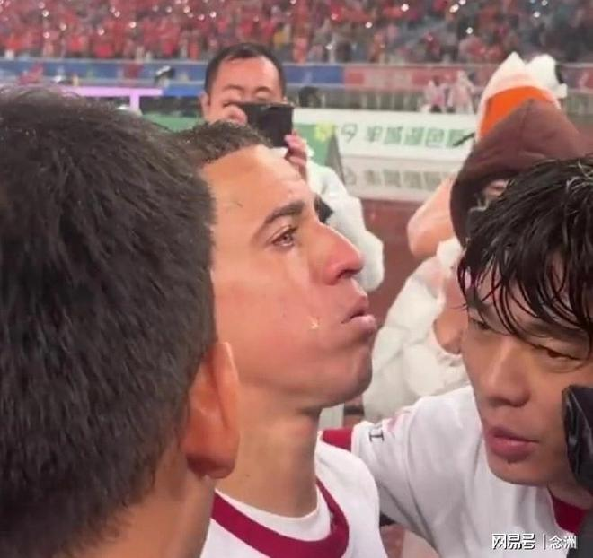

中超最后一轮，成都蓉城2-3输给山东泰山，遭遇4连败，最终无缘夺冠。31岁的巴西中场罗慕洛了发布公开信，向球迷道歉！

本赛季，身披10号球衣的罗慕洛为成都蓉城在中超出场30次，贡献1球4助攻，不过下半程表现一般。而在丢冠之后，他多次泪流不止，泣不成声。

如今，罗慕洛也是第一次公开回应无缘冠军的蓉城队员，他发布致成都球迷的一封公开信，内容如下：

今天，我含着眼泪写下这些文字，心碎不已，心中的痛苦难以用语言形容。或许，无论用怎样的言语，都无法完全表达此刻交织在我心中的失落、悲伤与感激。这一赛季所经历的一切，将会成为我人生中一道永远无法抹去的伤痕，一段我将永远铭记的回忆。

2026年，将是我们距离梦想如此之近的一年。我们为之拼搏、为之坚信，克服了重重困难，一路并肩前行，为了一个不仅属于我们，更属于整座城市的目标而努力。遗憾的是，我们最终没能赢得那个大家都无比渴望、也无比值得拥有的冠军。

真的很难接受。想到我们曾经拥有如此接近创造历史的机会，却最终没能将所有的努力化为一座冠军奖杯，心里真的很痛。我知道，你们曾给予我们多少期待，曾如何陪伴和支持我们，也知道你们有多么渴望这一刻的到来。

因此，我想向大家说一声对不起。对不起，我们没能为你们带来这份喜悦，没能实现我们共同追逐了这么多个月的梦想。请相信，这份失落和遗憾同样深深留在我们每个人的心中。正因为我们深知这家俱乐部和这件球衣对你们意味着什么，所以我们才会如此心痛。

六个赛季以来，成都早已不再只是我工作的地方。这里已经成为我生命、我的故事以及我的家庭的一部分。在这里，我结识了朋友，经历了无数难忘的时刻，面对过挑战，也收获了让我永远无法忘怀的爱与温暖。

身披这件球衣，我已经出战超过150场比赛。但再多的数字，也无法真正代表我在这里经历的一切，以及我对这家俱乐部的全部感情。正是在这里，我更加深刻地理解了这座城市的力量、球迷的重要性，以及能够代表这片颜色所拥有的荣誉与责任。

如今，对我而言，我不仅仅是一名球员，更觉得自己是这个大家庭的一员。也正因为这份归属感如此深厚，所以没能赢得这个冠军，才让我感到如此失落和心痛。

这些年来，我们共同经历和建立的一切，绝不会因为一个结果而被抹去。能够成为这家俱乐部历史的一部分，我始终感到无比自豪。能够与这样一群我逐渐学会尊重、欣赏并深爱的球迷共同走过这段旅程，更是我人生中无比珍贵的经历。

我最大的愿望，就是能够和你们一起庆祝这个冠军，看到这座城市因胜利而欢笑，感受期待已久的夺冠喜悦，并在球场上回报大家一直以来给予我的爱。遗憾的是，我们没能做到。也许，正是因为成都在我心中有着如此特殊的意义，这份遗憾才会如此难以释怀。

对于你们这些球迷，我想表达最深的敬意与感激。你们才是这家俱乐部真正的灵魂，也是让这家俱乐部始终保持强大力量的根本。正是你们的热爱，让成都变得如此特别，也让球场上发生的一切拥有了真正的意义。

对于未来有机会、有责任继续身披这件球衣、捍卫这份荣誉的人，我衷心希望你们能够为这座城市重新带来应有的骄傲、欢乐和更多伟大的冠军荣誉。希望你们永远不要忘记对这支球队的付出、尊重与责任，因为正是这群球迷，让这家俱乐部成为今天如此特别的存在，并且未来也将继续如此。

感谢你们从未停止相信我们，感谢每一次掌声、每一句充满爱意的话语，也感谢你们一直陪伴我们，直到最后一刻。

成都不仅仅是我职业生涯中的一座城市，更是我人生故事中不可分割的一部分。这份情感，我将永远珍藏在心中。

致以我最诚挚的敬意、爱与感激。

罗慕洛的公开信确实非常感人，无论个人表现如何，成都球迷对他的诚意还是非常满意的，也有网友质疑：外援都道歉了，作为队长的韦世豪为何一声不吭？

特别声明：以上内容(如有图片或视频亦包括在内)为自媒体平台“网易号”用户上传并发布，本平台仅提供信息存储服务。

Notice: The content above (including the pictures and videos if any) is uploaded and posted by a user of NetEase Hao, which is a social media platform and only provides information storage services.

孤单是寂寞的毒 2026-11-10 03:59:49

体育吐槽 2026-11-09 21:43:28

小火箭爱体育 2026-11-11 17:26:54

鱼鱼手工 2026-11-10 07:09:55

芝士星球啊 2026-11-09 00:47:15

不写散文诗 2026-11-11 17:32:54

我们的主场 2026-11-10 00:10:48

八度科普 2026-11-11 10:39:25

老輪侃世界 2026-11-11 04:18:52

不如恋物j 2026-11-11 08:25:54

骄阳之夏明 2026-11-10 01:22:03

Leslie潘伟力 2026-11-08 21:11:01

弓立军 2026-11-09 01:08:49

田萌不卖萌 2026-11-09 16:40:26

咪咕体育 2026-11-09 17:49:46

罗克 2026-11-08 22:56:55

体坛经济观察 2026-11-11 17:47:23

盛世论坛 2026-11-10 02:12:40

诗晏 2026-11-11 05:02:45

阿嬍体育评论 2026-11-09 03:44:28

韩乔生 2026-11-10 18:26:07

为了更好 2026-11-11 04:21:43

我很乖 2026-11-10 03:23:17

悲欢自饮v 2026-11-11 15:28:05

骄阳之夏明 2026-11-11 01:10:21

国+社区 2026-11-08 22:06:29

篮球圈里的那些事 2026-11-11 17:54:49

懂球帝 2026-11-11 18:35:04

想温柔 2026-11-10 01:41:47

淺笑如夏 2026-11-11 05:07:50

朴朴实实的情 2026-11-09 04:20:10

独特l 2026-11-09 16:17:43

我们的主场 2026-11-09 00:04:45

徐骧老表哥 2026-11-09 00:36:34

日在落日打怪 2026-11-10 02:21:19

一个香蕉说球 2026-11-10 20:04:31

冰封情书熵增中r 2026-11-09 09:19:47

精彩背后的故事 2026-11-11 04:02:01

界面新闻 2026-11-10 15:05:55

众生的世界观 2026-11-10 03:41:23

## 配图

图：足球（网易体育 · 2026-11-11）

## 来源

- [网易体育 · 原文](https://www.163.com/dy/article/LBEF2L420553AOVQ.html)
