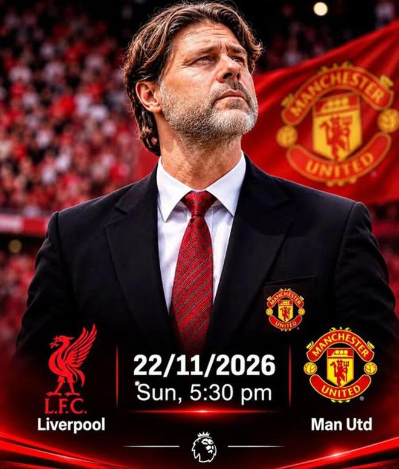

波切蒂诺执教生涯中，可能都需要一段时间才能真正将自己的足球哲学融入新的球队。然而，他的处子秀都有不错的结果，至今从未输过！如果按照这个趋势，曼联月底做客安菲尔德对阵利物浦，至少应该全身而退。

54岁的波切蒂诺执教过西班牙人、南安普顿、托特纳姆热刺、巴黎圣日耳曼、切尔西和美国国家队，他们的首场比赛都至少战平。不过，在南安普顿、热刺和切尔西的前10场英超，总共30场比赛，波帅只赢了11场，战平8场，遭遇11场失利，胜率仅36.7%，

波切蒂诺在西班牙人的首战，是国王杯对同城劲敌巴萨0-0战平。登陆英超带领南安普顿后，其首秀0-0与埃弗顿握手言和。他在热刺的第一场比赛1-0拿下伦敦德比对西汉姆联的胜利，随后再赢一场取得两连胜。至于在巴黎圣日耳曼，处子秀则是1-1与圣埃蒂安握手言和。担任切尔西教练的第一场，波切蒂诺1-1战平利物浦。而在国际赛场带领美国时，他首场比赛2-0拿下巴拿马。总结起来，波切蒂诺执教生涯在新球队正式比赛首秀战绩为2胜4平。

不过，作为主帅，波切蒂诺8次出征安菲尔德只取得1次胜利，是在2013年带领南安普顿时实现，德扬·洛夫伦下半场的头槌让「圣徒」爆冷1-0赢球。值得一提的是，当时该队还有曼联现在的左后卫卢克·肖，那年18岁的卢克·肖冻结了斯图里奇。

处于降级区的曼联，目前落后排名第四欧冠区的利物浦整整10分。届时，红魔可能会采取他们最喜欢的防守反击战术。在2013年弗爵退休之后，关于曼联应该采取什么战术，一直存在反复的争论。有人认为曼联赢球就行，另一些则认为作为豪门，还要赢得光彩，压出去攻！

有趣的是，曼联的主帅似乎总是在两种教练之间切换。一种是拥有固定执教风格的欧洲教练，另一种则弗爵时代的退役名宿。现在，波切蒂诺希望自己成为第三种，结合上述两类人的优点，消除他们的缺陷。

卡里克上赛季带队成功，实现连胜，主要是依靠攻防转换时的高效。数据显示，当曼联的控球率低于50%时，只输过一次比赛，13场比赛中的胜率高达62%；而当球队能够掌控更多球权时，胜率却下降到36%。这种打法适合曼联那些直来直去的攻击手，又能保护脆弱的后防。再加上当时卡塞米罗突然化身「空霸」，在定位球屡有建树。本赛季他离开后，红利都消失了。

然而卡里克和许多球迷都认为，顶级豪门不能只打反击。所以，卡里克本赛季希望球队化身流畅控球的队伍，通过简洁的传球组织进攻，就像路易斯·恩里克在巴黎圣日耳曼的三中场组合。卡里克希望他的球队能顶住对手的高位逼抢，迅速向前传球打出快攻。

毫无疑问，这一战术改革失败了，就像他的前任滕哈格和索尔斯克亚一样。曼联球员抱怨卡里克和助教史蒂夫·霍兰德的战术调整，认为应该维持上赛季的打法不变。

波切蒂诺将希望自己能够取得中间的平衡。按照他的说法，他希望自己的球队成为场上的控制者，始终高位逼抢，努力拼搏，充满活力。因为他除了崇拜弗爵，也是阿根廷著名教练马塞洛·贝尔萨的弟子，也喜欢这位「疯子」教练的风格。有趣的是，波切蒂诺首战对手——利物浦的现任主教练安多尼·伊劳拉，同样是贝尔萨的弟子，在毕尔巴鄂竞技为他踢过球。

这些教练都喜欢高强度、立体化的足球，这也跟曼联的传统相符合，红魔肯定不是技术最精湛的球队，然而，球迷希望看到球队拼尽全力、永不放弃。死敌利物浦，同样如此，这也是西北部工业城市的精神。

波切蒂诺与瓜迪奥拉和恩佐·马雷斯卡的曼城不同，他在美国队的世界杯比赛中，同样展示了自己的执教风格，并且有了新的调整。美国队中只有部分球员必须坚守自己的位置，他们的中场被允许自由跑动，这会给采用区域防守的对手制造麻烦。

另外，通过中场的配合，波切蒂诺的美国队能给锋线上的队友制造出空当，并将球传到防线身后，利用快马福拉林·巴洛贡的速度争取进球。这套路就是卡里克本赛季在曼联想要采用，却没有实现的。

卡里克的球队经常在逼抢中变成424的站位，一旦对手突破重围，曼联的防守就有麻烦。对手本赛季已经意识到这个弱点，而红魔没能做出相应的调整。另外，卡里克季前集训强度不足，导致球队体能下降，而且本赛季有欧战，他们的比赛压力更大。这些加在一起，导致球队崩溃。

「我的理念是，在良好的组织架构之下，让球员拥有更自由的踢球风格。」波切蒂诺解释说，他将用更有序的纪律，取代卡里克自由的管理方式。他将希望球队变得训练有素，像当初的热刺，而不是如同曼联这些年来只靠天赋和本能踢球。

从足球理念的角度，波切蒂诺与弗爵在曼联的价值观颇为契合，毕竟老爵爷就是他的偶像。波帅还有丰富的经验，有助于他比卡里克做得更好。他的目标无疑是可以做到的，法比安·许尔泽勒的布莱顿场均控球英超第四，10轮后排名高居第二，打入26球联盟最多，7个失球则是第二少。

波切蒂诺将会预先设定模式，但同时也赋予个别球员解决问题的自由。波切蒂诺解释说：「最重要的是要设计出让球员感到舒适、并能展现其真实水平的良好体系。」

在波切蒂诺的切尔西，科尔·帕尔默因此打出了自己的巅峰赛季，各项赛事打入25球，其中英超22球。「他给了我信心与自由，让我能够到球场上的任何我想去的地方，从而发挥自己的优势。」帕尔默说。

但如果波切蒂诺在曼联也成绩不佳，可能就真正说明，俱乐部的问题不是主教练和球员，重复不断的糟糕局面需要更深层次的彻底改革。

特别声明：以上内容(如有图片或视频亦包括在内)为自媒体平台“网易号”用户上传并发布，本平台仅提供信息存储服务。

Notice: The content above (including the pictures and videos if any) is uploaded and posted by a user of NetEase Hao, which is a social media platform and only provides information storage services.

咪咕体育 2026-11-14 12:21:09

収起了底线 2026-11-15 18:39:52

阅尽天下大事 2026-11-16 04:50:16

一个香蕉说球 2026-11-15 14:06:01

风里小记事 2026-11-15 05:28:04

一世菜鸟a 2026-11-16 01:48:24

坠入温柔晚风 2026-11-16 04:40:10

界面新闻 2026-11-13 20:38:56

温柔且自由 2026-11-16 05:02:34

甜份超标的我 2026-11-16 05:09:26

凉城若梦h 2026-11-14 00:13:17

足球印象CC 2026-11-13 08:04:55

孤酒老巷QA 2026-11-16 00:14:15

足球印象CC 2026-11-15 16:34:56

绝少至尊 2026-11-15 07:19:50

火星猪同学 2026-11-15 00:15:27

我们的足球记忆 2026-11-15 11:19:03

人间闲散客 2026-11-15 02:57:11

孤酒老巷QA 2026-11-15 16:29:00

陶衣柜 2026-11-15 06:11:12

冷饭说球 2026-11-14 11:24:58

足球印象CC 2026-11-12 16:01:08

火星猪同学 2026-11-15 00:17:55

超喜欢我 2026-11-15 01:00:23

篮坛第一线 2026-11-16 05:18:21

微雨花间h 2026-11-14 05:12:17

球事百科吖 2026-11-16 06:22:53

罗吹终结者 2026-11-15 15:14:21

嘛呢八十分 2026-11-14 01:17:19

赛场名场面 2026-11-16 04:54:09

你是佛的弟子 2026-11-16 02:14:43

球事百科吖 2026-11-16 06:25:59

惊鸿照影b 2026-11-16 01:45:13

冷饭说球 2026-11-14 11:19:02

足球印象CC 2026-11-14 13:02:13

懂球帝 2026-11-16 06:02:54

足球印象CC 2026-11-14 09:11:03

足球印象CC 2026-11-14 16:00:57

一个香蕉说球 2026-11-15 14:04:49

大海体娱 2026-11-14 11:21:54

## 配图

图：足球（网易体育 · 2026-11-16）

## 来源

- [网易体育 · 原文](https://www.163.com/dy/article/LBRAI8IN0529999M.html)
