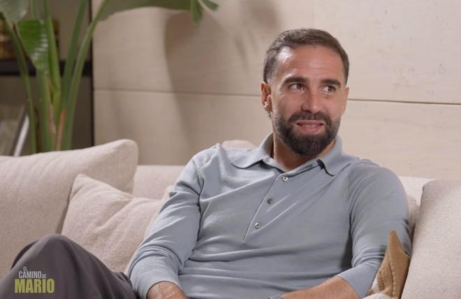

卡瓦哈尔接受了前马竞球员马里奥-苏亚雷斯的采访。谈话中，他回顾了自己在皇马的经历，谈到了无缘世界杯的遗憾、过去两年受到伤病困扰时的心情，以及离开皇马、加盟赫塔费的决定。

签约之前，你和博尔达拉斯谈过？

很好。他给我的感觉是一个非常好的人，是那种老派教练，会给你施加压力，对你提出要求。这么说可能有点怪，他有点像一个爱唠叨、脾气不太好的老爷爷，会督促你、严格要求你，但实际上又非常善良，是个很好的人。大概就是这种感觉。

听说他会给你们称体重，是怎么回事？

是的。比赛前我们会有体能教练安排的训练，间歇期之后也会继续。他们会让我们做一些跳跃训练，也会看看大家的情况。

我一直保持得不错。我看到有一张罚款表，具体数字我记不清了。大概是在理想体重的基础上，允许你有1公斤的浮动，之后每多100克就要罚多少钱。不过有这样的管理，我觉得挺好的。

是的。现在体重太重了，也没办法踢比赛。你现在的体重还略低于标准吧？我很好奇，你注册的事情是怎么回事？我记得我们还聊过。如果真是因为那个原因，我觉得那条规定很荒唐：因为你以前赚过很多钱，他们就不相信你能以现在的薪水踢球，是这样吗？

对。这是一条我觉得已经有些过时的规定。以前足球世界里的灰色收入可能更多，俱乐部和你签一份合同，写一个金额，然后再用房子或者其他实物支付报酬。

所以在西班牙，大概是到了36岁，你才可以按照最低工资签约，并按那个金额计入工资限额。如果年龄不到，西甲联盟就会按照一些标准，确定这名球员应该拿多少工资。

但这说不通。就像你说的，你想留在家附近，我不是说让你免费踢球，毕竟还有必须支付的最低工资。

没错。最终主要还是关系到工资限额，也就是俱乐部要计入限额的金额。

安赫尔-托雷斯为此提供了担保，对吧？

对，因为俱乐部的空间比较紧张，所以他必须提供担保。事情确实是这样。主席为了给我注册，做出了努力，提供了担保。

你在足球世界里几乎赢得了一切。你还需要证明什么？

身边的人经常对我说这句话。当我们在决定未来去哪里的时候，我记得他们对我说：“你不需要向任何人证明什么。按照自己的想法去做，做自己想做的事。”这让我来到了赫塔费。

是什么让你每天早上醒来，依然有这样的热情和动力去参加比赛？

我觉得是因为我热爱这项运动。说到这里，我有点激动。因为从5岁开始，我就一直想成为一名足球运动员。

我曾经和妻子聊过。感谢上帝，我们非常幸运，这项运动能给我们带来非常高的收入。但即便踢球只能赚1800欧元，我也依然会成为一名足球运动员。

如果我们连自己喜欢的事情都不做，还能做什么呢？

赫塔费今年的目标是什么？联赛保级，还有欧协联？

对，我们必须继续努力。接下来还有三场欧协联比赛，我觉得至少要拿到6分，才能晋级。间歇期之后，我们要踢来自格鲁吉亚的伊比利亚1999；然后在主场对阵安道尔球队艾斯卡迪斯国际；之后去阿姆斯特丹对阵阿贾克斯。

你还没有拿过欧协联冠军。

对，还有欧联杯也没拿过。希望能拿到吧，当然希望。不过正如教练所说，联赛才是我们赖以生存的根本。如果能够像上赛季的巴列卡诺那样打进决赛，给球迷们带来快乐，那当然很好。

你职业生涯中最难防守的球员是谁？

内马尔。巅峰时期的内马尔。他是一名各方面能力都很全面的球员：他能够利用空间，能接脚下球，能盘带，能从两边突破。如果你给他空间，他还能送出穿透性传球。他的传球视野很好，真的非常、非常全面。

丹尼-卡瓦哈尔身上有什么是大家不了解的？如果他们看到了，会感到惊讶？

我觉得，不是皇马球迷的人，可能会因为我的踢球方式而对我有些看法。我踢球很拼，他们可能会想：“这家伙……”就像足球场上常说的，对手会有点讨厌你。但我觉得自己是一个不错的人，也有幽默感。我不会介意在周六去商场时和别人合影40次，因为我并不在意这些。

喝了两杯葡萄酒之后，人就没那么害羞了。不过说真的，在自己的舒适区里，我并不害羞，反而更爱开玩笑。

但很多人一开始可能会觉得我有点冷淡、看起来比较严肃。比如学校里其他孩子的家长，现在我们已经有了一些交往，但最开始他们可能会这么看我。我其实不是那样的人。

这也是我们做这个节目的一个原因。我们不只是聊足球，也是因为大家往往会先入为主地认为我们……

认为我们球员是什么样的人。

没错。他们并不了解球员背后真正是什么样的人。你怎么看本赛季的皇马？

我觉得他们现在正处于最好的阶段。他们在国家德比中赢球，之后又在雅典完成逆转。我觉得他们缩小了联赛中的差距，现在的状态很好。

他们的比赛你都会看吗？

几乎都会。如果时间上实在不方便就没办法，但通常我都会看。

你想踢球踢到什么时候？

踢到我自己觉得不能再继续的时候。

也就是说，你会一年一年地看情况？

对，一年一年地看。不过有一点我很确定：退役之后，我想和朋友们组一支球队，踢七人制或者十一人制。

不是成立一家俱乐部，就是踢着玩？

对，我一直都想这么做。

那挺好，以后有机会叫上我。

我说件事，几乎没人知道。你刚才一说，我突然想起来：我记得自己当时可能还在卡斯蒂亚，我的朋友们有一支球队。有一次周末，天气很冷，我戴了帽子和围脖，去给他们当门将，和他们一起踢了一场比赛。

当门将受伤的可能性比较小。

对，比较不容易挨踢。我记得自己还做出了两次不错的扑救。

退役之后，你想做什么？

暂时先享受和家人在一起的时光。不过我想去上教练课程，拿到教练资格，以备不时之需。

我以前也这么想过，但现在课程要求更高了，我没办法把它和电视工作兼顾起来。相比体育总监，你更倾向于当教练？

对，我更喜欢战术方面的东西。但正如我说的，还要考虑家庭。我看到教练的生活是什么样的：有小孩子的时候，你可能要不断搬来搬去，三个月成绩不好就会下课。从这个意义上说，教练的生活更加漂泊。

我想问你，你希望有一天回到皇家马德里吗？

以什么身份回去？当教练？

那还很遥远，完全说不准。我的人生永远都会以某种方式和皇家马德里联系在一起。等我停止踢球的时候，我们再看看，我能以什么方式给俱乐部提供帮助。

好了，今天就聊到这里。很愉快。丹尼，你给我带了什么东西吗？

带了。一件我的赫塔费球衣。

你没有带皇马球衣，是因为你觉得我不会把它挂起来吗？

是。我知道你是个非常忠实的马竞球迷，可能会觉得有点为难。不过也不是这个原因。我现在是赫塔费球员，这次也是以赫塔费球员的身份接受采访，所以带了赫塔费球衣。

而且这么多年之后，这是你第一次离开皇马。我们会把它和其他球衣挂在一起。

非常感谢你接受我们的邀请。祝你一切顺利，祝你好运、身体健康，希望伤病远离你，也希望你和家人都过得很好。

特别声明：以上内容(如有图片或视频亦包括在内)为自媒体平台“网易号”用户上传并发布，本平台仅提供信息存储服务。

Notice: The content above (including the pictures and videos if any) is uploaded and posted by a user of NetEase Hao, which is a social media platform and only provides information storage services.

懂球帝 2026-11-17 05:19:23

懂球帝 2026-11-17 05:30:06

星河漫山野 2026-11-17 04:21:19

懂球帝 2026-11-17 05:19:23

足球印象CC 2026-11-16 21:02:04

足球印象CC 2026-11-14 09:11:03

足球印象CC 2026-11-15 08:56:57

罗氏看球 2026-11-14 11:46:55

孤酒老巷QA 2026-11-15 16:25:56

风过乡 2026-11-16 22:51:28

CR7足球频道 2026-11-14 17:35:37

海浪星体育 2026-11-16 11:09:26

足球印象CC 2026-11-16 11:33:14

薛艳艳爱生活 2026-11-16 11:13:40

元气满分吖 2026-11-17 06:19:51

精彩一网打尽 2026-11-16 15:29:28

懂球帝 2026-11-17 05:52:18

村里整活小分队 2026-11-15 01:30:58

足球印象CC 2026-11-16 16:59:51

咪咕体育 2026-11-14 12:21:09

収起了底线 2026-11-17 01:58:47

足球印象CC 2026-11-15 20:01:43

精彩背后 2026-11-15 14:23:41

足球印象CC 2026-11-16 20:02:18

足球印象CC 2026-11-15 16:34:56

足球印象CC 2026-11-16 15:59:25

足球印象CC 2026-11-15 14:58:57

足球印象CC 2026-11-16 18:54:52

足球印象CC 2026-11-15 18:05:13

星星没有你亮 2026-11-17 05:56:03

懂球帝 2026-11-17 01:26:58

一个香蕉说球 2026-11-15 14:04:49

米奇兔 2026-11-14 13:02:11

左脚爆射得分 2026-11-16 11:15:56

骄阳之夏明 2026-11-17 01:10:01

懂球帝 2026-11-17 04:58:11

米奇兔 2026-11-16 14:57:34

米奇兔 2026-11-15 12:53:09

生活超有趣 2026-11-14 14:34:24

一个香蕉说球 2026-11-15 14:06:01

## 配图

图：足球（网易体育 · 2026-11-17）

## 来源

- [网易体育 · 原文](https://www.163.com/dy/article/LBTTF1Q00549BAP0.html)
