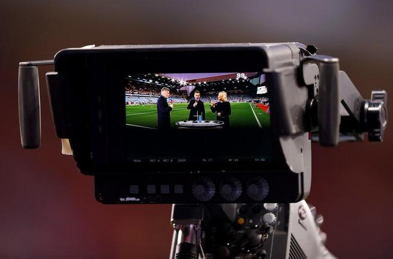

英超比赛应主要在周日进行，而英冠、英甲以及低级别联赛的比赛则优先安排在周六，这是talkSPORT主持人提出的建议，而则抨击英国首相安迪-伯纳姆发表他可能取消英国下午3点电视转播禁令的看法。

根据一项可追溯到20世纪60年代的规定，足球比赛在周六下午2点45分至5点15分之间不能在电视上播出。

这项规定旨在鼓励球迷前往观看低级别联赛的比赛，但由于大部分比赛都安排在下午3点开球，只有少数比赛可以在午餐时间或晚上进行电视转播。

俱乐部的球迷对这项规定表示不满，认为它已经过时，因为世界上许多国家都可以转播他们的比赛，但英国却不能。

英超首席执行官理查德-马斯特斯今年早些时候告诉talkSPORT，关于可能结束下午3点电视转播禁令的决定。

当前的电视转播权周期将持续到2028/29赛季结束，因此，从那时起可能会取消这一限制。

下午3点的电视转播禁令应该结束吗？

然而，节目主持人斯特林详细阐述了他对取消禁令可能产生的影响的担忧，并提出了一项英格兰足球联赛（EFL）和低级别联赛俱乐部也将从中受益的解决方案。

“我读了一篇很棒的文章，它最初写于2023年，并在The Athletic上更新。外面的人，我知道如果你是英超球迷，你会说，‘低级别联赛的比赛不会受到影响，因为英超下午3点开球的比赛是赫尔城对阵富勒姆之类的比赛’，恕我直言。

“但一旦这件事通过，如果它通过了，有什么能阻止事情发生变化呢？例如，这个赛季，切尔西对阵利物浦，那是中午12点30分踢的，切尔西对阵曼联也是中午12点30分踢的，纽卡斯尔对阵阿森纳是下午5点30分，曼城对阵切尔西是下午5点30分。

“有什么能阻止当权者把那些比赛，那些重要的比赛，定在下午3点开球呢？然后看看它对低级别联赛球队的影响。这篇文章也提出了一种解决方案，那就是——不要有任何英超下午3点开球的比赛，这样就不会影响到其他联赛了。

“把它们定在中午12点30分和下午5点30分，或者，这里有一个更好的主意，把它们全部，或者几乎全部，都安排在周日进行。

“让周日成为英超日，然后英格兰足球联赛和所有低级别联赛都在周六进行，英超在周日可以独占赛场。”

伯纳姆也对结束下午3点电视转播禁令的可能性表示担忧，他通过英国广播公司：“我建议谨慎一点，因为它确实保护了低级别联赛俱乐部的收入。

“如果你在任何时候都有几乎是连绵不绝的英超足球比赛，那么它可能会削弱人们观看足球联赛或非联赛的动力。

“所以我认为必须仔细考虑。我在这里不会只从纯粹的消费者角度来看待问题。我将从足球健康的视角来处理这个问题。”

然而，前老板霍尔丹声称，首相对此事并不了解，政客们在发表评论之前必须对此有所理解。

“他是对的，还是在这件事上迎合大众？”节目的主持人吉姆-怀特问道。“他、你、我以及其他所有人都知道，如果下午3点有现场直播的比赛，上座率会受到影响。”

“那这又是基于什么呢？这是基于50、60、70、80年前工厂在特定时间开工和停工时所产生的经验数据。”

“当然，当电视转播权变得更普遍时，人们对观看直播比赛的期望也有了特定的看法。有没有经验数据支持这一点？”

“英格兰足球联赛（EFL）是这方面的争论点。不是英超联赛，英超联赛有98%的上座率，他们不在乎下午3点的禁播时间，他们想转播他们的比赛，并给广播公司更多的钱，这样比赛就可以重新分配。”

“你不能总是一味索取，你不能要求英超联赛重新分配……然后又设置障碍。如果他们想把禁播时间设为下午3点，并取消它，而这种想法是，不知何故，观看一场英超比赛会影响人们去观看一场次级比赛，这可能有一些道理。”

“但你为此得到了什么呢？你为此得到了什么？因为你不是白白放弃的。如果你得到的东西比你付出的多得多，那么，市长当然应该好好研究一下这些细节。”

“关于他那荒谬的的言论，他根本不知道自己在说什么。你是一个平民出身的人，这很棒；你努力与人民保持联系，这很棒；我更喜欢与人民有联系的政治家，而不是没有联系的。”

“但我也更希望他们言之有物。我认为丽莎-南迪（Lisa Nandy）所说的大部分话都没有实质内容，而她还是数字、文化、媒体和体育部（DCMS）的影子大臣。”

“当他们涉足体育界时，无论他们属于哪个党派，无论是保守党、工党，还是自由民主党那个小丑学院，抑或是绿党，或者我们政治中参与的任何其他乡巴佬。”

“如果他们涉足体育，就要知道自己在说什么，如果你要谈论解除下午3点的转播禁令，你在要求什么？”

“你要求英超联赛重新分配一大笔钱。如果你不取消下午3点的禁播时间，你会得到更多的钱被重新分配，还是更少？所以，搞清楚你在说什么……”

“他一直在插手这些事情，”乔丹补充道，谈到伯纳姆时说。“这很棒，但这种民粹主义决策最终缺乏实质内容。”

“我不喜欢政治家插手体育，因为我认为他们只会利用体育来与投票的球迷建立关系。”

怀特指出，伯纳姆是一位狂热的埃弗顿球迷，经常去现场观赛，他展现了他对俱乐部的热情支持。

“他这样没什么不对，”乔丹坚持说。“基尔-斯塔默（Keir Starmer）也是一个去观看阿森纳比赛的平民，另一个意识形态上志同道合的笨蛋。”

“事实是，没有必要在没有真正了解情况的情况下涉足一个主题，因为如果你问他，‘你认为你正在失去什么？你正在失去上座率，这基于什么？你是否意识到，为了让英超联赛重新分配更多的资金，这对英格兰足球联赛（EFL）来说将更具存在意义，他们需要这个作为交换条件？’ ”

“‘哦，是吗？’‘是的，那你为什么涉足你不知道的事情呢？因为如果英格兰足球联赛（EFL）的俱乐部能从英超俱乐部那里获得更多的资金，因为英超俱乐部得到了一些作为交换，那对英格兰足球来说不是更好的方式吗？’ ”

“‘哦，我想也是，’那你为什么不闭嘴，先弄清楚事实，而不是哗众取宠呢？”

特别声明：以上内容(如有图片或视频亦包括在内)为自媒体平台“网易号”用户上传并发布，本平台仅提供信息存储服务。

Notice: The content above (including the pictures and videos if any) is uploaded and posted by a user of NetEase Hao, which is a social media platform and only provides information storage services.

懂球帝 2026-11-18 00:36:23

懂球帝 2026-11-18 00:14:44

温柔且自由 2026-11-18 03:58:19

足球印象CC 2026-11-16 11:33:14

懂球帝 2026-11-18 03:24:28

懂球帝 2026-11-18 05:18:06

足球印象CC 2026-11-15 16:34:56

火星猪同学 2026-11-17 09:24:41

懂球帝 2026-11-18 00:04:14

足球印象CC 2026-11-16 15:59:25

一个香蕉说球 2026-11-15 14:04:49

米奇兔 2026-11-15 12:53:09

王飬吃吃喝喝 2026-11-17 02:54:31

零度眼看球 2026-11-18 06:34:25

懂球帝 2026-11-18 05:38:04

温柔且自由 2026-11-18 05:39:00

精彩背后 2026-11-15 14:23:41

左脚爆射得分 2026-11-17 17:55:46

一个香蕉说球 2026-11-15 14:06:01

快乐加载中21 2026-11-18 05:03:42

精彩背后 2026-11-17 12:11:18

新点生活 2026-11-15 14:31:57

孤酒老巷QA 2026-11-16 00:14:15

甜度百分百21 2026-11-18 04:55:37

足球印象CC 2026-11-17 18:59:18

光影拾贝 2026-11-18 00:12:00

锌之助吖 2026-11-17 01:08:45

精彩背后的故事 2026-11-17 03:00:33

懂球帝 2026-11-17 08:19:58

我们的足球记忆 2026-11-15 11:19:03

体坛周报 2026-11-17 04:21:41

浣溪爱球 2026-11-17 12:02:31

懂球帝 2026-11-18 04:56:07

足球故事GOAL 2026-11-17 20:06:59

精彩一网打尽 2026-11-16 15:29:28

海浪星体育 2026-11-17 11:55:54

心开动漫鑫鑫 2026-11-17 01:26:26

懂球帝 2026-11-18 04:26:09

一世菜鸟a 2026-11-18 02:23:43

看看新闻Knews 2026-11-15 11:25:26

## 配图

图：足球（网易体育 · 2026-11-18）

## 来源

- [网易体育 · 原文](https://www.163.com/dy/article/LC0FO4740549BAP0.html)
