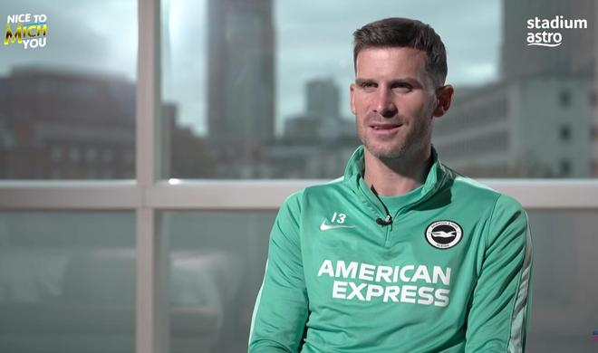

布莱顿中场帕斯卡尔-格罗斯近日接受Astro Premier League采访，谈到了自己的运动习惯、父亲对其足球生涯的影响、重返布莱顿的原因以及球队本赛季的目标。格罗斯表示，父亲不仅教会了他如何踢足球，更从小培养了他的做人准则。谈到球队发展时，他强调英超竞争非常激烈，不能因为取得不错的开局就放松警惕。此外，他还谈到了自己对年轻球员的帮助，以及通过观看比赛录像不断提升传球和比赛阅读能力的经历。

记者： 首先，帕斯卡尔，感谢你接受Astro Premier League的采访，很高兴认识你。我们听说你在足球之外也是一个非常热爱运动的人，你的主教练甚至开玩笑说，你根本坐不住，总是在寻找机会参加跑步比赛。你对运动和跑步的热爱是从哪里来的？

帕斯卡尔-格罗斯：我不会说自己特别热爱跑步。我想，真正让我着迷的是足球和体育运动。至于我坐不住，这倒是真的。跑步也是体育运动的一部分，所以我必须坚持下去。

记者： 我之所以提到跑步，是因为我听说你曾经在夏天赢得过一场8.4公里的跑步比赛。你是不是做什么事情都很有竞争意识？

帕斯卡尔-格罗斯：是的，我想确实如此。我家人应该也会这么说。即使和孩子们一起玩游戏，我也会很有竞争意识。不过，你刚才提到的那场比赛，是我人生中唯一参加过的跑步比赛。

记者： 如果让布莱顿全队参加一场10公里跑步比赛，你觉得谁会赢？你认为自己能拿第一吗？

帕斯卡尔-格罗斯：我会选择相信自己。

记者： 现在我大概明白你的运动天赋从哪里来了，因为你的家庭似乎也很有运动氛围。你的父亲自己也曾是一名足球运动员，他对你的职业生涯产生了多大的影响？

帕斯卡尔-格罗斯：影响非常大。我认为，如果没有他，我可能无法成为一名职业球员。我小时候，他教会了我很多东西，包括技术层面的内容，以及在最高水平的比赛中踢球所需要具备的心理素质。如果没有他，我想今天也不会坐在这里接受采访。

记者： 你还记得自己和父亲之间最早的一些重要回忆吗？比如小时候他带你接触足球、带你去看比赛，或者给你看比赛录像。你最早的记忆是什么？

帕斯卡尔-格罗斯：给我看比赛录像？那时候可不是这样的时代（笑）。他带我参加了人生中的第一次足球训练，那时我只有4岁，这是我人生中最早的一些记忆之一。后来，他还担任了我和朋友们五年的教练。所以，我们之间有很多美好的回忆。

记者： 你认为自己从父亲那里学到的最重要的足球道理是什么？

帕斯卡尔-格罗斯：他最先教给我们的，是如何做一个好人。这是所有事情的起点。在他的训练课上，守时非常重要，你必须学会打招呼、说再见、说谢谢和不客气。做好这些之后，我们才开始踢足球。也就是说，他首先教我们如何做人，然后才教我们如何踢球。

记者： 在某种程度上，他首先是一位父亲，然后才是一名足球教练。

帕斯卡尔-格罗斯：当然是这样。不过，他对我们所有来自那个地方的朋友都是如此，对每个人的要求都一样。

记者： 你的回归显然受到了俱乐部的热烈欢迎，在某种程度上，这就像回家一样。经历了在多特蒙德的欧冠征程之后，是什么让你决定重返布莱顿？你最怀念这里的什么？

帕斯卡尔-格罗斯：有很多原因。就像我一直说的，我人生中最重要的很多事情都是在布莱顿发生的。我热爱这家俱乐部，也喜欢这座城市。我在这里结了婚，孩子们也在这里出生。我在这座城市还有很多朋友，所以我怀念的是这里的一切。现在能够回到这里，我真的非常开心。

记者： 布莱顿本赛季的表现相当不错。你认为俱乐部能够取得怎样的成绩？如果想要更进一步，还需要做些什么？过去几个赛季，我们已经看到布莱顿一直在朝着积极的方向发展。

帕斯卡尔-格罗斯：我们需要继续前进。英超联赛非常艰难，即使你取得了一个不错的开局，也并不意味着什么。整个赛季都很漫长，还要参加杯赛和欧战。每场比赛都是争取三分的重要机会，而且每场比赛都非常困难。所以，你不能把目光放得太远，因为在这个联赛中，这样做是非常危险的。

记者： 现在你已经成为队内经验比较丰富的球员之一了。你是否享受指导和帮助年轻球员成长的过程？

帕斯卡尔-格罗斯：是的，这也是我工作的一部分，而且我很喜欢这样做。俱乐部有很多非常有天赋的年轻球员，我认为自己可以利用经验帮助他们，也可以给予他们关心和支持，同时对他们提出要求，推动他们进步。这其中需要找到一个微妙的平衡，因为每个人都是不同的。我们的球队里还有很多不同国籍的球员。所以，这是我工作的一部分，我真的很享受这个过程。

记者： 不仅仅是不同国籍，还有不同的年龄层。我个人就不太能理解Z世代，更不用说比他们还年轻的一代了。在你帮助成长的这些年轻球员中，谁给你留下了最深刻的印象？

帕斯卡尔-格罗斯：很难只选出一个。我们有一群非常优秀的年轻人。我认为巴比斯-科斯图拉斯本赛季开局就踢得很好，他是一名非常有天赋的球员，而且人也非常好。他在某些方面还有进步空间，但我对他本赛季的开局表现非常满意。

记者： 顺便问一句，你会玩英超梦幻足球游戏吗？

帕斯卡尔-格罗斯：不会。

记者： 如果你玩英超梦幻足球游戏，现在要组建一支球队，你会经常选择哪三名布莱顿球员？

帕斯卡尔-格罗斯：我会选择巴比斯-科斯图拉斯，因为他能够进球，这总是一件好事，我认为他能拿到很多积分。另外，我会选择巴拉-费布鲁亨，因为我们最近取得了几场零封，而且我也愿意相信自己的能力。

记者： 那么，你觉得布莱顿队内谁最幽默？谁在训练中最认真？作为队内比较资深的球员，你这些年应该观察过不少队友。

帕斯卡尔-格罗斯：我认为我们所有人在训练中都非常认真，这也是球队能够保持竞争力、不断进步的重要原因。至于幽默的人，我们队里有好几个。我们签下了普罗米斯和前锋科斯图拉斯，他们都很有趣。实际上，球队里有很多幽默的人，大家在一起时总能找到很多乐趣。

记者： 如果球队组织外出聚会，你会放心让他们负责安排吗？

帕斯卡尔-格罗斯：当然，当然。

记者： 我还想谈谈你个人的比赛风格。你以出色的传球能力和视野著称。你认为这些是天赋使然，还是自己花了很多时间研究比赛的结果？

帕斯卡尔-格罗斯：我认为两者都有。我确实花了很多时间研究比赛，这一点是肯定的。我会观看很多比赛，也会反复观看自己的比赛录像，看看自己是否做出了正确的决定，或者有没有遗漏什么。有些传球需要你提前了解球队的整体阵型和位置关系。当然，我认为你也需要一定的天赋，同时还必须通过努力不断提升自己的传球能力。

记者： 那么，对你个人和布莱顿来说，怎样才算一个成功的赛季？

帕斯卡尔-格罗斯：我认为我们希望比上赛季取得进步。不过，现在赛季还处于非常早期的阶段，我不喜欢谈论太过遥远的目标。我们只需要在眼下每隔三天到来的比赛中继续努力、不断进步。等到明年某个时候，我们再来讨论自己究竟想要实现什么目标。

特别声明：以上内容(如有图片或视频亦包括在内)为自媒体平台“网易号”用户上传并发布，本平台仅提供信息存储服务。

Notice: The content above (including the pictures and videos if any) is uploaded and posted by a user of NetEase Hao, which is a social media platform and only provides information storage services.

中场哨 2026-11-19 18:47:50

懂球帝 2026-11-21 01:02:50

篮坛第一线 2026-11-20 20:14:33

懂球帝 2026-11-21 01:57:29

懂球帝 2026-11-21 18:45:52

一路荒凉如歌aa 2026-11-21 02:04:15

晚风知我意21 2026-11-21 18:56:22

佳客体育 2026-11-21 05:27:27

鸟儿太能吃 2026-11-21 03:42:59

花魄m 2026-11-21 19:07:11

懂球帝 2026-11-21 18:24:14

海星动画 2026-11-21 13:35:30

月亮上的少女 2026-11-21 12:39:18

科技前沿菌 2026-11-21 10:28:25

AI小屋的日常随笔 2026-11-20 08:25:59

乐享人生风雨 2026-11-21 00:48:37

足球印象CC 2026-11-20 08:03:21

懂球帝 2026-11-21 18:55:04

小车车和小刘刘 2026-11-19 02:31:01

为了更好 2026-11-19 04:01:59

一个香蕉说球 2026-11-20 08:39:35

一个香蕉说球 2026-11-20 08:32:32

曼巴体育6 2026-11-21 19:10:09

萌宠呵护侠 2026-11-19 02:43:35

火星猪同学 2026-11-19 18:42:21

浮云过影r 2026-11-19 04:31:52

生活浩浩乐 2026-11-19 01:23:41

孤酒老巷QA 2026-11-19 21:19:45

孤酒老巷QA 2026-11-19 21:16:41

绿荫杂谈视频播客 2026-11-20 16:29:01

务农翻车小青年21 2026-11-21 01:23:46

懂球帝 2026-11-21 18:45:52

风霜侃球 2026-11-20 11:37:31

你是佛的弟子 2026-11-21 02:48:57

星视频 2026-11-21 13:28:54

友谊第一 2026-11-21 17:53:29

小熊回收站 2026-11-21 03:21:18

夜里的海风 2026-11-21 12:21:42

ChinaRain刘晓健 2026-11-19 16:00:38

懂球帝 2026-11-21 18:55:08

## 配图

图：足球（网易体育 · 2026-11-21）

## 来源

- [网易体育 · 原文](https://www.163.com/dy/article/LC9JDEBT0549BAP0.html)
