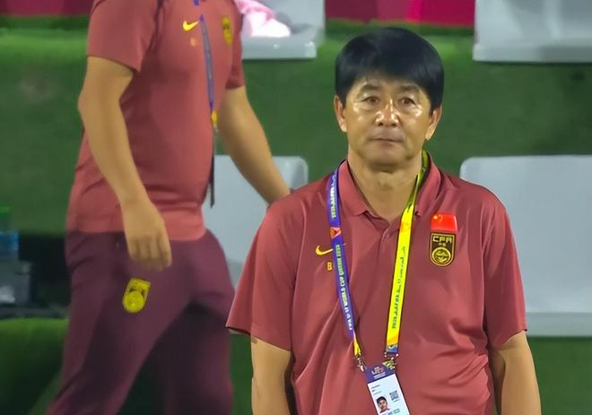

11月20日晚间，U17世界杯首场小组赛，中国队遭遇开门黑。在与西班牙队的争夺中，中国队全面处于下风，最终0-5惨败。赛后，董路对中国队的战术提出了质疑。

此役，中国队控球率为26%，射门3次，2次射正，1次得分机会，传球成功率93%，被西班牙队彻底压制。西班牙队控球率74%，射门19次，射正11次，7个角球，拿到了4次得分机会，打进5个球。

比赛结束后，中国队的主帅、日本教练浮嶋敏一脸严肃。董路如此评价中国队的表现：“这个比赛可能不能证明我们怎么做去行，但是一定能揭示我们怎么做不行。有人说你董路厉害，这个比赛你应该怎么打？这个我不敢说，但是我肯定知道这么打肯定是不行的！”

董路强调：“一呢，比分显示0-5，这个比分呢说白了，你这0-5实际上是差两个档次的比分，它跟0-2、0-3是不一样的，我个人觉得呢，这个比分肯定是大的，对吧？你这给未来的小组出线埋下了很大的阴影，因为你丢了5个。如果打这个摩洛哥，你又输了，然后你带着多少个负的净胜球，你去打斐济呀？”

“对不对，你能打斐济几个呀？最后这3分，你净胜球如果不够的话，你怎么出线呢？是不是？所以我个人觉得这个比分肯定是比较大的啊。”

董路表示：“三年啊，（中国队）集训了303天啊，交出了这样一份答卷！你们一定要相信我，这个西班牙队没有尽全力，你一定要相信我，你就看一个队员，就这3号，他基本上是走着踢的。这3号平常他要是这么踢，能踢到巴萨B队吗？拿球就带，根本就不合理，他们联赛绝对不能这么踢，你这么踢，教练早就给你换下去了。”

浮嶋敏的战术是否合理？董路表示：“中国队有一些阶段的防守还是不错的啊，但是我还是那句话，就是你让边前卫落下来，这是容易的，但如果你要让边前卫去补肋部，这是难的。”

特别声明：以上内容(如有图片或视频亦包括在内)为自媒体平台“网易号”用户上传并发布，本平台仅提供信息存储服务。

Notice: The content above (including the pictures and videos if any) is uploaded and posted by a user of NetEase Hao, which is a social media platform and only provides information storage services.

大象新闻 2026-11-20 18:35:02

新民晚报 2026-11-20 18:54:38

极目新闻 2026-11-20 15:01:38

潇湘晨报 2026-11-20 12:00:15

财联社 2026-11-21 04:48:07

齐鲁晚报 2026-11-19 10:20:54

大风新闻 2026-11-20 20:07:09

闪电新闻 2026-11-20 10:50:52

看看新闻Knews 2026-11-20 18:56:15

界面新闻 2026-11-20 15:26:50

新京报 2026-11-20 10:12:11

扬子晚报 2026-11-20 07:36:45

极目新闻 2026-11-20 16:53:20

界面新闻 2026-11-20 16:42:26

财联社 2026-11-20 20:27:06

极目新闻 2026-11-20 15:01:38

界面新闻 2026-11-20 21:03:27

界面新闻 2026-11-20 09:03:33

北京网络举报 2026-11-20 18:08:13

证券时报 2026-11-21 06:16:06

## 配图

图：足球（网易体育 · 2026-11-21）

## 来源

- [网易体育 · 原文](https://www.163.com/dy/article/LC86PH0105566VBM.html)
