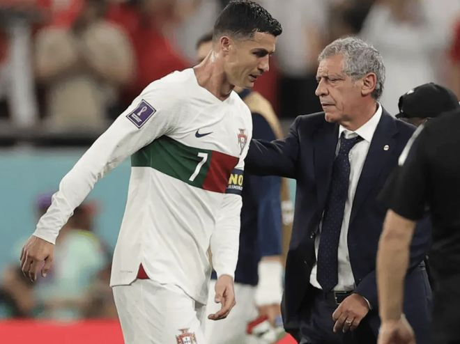

11月5日晚间，41岁的C罗忽然宣布退出葡萄牙国家队，引发世界足坛震荡。根据ESPN的最新消息，C罗已经确定将踢告别赛，但他不愿意让热苏斯以及桑托斯来执教这场比赛。

在为国出征23年后，C罗意外地按下了结束键，留下了一堆让后人无法企及的纪录。外媒强调，C罗与葡萄牙队主帅热苏斯关系决裂，这是其退出国家队的最主要原因。C罗永远都不想再和热苏斯一起工作了。

C罗曾表示热苏斯违背了2人之间的诺言，这直接导致C罗在10月初擅自离开国家队的训练营。而在那次事件后，热苏斯一直都没有公开道歉，C罗对此不能容忍。按照原计划，热苏斯将在今日对外公布最新的葡萄牙名单，而C罗却恰好在提前1天宣布退出国家队。

葡萄牙记者强调：“即便未来真的要举办告别赛，只要热苏斯还在执教葡萄牙队，这场比赛就不会发生。C罗坚决拒绝让热苏斯来执教那场比赛，无论这场比赛是热身赛还是正式比赛。”

ESPN表示，C罗已经确定要踢一场告别赛，为自己23年的国脚生涯画上一个句号。同时，C罗也不会让前主帅桑托斯来执教，尽管二人曾在国家队共事长达8年。2022年世界杯期间，桑托斯让C罗当替补，二人关系随后恶化。

ESPN指出，C罗的这场告别赛大概率会由已经77岁的斯科拉里指挥。当年，斯科拉里让C罗完成了国家队首秀。在C罗父亲去世后，斯科拉里也给了年轻的C罗很大的支持。

特别声明：以上内容(如有图片或视频亦包括在内)为自媒体平台“网易号”用户上传并发布，本平台仅提供信息存储服务。

Notice: The content above (including the pictures and videos if any) is uploaded and posted by a user of NetEase Hao, which is a social media platform and only provides information storage services.

球场没跑道 2026-11-06 10:01:38

本泽体育 2026-11-06 07:51:47

阿讯说天下 2026-11-06 16:18:54

法老不说教 2026-11-06 16:28:43

温心娱乐1 2026-11-06 14:59:30

爱足球的谢宇宁 2026-11-06 01:27:38

我爱英超 2026-11-06 16:51:27

本泽体育 2026-11-06 18:27:33

夜里的海风 2026-11-05 04:20:17

正观新闻 2026-11-06 09:12:38

燕子向往远方 2026-11-04 16:03:49

脑洞编剧小剧场 2026-11-06 01:53:56

爆笑柴柴 2026-11-05 15:33:58

异环 2026-11-05 00:51:17

足球印象CC 2026-11-05 21:32:14

CR7足球频道 2026-11-02 13:41:57

体育吐槽 2026-11-05 19:38:17

神秘研究院 2026-11-06 11:09:11

肆无忌惮的哭 2026-11-05 04:31:45

追梦聊球 2026-11-06 18:51:50

薛艳艳爱生活 2026-11-06 11:15:07

CR7足球频道 2026-11-05 16:34:49

陌上初安j 2026-11-06 06:28:01

郭夷包工头 2026-11-06 00:59:20

哀伤入骨i 2026-11-06 03:15:29

全球风情大揭秘 2026-11-05 04:43:40

精彩背后的故事 2026-11-06 04:28:45

足球印象CC 2026-11-06 11:01:13

体育书生阿南 2026-11-05 18:55:32

白沙体育 2026-11-06 11:46:20

左脚爆射得分 2026-11-05 10:32:33

云汐乐娱 2026-11-06 14:43:27

一个香蕉说球 2026-11-06 01:27:45

足球印象CC 2026-11-06 16:03:39

蜡笔足球 2026-11-06 11:33:19

青山入怀u 2026-11-05 23:49:06

神秘研究院 2026-11-05 10:20:40

宇宙天文眼 2026-11-04 22:52:10

猫熊说体育 2026-11-05 08:44:20

跨越式 2026-11-06 12:00:12

## 配图

图：足球（网易体育 · 2026-11-06）

## 来源

- [网易体育 · 原文](https://www.163.com/dy/article/LB1RHP2B05566VBM.html)
