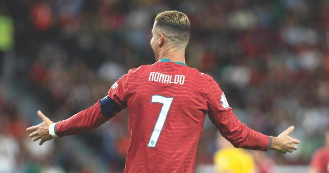

葡萄牙媒体球报发表评论文章，回顾C罗国家队生涯的告别方式，指出这位41岁的球星虽未以理想中的方式告别，但其留下的记忆与进球将长久留存。

我们曾想象过另一种场景。一座座无虚席的球场。一场真正的比赛。当然还有C罗进球。因为即便在告别时刻，我们仍要求他进球。然后，那件国家队球衣紧贴身体，那一刻，一个男人望向看台，意识到自己已无需再奔跑。他可以留在那里。我们在等待。

但事情并非如此。留下的是一段视频。在此之前，是挪威的一场替补席、一次未获出场机会的热身、一些C罗声称被断章取义的话语，以及一次离开集训营。最后一场比赛早已发生。没有人知道那竟是最后一场。这始终是此类结局中最令人悲伤的部分。有时，生活在我们身处别处时关上了门。

可以肯定，这并非C罗梦想中的告别。但他也参与书写了它。而许多曾将他奉若神明的人，在某一刻也乐于解读文本以将他钉上十字架。正是那些以压倒性优势战胜温和与审慎的极端。因为人群唯一比捧起偶像更喜欢的，就是看他坠落。有些人接近一位伟大球员的衰落时，带着终于在失业队伍里找到一个富人的喜悦。仿佛变老是一种认罪。仿佛时间终于证明他们一直是对的。

法尔考，巴西足球的明星之一，曾说球员会死两次。第一次是当他停止踢球时。无论他是谁。这话来自一位曾掌控1982年巴西中场、至今仍被视为罗马历史上最伟大球员之一的人。他在认识足球之前就认识了它的缺失。同一句话的另一半，同样出自法尔考，揭示了爱不再被回应的残酷：“不是球员离开足球。是足球离开我们。”

C罗多年来一直在与这第一次死亡抗争。他早早到场。训练更多。拒绝一份甜点、一个睡不好的夜晚、一个没有额外训练和休息的下午。这种固执中有某种令人感动的东西。这个男人举起杠铃，如同把柜子抵在门上阻止窃贼进入。很长时间里，这奏效了。某种程度上，仍然奏效。41岁的他，在沙特阿拉伯每打进一记精准射门，就更接近千球。但窃贼仍在门外。耐心等待。

终点可以推迟。避免它则是另一回事。某一刻，双腿仍然服从，进球仍然出现，但位置已在改变。教练看向替补席。一个年轻人开始热身。足球甚至不需要夺走我们的球。只需不再承诺下一个球属于我们。

这场离开始终看似难以平静。不仅因为C罗的性格。也因为我们围绕他构建的世界。多年来，他负责解决整支球队的问题。他拯救教练免于尴尬的解释。他给予队友比自身能力更宏大的夜晚。当一个男人如此频繁地做到这些，最终会把感激与既得权利混为一谈。

缺点并非现在才有。一直存在那种恼怒——他似乎认为每一个偏离他路线的球都是小小的不公。然后他打进两球。或三球。球场起立，争论平息。

安切洛蒂曾描述与这位职业球员共事的轻松。齐达内也懂得理解他，并借其羽翼在皇马赢得三连冠。无需否认他们来承认问题。有努力、智慧和对胜利的强烈渴望。也有足够的进球让许多事情变得可忍受。足球在赢球时有着格外灵活的 morals。

这是一种共同的教育。他滋养了球队。球队滋养了一切都靠他的观念。现在要求他安静地坐下，接受自己只是众多可能性之一，等于要求一个男人在不换工作的情况下学会另一种职业。他应该做到吗？应该。但谈论别人总是更容易。

本周的视频有一种其他时刻所缺乏的尊严。C罗谈论国家队。谈论人民。谈论远离家乡的葡萄牙人。国家在那里。他在葡萄牙的足迹。分歧被排除在外，这很好。它不解决已发生的事。也不需要。告别不是法庭，无需带证人证明谁先开始。

与若热-热苏斯的问题可能加速了结局，但并未创造深渊。C罗本人承认，他在世界杯后写下了告别信。在国家队结束旅程的感受在近期事件之前就已存在。但它存在。只有他知道那张纸在内心藏了多久。

无需赦免他来感到悲伤。也无需谴责热苏斯来感谢C罗。有一天我们将能谈论这些岁月，而不把每段回忆变成对队长赞成或反对的投票。现在仍难。争论近在眼前。我们几乎看不见球场。

但我们会看到的。对瑞典的三球。对西班牙的三球。以及许多其他进球。那些葡萄牙显得渺小而他拒绝接受这一尺度的夜晚。这些将留存。争议只有一罐打开的饮料的保质期。记忆靠别的东西滋养。

正如法尔考所说，球员会死两次。但有些作品继续在看过它们的人眼中呼吸。C罗将离开球场。足球将继续在我们每个人心中寻找他。

特别声明：以上内容(如有图片或视频亦包括在内)为自媒体平台“网易号”用户上传并发布，本平台仅提供信息存储服务。

Notice: The content above (including the pictures and videos if any) is uploaded and posted by a user of NetEase Hao, which is a social media platform and only provides information storage services.

足球印象CC 2026-11-06 20:31:51

青山入怀u 2026-11-07 06:52:28

翰飞观事 2026-11-07 09:47:04

咪咕体育 2026-11-07 08:31:17

为了更好 2026-11-07 04:39:25

足球印象CC 2026-11-05 21:32:14

足球印象CC 2026-11-06 21:01:18

足球印象CC 2026-11-07 13:04:11

oo烛光透影 2026-11-07 03:06:48

祭怀莲 2026-11-07 04:51:47

足球印象CC 2026-11-06 16:03:39

风过乡 2026-11-07 18:06:25

商道人物志 2026-11-07 02:06:57

脑洞编剧小剧场 2026-11-06 01:53:56

燕子向往远方 2026-11-04 16:03:49

异环 2026-11-05 00:51:17

爆笑柴柴 2026-11-05 15:33:58

笨尼尼子 2026-11-07 09:15:39

足球印象CC 2026-11-06 11:01:13

纵使风吹 2026-11-07 04:38:55

浅夏安然n 2026-11-07 07:35:12

薛艳艳爱生活 2026-11-07 11:23:59

惊鸿照影b 2026-11-07 07:35:57

足球印象CC 2026-11-07 15:59:15

搞笑事务所 2026-11-05 10:54:49

肆无忌惮的哭 2026-11-05 04:31:45

陌上初安j 2026-11-06 06:28:01

心开动漫 2026-11-07 04:28:29

哀伤入骨i 2026-11-06 03:15:29

青山入怀u 2026-11-05 23:49:06

青树柠檬q 2026-11-07 01:11:13

一个香蕉说球 2026-11-06 01:27:45

君马体育 2026-11-05 22:15:19

咪咕体育 2026-11-07 08:31:08

冷饭说球 2026-11-07 11:02:49

蜡笔足球 2026-11-06 11:33:19

精彩背后的故事 2026-11-06 04:28:45

云汐乐娱 2026-11-06 14:43:27

商道人物志 2026-11-07 02:06:43

精灵之舞z 2026-11-06 01:34:45

## 配图

图：足球（网易体育 · 2026-11-07）

## 来源

- [网易体育 · 原文](https://www.163.com/dy/article/LB5I6DA60549BAP0.html)
