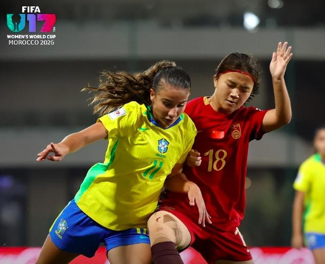

11月2日凌晨，U17女足世界杯1/4决赛上演，中国队对阵巴西队。在1-0领先后，中国队被对手连进2球。最终，中国队1-2落败，无缘4强。不过，巴西队的第2个进球有犯规嫌疑。

1/8决赛中，中国队通过点球大战淘汰了法国队，对手首次打进U17女足世界杯的8强，创造历史。今日对阵巴西队，中国队的小姑娘希望再进一步。

第42分钟，吴逸晨前场拿球，在左路开始个人强吃模式，打爆了对方的后卫，强行射门得手，中国队1-0领先。

第47分钟，巴西队右路传中，中国队在禁区里的防守陷入混乱。最终，巴西队在乱战中破门，1-1。

此后，两队陷入拉锯战，眼看常规时间就要结束，巴西队上演了绝杀。第87分钟，巴西队右路传中，后卫在后门柱头球摆渡，海伦娜-维埃拉门前包抄，推射破门，2-1！

慢镜头显示，巴西后卫在头球摆渡前有一个明显的推人动作，但裁判没有表示。

最终，中国队1-2不敌巴西队，无缘4强。中国球员赛后显得很沮丧，但她们配得上掌声。

中国球迷对本场比赛的美国裁判提出抗议：“巴西进的第二个球，下底传中争顶的明显推人，裁判无视。”、“美国裁判眼瞎，对中国赢美国赤裸裸的报复。”

特别声明：以上内容(如有图片或视频亦包括在内)为自媒体平台“网易号”用户上传并发布，本平台仅提供信息存储服务。

Notice: The content above (including the pictures and videos if any) is uploaded and posted by a user of NetEase Hao, which is a social media platform and only provides information storage services.

参考消息 2026-10-31 20:35:09

学申论的谈妹 2026-11-01 18:30:49

政知新媒体 2026-11-01 15:18:21

大众网 2026-11-01 11:59:06

中安在线 2026-11-01 18:59:39

江南晚报 2026-11-02 03:24:02

新京报 2026-11-01 11:46:23

江南晚报 2026-11-01 12:18:22

都市快报橙柿互动 2026-11-01 17:38:51

掌上春城 2026-11-01 16:17:22

新华社 2026-11-01 23:45:17

环球网资讯 2026-11-01 17:25:17

界面新闻 2026-11-01 18:33:51

极目新闻 2026-11-01 17:47:52

环球网资讯 2026-11-01 13:23:33

新华社 2026-11-01 20:18:28

金台资讯 2026-11-02 06:11:34

## 配图

图：足球（网易体育 · 2026-11-02）

## 来源

- [网易体育 · 原文](https://www.163.com/dy/article/LAN8ETDS05566VBM.html)
