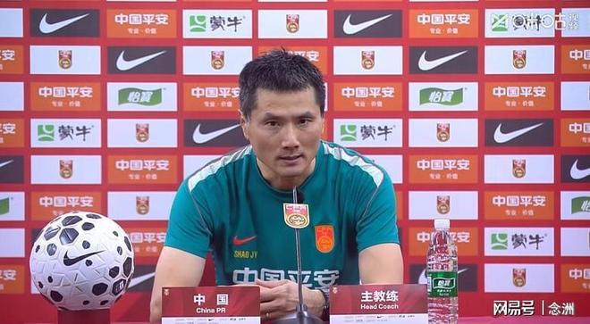

国足2-2战平巴林，两场不败结束2026年的所有比赛，主教练邵佳一执教一年，取得10场4胜2平4负的成绩。赛后，他出席赛后发布会，对于上半场的糟糕表现主动担责，并且表扬了球员。

邵佳一开场白说道：“大家晚上好，我相信今天大家都能感受到这个肯定是一场非常激烈的比赛，双方都奉献了很好的45分钟。但是确实我们也需要总结的地方就是我们在开场的时候不是很兴奋，和我们第一场形成一个大的反差，第一场反而是我们前30分钟非常的好。”

“这场是我们后60分钟占据了绝对的主动。我对队员，所有队员的表现都很满意。这个从过程上来讲，我们回去还要总结。这个我对队员都是非常满意的。作为教练员，上半场出现那种情况，我肯定要回去要去总结，这也是我的责任。”

“2:2的比分，没有取胜很可惜。但是我觉得这个让我们留一点遗憾，其实是给我们更多的动力，让我们在未来能够变得更好。谢谢大家。”

记者提问：“问一下邵指导，总结一下这两场比赛，是否达到了预期热身的目标？然后也想问一下球队接下来的计划，有没有集中的冬训？”

邵佳一表示：“应该说比赛肯定是，我们的目标是拿到6分，两场比赛能够取胜，这是我们的目标。但是确实很可惜，没有拿到。但是从过程上来讲，我觉得还是达到了我们队练兵的这种这种效果，包括下半场我们能够持续的保持的压力。”

“上半场我也跟队员在说，我们持续的保持这样的节奏，对手是跟不上我们的。当然了，我们的联赛，30轮结束，这可能也是一个原因，大家确实这个从身体上、从心理上在一个疲劳的阶段。但是还是我上次新闻发布会之前说的，这些队员已经非常棒了，我不可能要求他们更多了，这个每一个人在场上都全力以赴，注意力非常集中的去专注在比赛场上。”

“当然肯定我们还会有很多继续提升的空间，这是毋庸置疑的。但是我觉得单从，这次这两场比赛来看，我觉得我们肯定达到了这个我们的要求，我们的设想。”

“除了比分不完美，我觉得其他的都还不错的，冬训我们回去要和协会要去商量，我当然还是希望能够国家队能够有一定的时间，像今年年初一样，在不影响各个俱乐部备战的情况下，还是希望能够给我们的球员，给我们的年轻队员，能够有更多的这种训练的机会、磨合的机会。”

记者提问：“邵指导，就是您带国家队一年了，这一年您的体验怎么样？然后让您最印象深刻的是什么？”

邵佳一表示：“这个今天我们准备会的时候，我跟队员也在说啊，我们希望我们中国人讲究善始善终，开头在肇庆，2026年的最后一期也在肇庆。我们也希望能够带着一个满意的结果，高高兴兴的离开这。这个这一年确实对我还是这个成长帮助还是很大的，从年初我们的集训。然后到年中，再到年尾，我们每一个阶段也让我更加认识到了这个国家队球员在不同时期我们的状态。”

“这个如果你不在这个位置上，你确实很难能够知道，你也很难能够做出，在未来能够做出及时的调整。所以这一年对我来讲是非常宝贵的。这一年我也感谢我们球迷们各界对我的工作的支持，确实我的工作我自己觉得还是非常不够的，但是大家还是给了我很多的支持。我也能感受的到。我的这些小伙子们，我的团队非常的棒，他们能够始终在我身后对我这个毫无保留的支持。刚才说了，就跟这场比分一样，肯定是不完美的，所以这才是我们未来的动力。最印象深刻的啊。”

“印象深刻肯定是好的事情，印象深刻肯定是我们第一场赢库拉索那场，我希望我们能够持续有这样的体验，让这种胜利能够成为中国国家队常。一种常态。我们也为了这个目标竭尽全力。”

记者提问：“主教练想再问一下，就是从后面一阶段来看的话，您觉得现在这个球队，这几场比赛表现出来的结果，有哪些方面是最需要提高的？”

邵佳一说道：“应该是我们对真正的国际比赛的这种对抗性。这个不光是我，我相信大家也都能看得到，我的队员最能体会到。这种国际的比赛和真实的我们在联赛当中的节奏是不一样的，这个是事实。所以我改变不了这个大环境，这是实话。”

“但是我会尽我最大的可能性去改变我们的国家队，会让我们这支团队能够在每一个阶段，不同时刻。都能够保持像他们这两场比赛这种昂扬的斗志，这种拼搏的精神，包括在场上这种团队性、组织性、整体性、纪律性。这个就是我在接下来的需要改进的地方。”

特别声明：以上内容(如有图片或视频亦包括在内)为自媒体平台“网易号”用户上传并发布，本平台仅提供信息存储服务。

Notice: The content above (including the pictures and videos if any) is uploaded and posted by a user of NetEase Hao, which is a social media platform and only provides information storage services.

懂球帝 2026-11-17 22:50:06

Leslie潘伟力 2026-11-18 00:17:37

亿点点不一样 2026-11-16 01:09:56

他想要很多很多的梦 2026-11-18 06:04:50

体育吐槽 2026-11-17 14:48:33

脑洞编剧小剧场 2026-11-18 02:30:20

邻家二蛋不靠谱 2026-11-18 02:30:26

风过乡 2026-11-18 00:55:04

我们的主场 2026-11-18 00:15:17

守你如初p 2026-11-18 01:57:34

烟寒若雨s 2026-11-18 01:53:28

老牧说说 2026-11-18 04:47:05

澎湃新闻 2026-11-15 10:38:23

广东体育频道 2026-11-17 01:32:53

足球印象CC 2026-11-16 18:01:58

啊哒体育 2026-11-18 03:06:31

我想把最好的一面展现给你 2026-11-18 06:03:00

足球印象CC 2026-11-15 17:23:27

为了更好 2026-11-18 02:53:12

小朋友手工 2026-11-15 07:22:10

极度说球 2026-11-17 21:12:50

篮球过人技巧 2026-11-15 17:24:54

残梦断忆 2026-11-15 13:42:34

大海体娱 2026-11-16 11:07:33

徐骧老表哥 2026-11-17 22:52:56

曹操篮球解说 2026-11-16 10:56:16

我们的主场 2026-11-18 01:12:24

带你领略世界风采 2026-11-17 16:51:53

懂球帝 2026-11-18 06:09:25

懂球帝 2026-11-18 06:22:13

浅夏安然n 2026-11-18 01:25:38

大伟笑场 2026-11-16 08:32:35

极目新闻 2026-11-17 15:57:30

悲欢自饮v 2026-11-17 01:06:18

北青网-北京青年报 2026-11-17 14:35:09

老涺学科普 2026-11-16 03:39:47

人民网-人民日报 2026-11-18 05:42:09

大风新闻 2026-11-17 08:52:07

生活超有趣 2026-11-15 19:43:00

冰心说影 2026-11-15 12:38:24

## 配图

图：综合（网易体育 · 2026-11-18）

## 来源

- [网易体育 · 原文](https://www.163.com/dy/article/LC0FRISB0553AOVQ.html)
