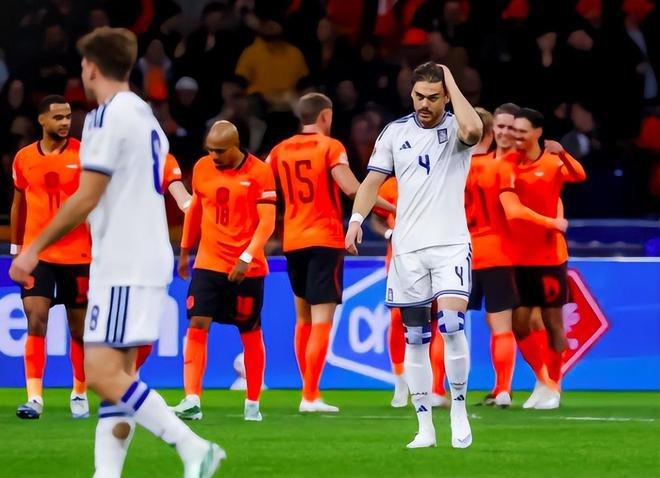

11月14日凌晨，欧国联A2组第5轮焦点大战，荷兰对阵希腊。比赛中，荷兰火力全开，半场就打进5球。最终，荷兰7-0大胜希腊，后者遭遇88年来的最耻辱一战。

前4轮，两队都是8分。此役，双方争夺小组头名。荷兰目前排名世界第9，而希腊则是世界第41。开场后，主场作战的荷兰疯狂施压。裁判哨响6分钟后，萨默维尔禁区内抽射破门，荷兰1-0领先。

第12分钟，莱茵德斯小角度射门得手，荷兰2-0领先了。第18分钟，马伦传中，莱茵德斯包抄得分，荷兰3-0，比赛已经失去了悬念。

第33分钟，荷兰队打出精妙的配合，莱茵德斯打空门得手，荷兰4-0。在短短21分钟的时间里，莱茵德斯上演了帽子戏法。

第40分钟，马伦右路传中，队友廷伯抢点破门，比分变成了5-0。

下半场，荷兰队没有使出全力。第59分钟，廷伯打空门得手，梅开二度，荷兰6-0。

第61分钟，邓弗里斯助攻马伦破门，比分来到了7-0。此后，荷兰队不再进攻。

全场比赛，荷兰队控球率53%，射门17次，射正13次，得分机会9次，希腊队则是射门9次，1次射正。希腊队37年来首次单场丢7球，也遭遇了88年来的最惨失利。1938年，希腊曾1-11输给匈牙利。

46岁的荷兰主帅哈维迎来了生涯第二大胜利。此前，在萨德队执教的时候，哈维曾率队8-0击败对手。

特别声明：以上内容(如有图片或视频亦包括在内)为自媒体平台“网易号”用户上传并发布，本平台仅提供信息存储服务。

Notice: The content above (including the pictures and videos if any) is uploaded and posted by a user of NetEase Hao, which is a social media platform and only provides information storage services.

懂球帝 2026-11-14 06:00:24

懂球帝 2026-11-13 16:55:49

足球推文C 2026-11-13 16:10:46

懂球帝 2026-11-09 05:04:55

甜度百分百21 2026-11-14 04:38:26

懂球帝 2026-11-13 19:34:49

懂球帝 2026-11-14 04:44:09

懂球帝 2026-11-13 22:44:33

懂球帝 2026-11-14 06:00:23

小彭美识 2026-11-14 05:52:32

懂球帝 2026-11-14 05:37:50

足球狗说 2026-11-14 06:07:07

足球狗说 2026-11-14 05:35:41

足球推文C 2026-11-13 20:34:22

左脚爆射得分 2026-11-12 11:38:02

球事百科吖 2026-11-14 06:22:11

咪咕体育 2026-11-12 03:08:05

米奇兔 2026-11-13 13:58:52

体育吐槽 2026-11-11 17:33:01

我们的足球记忆 2026-11-13 02:05:51

凉城若梦h 2026-11-14 00:13:17

一个香蕉说球 2026-11-13 04:55:42

杰出清莲 2026-11-12 11:04:34

看你像个宝 2026-11-13 17:37:56

一个香蕉说球 2026-11-13 04:55:30

陈赩爱体育 2026-11-11 18:41:05

狍子歪解体坛 2026-11-13 06:27:05

狍子歪解体坛 2026-11-13 06:25:09

风霜侃球 2026-11-12 12:23:43

咪咕体育 2026-11-12 03:11:05

球事百科吖 2026-11-14 06:25:03

球事百科吖 2026-11-14 06:23:45

新华社 2026-11-12 09:45:39

狍子歪解体坛 2026-11-13 07:03:12

不知见闻社Iris 2026-11-12 13:08:57

小山的篮球 2026-11-12 12:32:52

狍子歪解体坛 2026-11-13 06:32:13

懂球帝 2026-11-14 06:00:24

懂球帝 2026-11-14 05:37:50

林间小温柔 2026-11-14 06:21:26

## 配图

图：综合（网易体育 · 2026-11-14）

## 来源

- [网易体育 · 原文](https://www.163.com/dy/article/LBM5T30U05566VBM.html)
