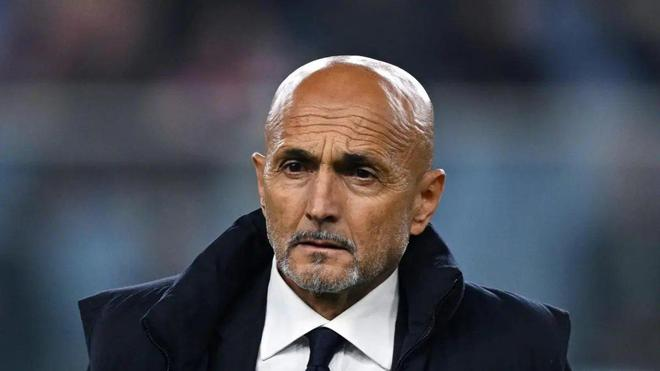

尤文图斯2-2战平佛罗伦萨后，主教练斯帕莱蒂接受采访，谈到了球队表现、穆阿尼与沃尔特马德的锋线配合，以及若昂-马里奥在禁区内手球引发的争议。

斯帕莱蒂认为，球队目前最突出的问题是缺乏稳定性。

“我们有时候会被一杯水淹没。随后，我们在比赛中的信心和从容就会受到影响。比赛刚开始不久，我们就丢了球。之后球队作出了不错的回应，但无论是个人表现还是整体配合，我们都无法保持稳定。我们可以踢好10分钟，但随后就会缺少一些东西。有时候，球队会选择接受现状，而不是主动作出选择并采取行动。关键在于作出选择并将其付诸实施，这样才能摆脱疑虑。如果始终停留在怀疑之中，你就会一直犹豫不决，最终也无法赢得重要的东西。”

谈到穆阿尼与沃尔特马德的锋线组合，斯帕莱蒂解释了自己的战术考虑。

“之所以作出这样的安排，是因为对手会对你实施逼抢，有时候你必须直接把球交给中锋。沃尔特马德展现出了一些更强的特点，尽管背身拿球并不是他的主要优势。不过，这项工作仍然需要他自己去完成。穆阿尼现在的状态好多了。随着状态恢复，无论被安排在哪个位置，他都能有所表现。他过去的跑动相对较少，现在跑得更多了，我认为他的特点也因此变得更加鲜明。”

最后，谈及若昂-马里奥在禁区内的手球争议，斯帕莱蒂表示：“我不知道，也不想再看一遍。我在场上已经看到了。”

特别声明：以上内容(如有图片或视频亦包括在内)为自媒体平台“网易号”用户上传并发布，本平台仅提供信息存储服务。

Notice: The content above (including the pictures and videos if any) is uploaded and posted by a user of NetEase Hao, which is a social media platform and only provides information storage services.

懂球帝 2026-11-08 20:01:19

懂球帝 2026-11-08 20:23:19

侧身凌空斩 2026-11-09 05:47:27

侧身凌空斩 2026-11-09 05:44:30

懂球帝 2026-11-09 05:49:04

刘家桥 2026-11-09 06:09:00

赛场速报局 2026-11-09 06:27:34

一个香蕉说球 2026-11-08 10:39:17

収起了底线 2026-11-08 02:38:56

侧身凌空斩 2026-11-09 06:08:37

咪咕体育 2026-11-07 08:31:17

爱足球的谢宇宁 2026-11-08 10:40:50

一个香蕉说球 2026-11-08 10:38:19

懂球帝 2026-11-09 06:19:24

一个香蕉说球 2026-11-08 10:33:13

浅夏安然n 2026-11-07 07:35:12

食趣社Taste 2026-11-09 06:11:29

转会窗ProMax 2026-11-06 13:30:57

一个香蕉说球 2026-11-08 10:33:05

爱足球的谢宇宁 2026-11-08 10:40:52

懂球帝 2026-11-09 06:40:14

浩瀚的星河 2026-11-09 05:55:16

几十年老球迷 2026-11-06 23:26:30

爆笑二皮 2026-11-08 09:51:14

超级无敌美少女何 2026-11-08 06:09:28

一个香蕉说球 2026-11-08 10:38:01

懂球帝 2026-11-09 05:49:04

墨史轩 2026-11-07 07:44:23

孤单是寂寞的毒 2026-11-09 03:01:33

领略非凡 2026-11-07 20:15:18

乐享人生风雨 2026-11-08 00:42:34

狍子歪解体坛 2026-11-09 03:30:09

球事百科吖 2026-11-09 06:15:55

球事百科吖 2026-11-09 06:32:07

懂球帝 2026-11-09 06:26:03

一路荒凉如歌a 2026-11-08 02:23:38

墨史轩 2026-11-07 02:25:36

陈赩爱体育 2026-11-08 01:28:32

全力说体育 2026-11-08 08:08:31

墨史轩 2026-11-08 01:03:10

## 配图

图：综合（网易体育 · 2026-11-09）

## 来源

- [网易体育 · 原文](https://www.163.com/dy/article/LB9A3LSJ0549BAP0.html)
