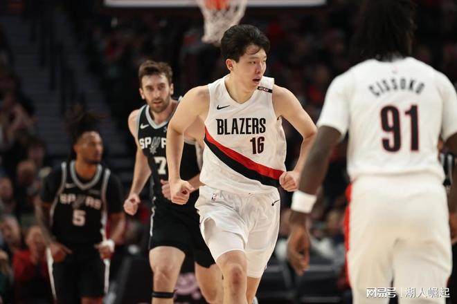

北京时间11月8日，NBA常规赛继续进行，波特兰开拓者队（6胜3负）遭遇连败。文班亚马得到29分和7个篮板，他带领球队6人得分上双，圣安东尼奥马刺队（8胜2负）依靠二三节攻势确立大比分领先，他们在客场以125-103战胜开拓者队。马刺队拿到8连胜，开拓者队遭遇2连败。

马刺队的文班亚马得到29分、7个篮板和3次助攻，瓦塞尔得到15分，卡斯尔得到14分、7个篮板和5次助攻，尚帕尼得到14分和4个篮板，哈珀得到13分和7个篮板，约翰逊得到10分和7个篮板，福克斯得到8分和6次助攻。开拓者队的阿夫迪亚得到15分和4个篮板，亨德森得到13分，利拉德得到12分和7次助攻，霍勒迪得到11分，扬布拉德得到11分，杨瀚森出场26分钟，7投3中，得到生涯首个两双12分、10个篮板、1次助攻和2次失误。

做客的马刺队迅速找到准星，文班亚马和卡斯尔投进3个三分球，他们率队以11-3领先。利拉德突破还击，阿夫迪亚两罚全中，开拓者队在首节还有6分52秒时追至7-12，杨瀚森也替补克林根出场。哈珀转身跳投命中，阿夫迪亚制造犯规，两罚一中，杨瀚森补篮不中。首节还有6分6秒时杨瀚森翼侧出手三分，科内特和瓦塞尔联手4分，马刺队以18-8领先。亨德森突破得手，之后杨瀚森连续收下防守篮板，卡斯尔跳投得分，本节还有3分56秒时霍勒迪突破跳投不中，杨瀚森补篮得手，开拓者队以12-20落后。

杨瀚森随后一次勾手不中，本节还有2分17秒时他造成哈珀犯规，两罚一中，双方相差7分。尚帕尼两罚全中，阿夫迪亚回敬三分结束7-0的反击波，首节结束时开拓者队以20-22落后。

第二节开始后两队你来我往，比分交替增加，布莱恩特三分命中，本节还有8分24秒时马刺队以33-27领先。12秒后杨瀚森再次被换上，亨德森三分不中，争抢篮板时杨瀚森造成约翰逊犯规，两罚全中，之后双方各得几分，卡马拉突破得手，半场前4分10秒时开拓者队以37-44落后。接下来的比赛开拓者队投篮失准，连续打铁，马刺队则连造犯规，科内特、卡斯尔、福克斯和文班亚马罚中10球，他们拉开比分。利拉德罚球暂时止血，文班亚马继续造犯规四罚全中结束9-0的攻击波，马刺队以64-47领先。阿夫迪亚突破得手，半场结束时开拓者队以49-64落后。

马刺队的文班亚马上半场得到16分，尚帕尼得到11分；开拓者队的阿夫迪亚得到10分，利拉德得到9分，杨瀚森得到5分和6个篮板。

双方在第三节开始后对攻几个回合，卡斯尔和福克斯各中三分，马刺队连得7分以77-57领先20分。亨德森突破跳投命中，文班亚马再次开火连拿7分，马刺队领先25分。霍勒迪回应5分止血，本节还有6分6秒时杨瀚森再次替补登场，马刺队又得4分，杨瀚森三分不中，哈珀和瓦塞尔联手6分，马刺队以95-65领先30分。杨瀚森传球给阿夫迪亚时失误，约翰逊突破得手，波特和亨德森合取5分，马刺队外线保持手感，哈珀和尚帕尼各进三分，三节结束时马刺队以109-76领先33分。

最后一节开始后杨瀚森留在场上，本节进行了4分9秒时他翼侧出手三分命中，开拓者队以85-116落后。之后的比赛双方都用替补打完，杨瀚森又突破得分，最终开拓者队以103-125落败。

马刺队首发阵容：福克斯、卡斯尔、哈珀、瓦塞尔、文班亚马

开拓者队首发阵容：利拉德、亨德森、卡马拉、阿夫迪亚、克林根

特别声明：以上内容(如有图片或视频亦包括在内)为自媒体平台“网易号”用户上传并发布，本平台仅提供信息存储服务。

Notice: The content above (including the pictures and videos if any) is uploaded and posted by a user of NetEase Hao, which is a social media platform and only provides information storage services.

破镜难圆 2026-11-08 16:42:00

体育新角度 2026-11-08 17:49:06

阅尽天下大事 2026-11-08 18:27:52

老玮是个手艺人 2026-11-08 18:19:59

体坛周报 2026-11-08 18:58:26

七堇年a 2026-11-06 02:30:39

创造精彩剧情 2026-11-08 03:56:17

泪之魂y 2026-11-06 01:56:57

落雪听梅a 2026-11-08 01:20:25

篮球过人技巧 2026-11-08 01:31:54

聚焦真实瞬间 2026-11-06 22:24:19

星光乐世界 2026-11-06 01:25:09

福娃谈体育 2026-11-08 16:55:04

一路荒凉如歌a 2026-11-06 02:31:01

正经球迷 2026-11-08 09:21:28

各地精彩不容错过 2026-11-08 05:50:52

阿嬍体育评论 2026-11-08 03:30:12

体坛速报局 2026-11-08 10:16:33

一纸情书s 2026-11-08 06:17:29

创造精彩剧情 2026-11-08 03:57:37

随遇而安之心 2026-11-07 05:09:37

一路荒凉如歌aa 2026-11-06 02:10:12

篮球盛世 2026-11-08 14:15:10

董老师看竞技 2026-11-08 16:37:37

一路荒凉如歌aa 2026-11-08 02:01:45

董老师看竞技 2026-11-08 17:26:48

小贤看体育 2026-11-08 13:44:13

领略非凡 2026-11-07 20:21:40

无人倾听无人倾听 2026-11-08 05:18:44

体坛速报局 2026-11-08 14:01:43

德瀚文 2026-11-08 05:47:29

天注定 2026-11-08 01:11:21

体坛速报局 2026-11-08 12:05:07

小叶子侃球FM 2026-11-07 19:05:39

一纸情书s 2026-11-08 06:18:50

十三哥侃大山 2026-11-07 00:59:06

球盲姐 2026-11-08 19:20:36

夜里的海风 2026-11-08 04:15:10

木易聊个球 2026-11-07 13:34:24

飞驰历史 2026-11-08 04:23:46

## 配图

图：综合（网易体育 · 2026-11-08）

## 来源

- [网易体育 · 原文](https://www.163.com/dy/article/LB7BJ65N0529AL9S.html)
