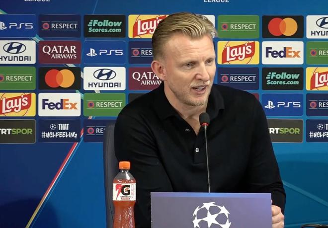

北京时间11月5日凌晨，欧冠联赛阶段第4轮，费内巴切主场3-2逆转利物浦。赛后，费内巴切临时主帅库伊特出席新闻发布会，谈到了本场胜利、球迷的支持以及自己未来是否留队等话题。

自2008年后，费内巴切首次在主场获胜，对手又是一支英格兰球队。当时是切尔西，今天费内巴切击败了利物浦。为了让球迷们享受今晚的欧冠，您能对他们说几句话吗？如果我没记错的话，今天的全场最佳球员是伊斯梅尔-于克塞克。我们看到，在球迷的支持下，费内巴切变得更加强大，球队也全力拼搏。你们是如何准备这场比赛的？对于球迷给予的支持，您想对他们说些什么？

首先，费内巴切时隔18年首次赢下一场欧冠比赛，尤其还是战胜利物浦。也许有些人还记得，我在利物浦效力时穿的是18号球衣，这对我来说是一个特殊的号码。但我之前也说过，就像我告诉球员们的那样，我们在赛前说过，尽管我们处境艰难，但我们有机会在伊斯坦布尔再次创造奇迹。如果能够创造这个奇迹，一切都可能朝着积极的方向改变。

不过，这样的回应必须来自我们自身。首先，我们相信球员，同时也让球员们相信自己。正如我们所说，你必须在正确的时机展现出激情、能量和侵略性。如果你做到了，你们也看到了在卡德柯伊会发生什么。

如果能够营造出这样的氛围，即使是世界上最好的球队也会遇到困难。在我看来，今天的胜利来之不易，但也不是靠运气得来的。我认为我们配得上这场胜利。我们创造了很多机会，一直在战斗，一直在拼搏。而且在我看来，我们是在面对欧洲最好的球队之一时做到这一点的。这就是我的分析。

您也可以谈谈球迷对球员的支持。

这正是我们需要的。我认为今天的全场最佳球员之一是伊斯梅尔，他拿到了这个奖项，踢得很出色。我们会继续信任他，因为他是一名优秀的球员。但另一位全场最佳其实是球迷，我们必须说出这一点。当你们把这种能量汇聚在一起，保持积极的态度并努力拼搏时，世界上没有多少球迷群体能营造出这样的氛围。

我的一些外国朋友也对这里的氛围和力量感到非常惊讶。如果我们每场比赛都能在卡德柯伊展现出这样的能量，而且正如我们所说，我们的客场球迷也非常出色，那么当我们彼此信任、给予彼此支持时，这家俱乐部就能在任何地方赢球，也能一直向上发展。

首先，我们重新回到了这项赛事的竞争当中。我想现在还有一些球队的比赛没有踢完，但我认为我们目前有机会踢附加赛，也还有时间去达到那样的平台和水平。不过，今天最重要的事情其实是为这个赛季剩余的比赛做好准备。球员们做出了非常好的回应，我们取得了一个非常好的结果，正在朝着我们希望在欧冠中所处的位置前进，而下一场比赛也变得更加重要。

我可以说，周日的比赛很重要。球员们会带着非常积极的心情回到萨曼德拉，埃姆雷也可以顺利地开始他的工作。我一直说，这对费内巴切来说是最重要的事情。

在欧冠中继续前进非常重要，但联赛同样是我们的首要任务。我们会继续前进，享受这股力量，但明天我们就需要让球队为周末的比赛做好准备。

您刚才也说了，赛前大家其实更看好利物浦，但您也说过，你们为对阵利物浦做了不同的准备，最终也取得了胜利。当球队打进第三球时，您是什么感受？我想了解一下比赛最后10到15分钟的情况。

正如我们所说，我们踢出了自己的比赛。你们知道利物浦有多么出色，他们有非常优秀的球员，有很棒的球员，所以这对我们来说会是一场艰难的比赛。

我们保持了紧凑的阵型，也在正确的时机很好地进行了逼抢。当我们0-1落后时，我并没有对这场比赛接下来会发生什么感到特别沮丧，也没有害怕或担忧。不过，两次从落后中追赶回来，感觉真的非常棒。球队的精神就在这里。无论发生什么，我们都曾向彼此做出承诺：我们会继续前进，继续为球队和俱乐部而战。

之后我们取得了进球，这也非常重要。因为我们此前对彼此说过：我们以11名球员开始比赛，但最终留在场上结束比赛的球员会决定比赛的结果。对此我非常高兴。罗梅卢-卢卡库为球队做得非常出色。他的性格对球队非常重要，不仅是在球场上，在球场外也是如此。但大家也都知道韦达特有多么重要，他们两个人在一起，以及他们今天在场上的表现，帮助我们赢下了比赛。

我会用英语提问，问题是关于阿奇-布朗的。他在英格兰并不是一名非常知名的球员。如今大家都看到了他的表现，这是否会让他更上一层楼？

这是我们曾经告诉球员们的，也是我和阿奇谈过的事情。对他来说，这是一个很好的机会，一个展现自己的绝佳机会。因为当你在欧冠中出场时，你面对的是最好的球队，也就获得了在最好的球队面前展现自己的机会。

你们知道，在土耳其，大家都知道他是一名多么出色的球员。现在，他有机会在一支非常优秀的球队面前展现自己。我认为他做得非常出色，防守工作很好，向前跑动也很好，我对他的表现非常满意。我对所有球员都非常满意，对他们每个人的表现都非常满意。

首先祝贺您。我想问的是，在很短的时间里，我们看到了球队发生了很多变化。今天上场的球队非常拼搏，您赛前说话也很有信心，说过“我们会赢”，还说“我们有惊喜”，最终也兑现了。在这么短的时间里，发生了什么变化？另外，赛前您和埃姆雷-贝勒兹奥卢见过面吗？他好像向您送上了祝福。你们有没有就战术或者其他事情进行过交流？您希望继续和埃姆雷-贝勒兹奥卢共事吗？据我了解，您会和管理层谈过之后再做决定。您希望留下来吗？您希望和埃姆雷-贝勒兹奥卢一起工作吗？

首先，问题太多了。第一个问题是什么？我忘了第一个问题。

我还是先从关于我们新任主教练的问题说起吧。我们曾经有机会一起踢了很长时间的球，也一直保持着友谊。最近几个月、几年，我们之间的交流并不多，但如果你们是真正的好朋友，这些就并不重要。我的工作就是全神贯注于今晚的比赛。正如我昨天说过的，我们一起开了一些会，我承担起了自己的职责，俱乐部希望我在今天担任主教练。

昨晚，俱乐部宣布埃姆雷成为新的主教练。今天早上我们见了面，彼此拥抱，我当然向他表示了祝贺，他也祝我好运。

我们稍微聊了一下俱乐部的情况，但没有谈论战术。他祝我这场比赛好运，我也告诉他，他的球队会有好的表现，会让他有一个好的开局。至于明天和之后会发生什么，我们会拭目以待。

首先，我非常高兴。我必须再次说，主席给了我这个机会，给了我来到这家伟大俱乐部的机会。他在赛季初邀请我来到这里。只要他希望我继续留在俱乐部，而且埃姆雷也同意，我就会继续留在这里。但库伊特并不是这里最重要的人，我们必须做对俱乐部最有利的事情。我想留下来吗？我想待在这里吗？当然想。我非常热爱这家俱乐部。

但正如我们所说，我们必须为费内巴切做正确的事情。我在这方面信任主席，我们之间的关系非常好。无论他做出什么决定，我都相信我们会找到自己的道路。但最重要的是，费内巴切今后会继续向前、向上发展，不仅是在欧冠，在土耳其联赛中也是如此。周末我们又要迎来一场重要的比赛，我们必须继续前进。

在伊斯梅尔-卡尔塔尔执教期间，贡多齐更多踢中场最靠后的位置。有时候我们甚至会看到他成为第三名中后卫，他会来到两名中后卫之间。坦率地说，从赛季开始以来，他的表现也受到了一些批评。今天我们看到他踢在中场更靠前的位置，位于伊斯梅尔和坎特身前。他也负责带领球队进行前场逼抢，有时候在逼抢对方后防线时，他甚至会来到前锋的身前。您是和贡多齐商量之后做出这个决定的，还是说这是您此前在观察比赛时就认为有必要做出的调整？

正如我们所说，我非常了解利物浦，我们队里也有很多高水平的球员。我们研究了自己的比赛计划，考虑如何创造机会去击败利物浦。很快我们就意识到，我们需要一个非常强大的中场，所以决定让伊斯梅尔、坎特和贡多齐一起出场。比赛中，伊尔凡的位置更靠内，他也在努力为阿奇-布朗创造更多空间。

我们拥有一个非常强大、紧凑的中场。我们希望伊斯梅尔和坎特两个人都待在中后卫身前。我认为马特奥是一名非常出色的球员，我们能看到有人批评他，但我认为有很多球员都受到了批评。

我们一直在努力拿出比过去几周更好的表现，这与我们彼此之间的信任和信心有关。我认为马特奥今天的表现非常出色，而伊斯梅尔、坎特和马特奥之间的配合对此也产生了很大的影响。他和罗梅卢-卢卡库之间也形成了配合。我们研究了应该如何防守、如何保持阵型紧凑，也希望在正确的时机进行非常有侵略性的逼抢。这些决定都是我们一起做出的。

我们看到了马特奥非常出色的表现。说实话，当计划奏效、你有信心，而且球迷在你身后支持你时，足球就会变得容易得多。

特别声明：以上内容(如有图片或视频亦包括在内)为自媒体平台“网易号”用户上传并发布，本平台仅提供信息存储服务。

Notice: The content above (including the pictures and videos if any) is uploaded and posted by a user of NetEase Hao, which is a social media platform and only provides information storage services.

懂球帝 2026-11-05 05:54:17

懂球帝 2026-11-04 20:13:22

狍子歪解体坛 2026-11-05 03:40:32

侧身凌空斩 2026-11-05 03:47:30

老斉科普君 2026-11-05 04:16:49

侧身凌空斩 2026-11-05 05:58:36

懂球帝 2026-11-05 05:01:44

懂球帝 2026-11-05 04:00:01

足球印象CC 2026-10-31 20:31:22

奶糖甜心Cutie 2026-11-05 02:41:25

钉钉陌上花开 2026-11-05 06:21:53

绿荫杂谈视频播客 2026-11-03 16:38:17

足球人物往事 2026-11-01 22:32:59

精彩背后的故事 2026-11-03 03:08:47

众生的世界观 2026-11-03 21:33:36

HC王楚淇 2026-11-03 16:23:25

狍子歪解体坛 2026-11-05 05:59:02

一个香蕉说球 2026-11-03 16:07:38

AI小屋的日常随笔 2026-11-02 22:27:13

独特l 2026-11-03 07:51:18

甜度百分百21 2026-11-05 05:57:55

左脚爆射得分 2026-11-04 10:31:29

一个香蕉说球 2026-11-03 16:12:38

精彩背后 2026-11-02 08:34:54

左脚爆射得分 2026-11-04 10:54:27

懂球帝 2026-11-05 03:59:58

AI小屋的日常随笔 2026-11-03 20:11:51

一个香蕉说球 2026-11-03 16:12:27

爱足球的谢宇宁 2026-11-03 16:23:09

阿超他的体育圈 2026-11-04 05:49:22

阿超他的体育圈 2026-11-04 06:12:41

罗氏看球 2026-11-04 09:39:51

Shoot体育 2026-11-04 11:37:20

RT今日俄罗斯 2026-11-04 12:35:56

咪咕体育 2026-11-04 23:16:16

墨史轩 2026-11-04 01:50:54

墨史轩 2026-11-03 03:50:26

足球印象CC 2026-11-04 13:48:22

墨史轩 2026-11-04 01:49:25

墨史轩 2026-11-04 01:47:36

## 配图

图：综合（网易体育 · 2026-11-05）

## 来源

- [网易体育 · 原文](https://www.163.com/dy/article/LAUVM01L0549BAP0.html)
