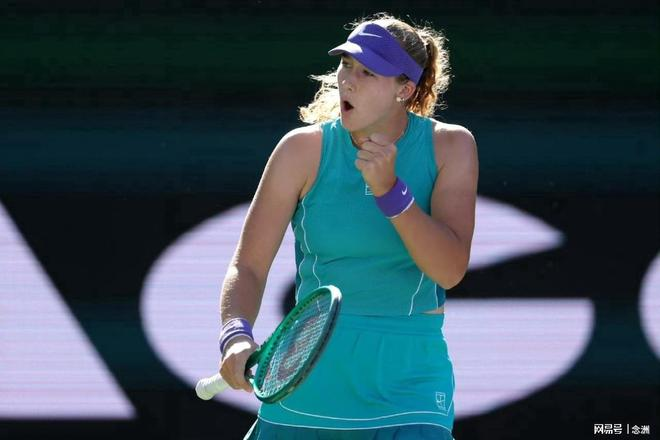

2026赛季WTA年终总决赛女单决赛落幕，19岁的米拉·安德列娃以7-5、6-3直落两盘击败乌克兰老将斯维托丽娜，职业生涯首次出战年终总决赛便拿下冠军。

这场对决本就是小组赛恩怨延续：小组赛首轮安德列娃就以6-4、6-0横扫斯维托丽娜，当时双方就没有完成握手环节；决赛再度相遇，不少球迷赛前就预判到场面可能尴尬。

比赛进程里，首盘双方拉锯到最后关头，安德列娃顶住对手回破压力拿下7-5；第二盘安德列娃延续进攻节奏，稳稳以6-3锁定胜局。

本届赛事五战全胜、一盘未丢，豪取赛季第4冠、生涯第7冠，收获1500积分、337万美元奖金，年终排名锁定世界第二，创造属于自己的青春奇迹。

比赛结束后，斯维托丽娜没有上前握手，也没有给出祝贺，而是直接转身坐回场边的球员休息椅，安德列娃则先与裁判礼貌握手，然后留在原地完成庆祝。

网球赛场素来把赛前赛后握手、尊重对手视作基本体育礼仪，不过由于俄乌冲突的原因，斯维托丽娜一直拒绝与俄罗斯、白俄罗斯选手合影、握手，这次总决赛的大合影也因此取消。

特别声明：以上内容(如有图片或视频亦包括在内)为自媒体平台“网易号”用户上传并发布，本平台仅提供信息存储服务。

Notice: The content above (including the pictures and videos if any) is uploaded and posted by a user of NetEase Hao, which is a social media platform and only provides information storage services.

澎湃新闻 2026-11-15 18:11:16

扬子晚报 2026-11-11 07:52:23

证券时报 2026-11-15 19:13:02

上观新闻 2026-11-15 23:09:58

央视新闻客户端 2026-11-15 17:26:33

海报新闻 2026-11-15 11:03:04

第一财经资讯 2026-11-15 21:05:08

上观新闻 2026-11-16 04:15:19

海峡导报社 2026-11-15 07:52:07

齐鲁壹点 2026-11-13 07:32:57

人民网 2026-11-15 07:07:16

都市快报橙柿互动 2026-11-16 06:40:03

天津生活通 2026-11-16 06:11:20

无线徐州 2026-11-16 06:05:08

## 配图

图：综合（网易体育 · 2026-11-16）

## 来源

- [网易体育 · 原文](https://www.163.com/dy/article/LBRB2I3U0553AOVQ.html)
