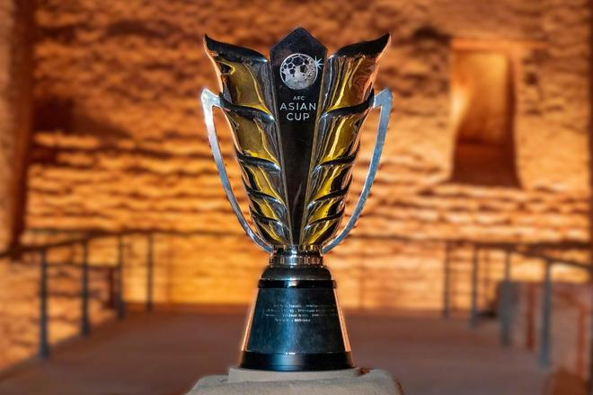

北京时间11月3日，亚足联官方发布公告，原定2027年1月举行沙特亚洲杯将延期至2027年12月23日至2028年1月21日举行。

经与2027年沙特阿拉伯亚洲杯赛事组委会（LOC）及沙特阿拉伯足球协会（SAFF）进行广泛讨论与密切磋商后，亚洲足球联合会（AFC）今日确认，原定于2027年1月7日至2月5日举办的新一届亚洲杯——将延期至2027年12月23日至2028年1月21日举行。

亚洲杯组委会已批准对这一旗舰级国家队赛事进行改期，原因是受地区局势发展影响，当前面临特殊情况，包括重大后勤复杂性及交通出行受阻。新的赛事日期将提交国际足联批准。

原定赛程下，赛事的组织与交付已面临非常规困难，出于对所有参赛球队、官员、观众及其他相关方利益的考量，延期实属必要。

亚足联对沙特足协及组委会致力于为亚洲球员和球迷呈献一届世界级赛事的承诺表示赞赏。亚足联将继续与组委会、各参赛会员协会、赞助商、转播及商业合作伙伴以及所有相关方紧密合作，确保呈献一届与亚洲最高规格男子国家队赛事地位及卓越运营水准相匹配的顶级赛事，同时尽力将延期带来的影响降至最低。

后续信息将通过亚足联官方渠道发布。

中国队在之前举行的亚洲杯抽签分组仪式中被抽入C组，同组对手为伊朗、叙利亚、吉尔吉斯斯坦。

特别声明：以上内容(如有图片或视频亦包括在内)为自媒体平台“网易号”用户上传并发布，本平台仅提供信息存储服务。

Notice: The content above (including the pictures and videos if any) is uploaded and posted by a user of NetEase Hao, which is a social media platform and only provides information storage services.

中国足球的那些事儿 2026-11-03 18:32:43

开屏新闻客户端 2026-11-02 00:10:33

爱笑的瓜姐 2026-10-31 19:58:50

悲欢自饮v 2026-11-03 06:32:30

刀锋体育 2026-11-03 19:33:34

汪星人哟 2026-11-03 19:16:11

RT今日俄罗斯 2026-11-03 17:09:50

地球知识局 2026-08-10 17:55:12

军武时间线 2026-11-02 12:20:40

邻家二蛋不靠谱 2026-11-03 02:43:31

左脚爆射得分 2026-11-03 11:11:43

足球印象CC 2026-10-30 08:48:21

搞笑千世界 2026-11-02 16:10:21

车马点兵V 2026-11-02 09:53:19

扬子晚报 2026-11-03 07:20:39

新京报政事儿 2026-11-02 22:21:04

看看新闻Knews 2026-11-03 00:15:06

米老师说台球 2026-11-02 21:35:43

南北饭斗罗 2026-11-02 11:50:00

雅儿姐爱追剧 2026-11-01 11:20:25

星夜涟漪 2026-11-03 10:35:13

懂球帝 2026-11-03 19:07:26

周说风云 2026-10-31 20:03:00

齐鲁壹点 2026-11-03 07:37:16

马克餐饮日记 2026-11-01 04:27:40

车马点兵V 2026-11-03 10:13:51

一个香蕉说球 2026-11-03 16:07:43

徐竦解说 2026-11-02 00:12:26

热心市民谣淼 2026-11-03 13:06:08

米老师说台球 2026-11-02 21:34:25

李玄清 2026-11-02 15:52:10

德林情感 2026-11-03 15:25:05

小鱼有事说 2026-11-02 22:05:41

米老师说台球 2026-11-03 18:34:04

明媚如初k 2026-11-03 12:45:48

中国新闻周刊 2026-11-03 15:40:29

南方都市报 2026-11-03 18:03:00

懂球帝 2026-11-03 19:07:26

千羽解读 2026-11-03 19:07:16

阿嬍体育评论 2026-11-02 02:24:26

## 配图

图：综合（网易体育 · 2026-11-03）

## 来源

- [网易体育 · 原文](https://www.163.com/dy/article/LAQLAV220549BAP0.html)
