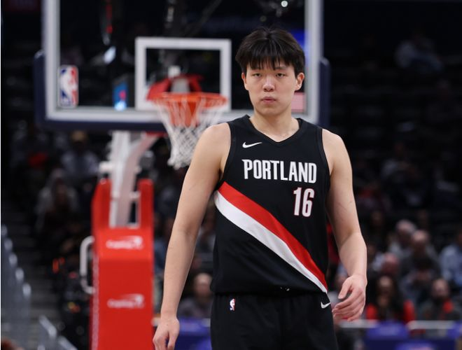

北京时间11月20日，NBA常规赛开拓者客场对阵雄鹿，雄鹿是背靠背第二场。开拓者在利拉德引领下逐步取得两位数领先优势，最终开拓者124-114战胜雄鹿结束2连败，雄鹿遭遇12连败联盟倒数第一。

开拓者：利拉德33分6板、亨德森27分7板3助、霍勒迪22分2板7助4断、卡马拉18分6板4助2断3帽、西索科13分5板3助3断、克林根7分13板2助、肯特2分1板2助、杨瀚森2分1板1助。

雄鹿：希罗19分4板3助、阿门特18分9板、亚库乔尼斯18分3板2助、罗林斯15分3板6助4断、伯里斯14分3板3助2断、韦尔11分5板2断、哈克斯9分。

开拓者前14场9胜5负，雄鹿前15场1胜14负。本场雄鹿缺少迪昂、库兹马、特纳，开拓者缺少阿夫迪亚、莫兰特、罗威、夏普等。首节开局，开拓者取得5-3领先优势，雄鹿一波6-0攻势反超比分。西索科上篮与利拉德三分反超1分，雄鹿连得5分夺回领先，克林根上篮得分。杨瀚森替补登场，哈克斯三分命中，双方接连得分，杨瀚森造犯规两罚不中。开拓者一波7-0攻势反超比分，其中亨德森命中压哨三分，首节结束开拓者24-21领先雄鹿。首节开拓者三分16中4，利拉德8分与杨瀚森4分40秒1中0得到0分，雄鹿三分8中3。

次节比赛，双方均是单节得分35+对攻，开拓者一波8-1攻势扩大10分优势，雄鹿连追5分，开拓者连得4分，雄鹿多点开花一波12-2攻势反超1分。利拉德三分开火率队46-44夺回领先，雄鹿一波11-1攻势反超8分，亨德森引领一波13-1攻势反超4分。南斯上篮得分，上半场结束开拓者60-58领先雄鹿。前两节比赛，开拓者三分26中9，利拉德19分与亨德森21分、杨瀚森7分20秒0分1篮板；雄鹿三分19中8，阿门特12+6与亚库乔尼斯10分。

中场休息回来，双方连续两节单节得分30+展开对攻，利拉德率先三分命中，希罗连中三分引领一波10-0攻势反超5分打停开拓者。双方持续紧咬比分缠斗，杨瀚森本节未登场。开拓者单节36-34净胜2分，三节结束开拓者96-92领先雄鹿。前三节比赛，开拓者三分36中15，利拉德28分与亨德森27分，引领4人得分上双；雄鹿三分34中14，希罗15分引领5人得分上双。

进入第四节比赛，开拓者逐步攻防压制扩大两位数领先优势，利拉德成功得分30+，杨瀚森再度登场得到2分，最终开拓者124-114战胜雄鹿结束2连败，雄鹿遭遇12连败联盟倒数第一。

开拓者：西索科、卡马拉、克林根、肯特、利拉德

雄鹿：阿门特、南斯、韦尔、希罗、伯里斯

特别声明：以上内容(如有图片或视频亦包括在内)为自媒体平台“网易号”用户上传并发布，本平台仅提供信息存储服务。

Notice: The content above (including the pictures and videos if any) is uploaded and posted by a user of NetEase Hao, which is a social media platform and only provides information storage services.

十夏九漓 2026-11-20 14:36:24

田先生篮球 2026-11-20 15:22:07

陈錈爱体育 2026-11-20 14:33:35

老范谈史 2026-11-20 16:10:12

马三看世界 2026-11-20 08:59:56

篮球盛世 2026-11-20 18:02:53

创造精彩剧情 2026-11-19 04:23:31

体育闲话说 2026-11-20 17:20:32

暗香暗香 2026-11-20 16:26:11

语妍视频剪辑 2026-11-20 14:12:27

篮球盛世 2026-11-19 13:26:05

透视到底 2026-11-20 17:44:38

宗介说体育 2026-11-20 15:14:38

独坐山巅前 2026-11-20 16:59:39

十三哥侃大山 2026-11-19 18:34:56

铭记人类辉煌 2026-11-18 23:50:22

眼界看世界 2026-11-20 17:00:44

佐流Saryu 2026-11-20 06:23:08

弄月公子 2026-11-20 15:24:31

汤圆看体育 2026-11-20 15:23:04

碳基打工人 2026-11-20 18:27:06

巨海克 2026-11-18 03:08:44

张硜卤说体育 2026-11-20 00:47:39

张硜卤说体育 2026-11-20 00:48:56

宗介说体育 2026-11-18 14:10:20

乐趣纪史 2026-11-20 16:42:02

一纸情书s 2026-11-18 04:17:59

你的雷达站 2026-11-20 17:35:02

体坛速报局 2026-11-20 12:09:00

篮球过人技巧 2026-11-20 14:01:51

马三看世界 2026-11-19 07:37:02

翻车选手小李 2026-11-19 00:41:33

体坛速报局 2026-11-20 13:14:46

凉生枕时e 2026-11-18 03:50:48

翻车选手小李 2026-11-18 03:27:29

福娃谈体育 2026-11-20 13:48:34

桑经艺 2026-11-20 04:22:42

木子酱手工 2026-11-19 00:56:33

水色胭脂香 2026-11-19 02:28:31

董老师看竞技 2026-11-18 20:51:33

## 配图

图：综合（网易体育 · 2026-11-20）

## 来源

- [网易体育 · 原文](https://www.163.com/dy/article/LC64IDIL0529RKNN.html)
