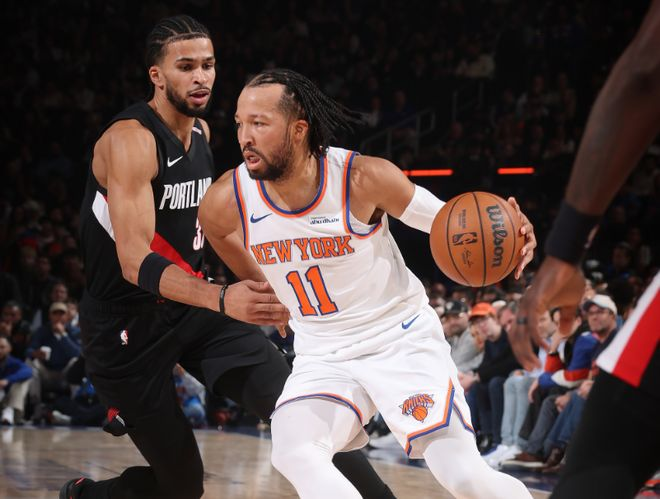

北京时间11月22日，NBA常规赛开拓者客场对阵卫冕冠军尼克斯，阿夫迪亚迎来复出，唐斯与阿奴诺比缺席。布伦森爆发率领尼克斯最多时刻领先26分优势，开拓者反扑逐步追到仅差6分，尼克斯随后重新扩大两位数领先优势。开拓者再度反扑追分，利拉德命中扳平三分，阿夫迪亚关键罚球准绝杀，布里奇斯压哨三分绝杀，最终尼克斯97-96绝杀战胜开拓者收获4连胜。

开拓者：克林根22分13篮板4助攻，阿夫迪亚20分9篮板5助攻，利拉德15分，霍勒迪13分9篮板7助攻，西索科11分，布里奇斯12分。

尼克斯：布伦森6记三分30分7篮板5助攻，沙梅特6记三分20分，德拉蒙德7分13篮板3盖帽。

开拓者前15场10胜5负，尼克斯前15场9胜6负。本场尼克斯缺少唐斯、阿奴诺比、克拉克森，开拓者缺少夏普、莫兰特、克雷伊奇与扬布拉德。首节开局沙梅特与德拉蒙德接连命中三分，引领尼克斯取得13-2领先优势，克林根与阿夫迪亚接连三分命中，开拓者回敬一波9-2攻势追分。布伦森持续攻传结合率领尼克斯打出18-4攻势，已经扩大31-15领先优势，尼克斯继续压制开拓者，首节结束尼克斯40-23领先开拓者。首节尼克斯20中14，其中三分12中9，布伦森7中6命中5记三分狂轰19分3助攻；开拓者23中9，其中三分12中3，阿夫迪亚8分与利拉德6分。

次节比赛，布里奇斯中投命中，开拓者连追7分，尼克斯很快内外开花扩大53-34领先优势。开拓者连追4分，双方之后缠斗至尼克斯55-40领先，沙梅特连中三分一波11-0攻势扩大26分优势，霍勒迪压哨三分追分，尼克斯单节26-20净胜6分，上半场结束尼克斯扩大66-43领先开拓者。前两节比赛，开拓者三分23中5，阿夫迪亚11分与利拉德8中2得到8分；尼克斯三分27中13，布伦森23+5+3与沙梅特4记三分14分。

中场休息回来，尼克斯进攻火力暴跌单节不足20分，开拓者率先一波10-2攻势追到差12分，布伦森接连中投得分维持72-59领先。开拓者连追5分，布伦森三分命中，开拓者连得5分追到差6分，阿尔瓦拉多三分回敬。西索科与沙梅特对攻一记三分，尼克斯单节15-29被追回14分，三节结束尼克斯81-72领先开拓者。前三节比赛，开拓者三分30中9，克林根15+8与阿夫迪亚15+6+5，引领4人得分上双；尼克斯三分32中16，布伦森30+5+4+6三分与沙梅特17+5三分。

进入第四节比赛，沙梅特三分命中扩大12分优势，开拓者一波7-2攻势追到差7分。达迪耶三分命中与科勒克2+1扩大13分优势，卡马拉三分命中，双方随后连续打铁。利拉德连得4分，阿尔瓦拉多抛射命中，克林根暴扣与补篮得分连得4分，阿夫迪亚两罚一中。尼克斯继续打铁，利拉德三分命中追到94-94，布伦森与利拉德随后三分均不中，布伦森继续投篮不中，阿夫迪亚造成德拉蒙德犯规两罚全中准绝杀，尼克斯继续打铁，布里奇斯三分绝杀，最终尼克斯战胜开拓者收获4连胜。

开拓者：西索科、卡马拉、克林根、阿夫迪亚、利拉德

尼克斯：哈特、沙梅特、德拉蒙德、布里奇斯、布伦森

特别声明：以上内容(如有图片或视频亦包括在内)为自媒体平台“网易号”用户上传并发布，本平台仅提供信息存储服务。

Notice: The content above (including the pictures and videos if any) is uploaded and posted by a user of NetEase Hao, which is a social media platform and only provides information storage services.

无术不学 2026-11-22 11:41:51

球场风暴 2026-11-22 11:31:04

破镜难圆 2026-11-22 12:43:45

花谢依然美 2026-11-22 12:29:15

汪星人哟 2026-11-22 12:26:26

锅子篮球 2026-11-22 12:14:32

小蒋爱唠嗑 2026-11-22 18:22:10

马三看世界 2026-11-22 15:08:56

体坛速报局 2026-11-22 09:23:43

陈錈爱体育 2026-11-22 18:28:46

十六在van游戏 2026-11-22 18:02:32

董老师看竞技 2026-11-20 20:01:07

心电图翻译情诗j 2026-11-22 10:30:42

破晓资讯 2026-11-22 17:44:54

张硜卤说体育 2026-11-20 00:48:56

咪咕体育 2026-11-21 16:21:48

骄阳之夏明 2026-11-22 01:29:34

原谅你 2026-11-22 04:52:49

宋垀搞笑配音 2026-11-20 04:28:57

语妍视频剪辑 2026-11-22 14:42:32

咪咕体育 2026-11-21 16:21:56

小轲搞笑解说 2026-11-21 00:41:52

篮球过人技巧 2026-11-20 14:01:51

毛豆何时归 2026-11-22 18:17:05

咪咕体育 2026-11-21 16:21:53

网文作者夏少斌 2026-11-22 17:32:35

咪咕体育 2026-11-21 16:20:32

大眼睛看看 2026-11-21 02:54:27

体坛速报局 2026-11-20 13:14:46

各地精彩不容错过 2026-11-22 05:04:23

篮球热嗖 2026-11-22 18:52:40

花凌若别离开 2026-11-22 00:20:22

咪咕体育 2026-11-21 16:21:43

姜大叔侃球 2026-11-22 17:44:00

黑曼巴谈球 2026-11-22 13:17:37

一路荒凉如歌aa 2026-11-22 01:49:39

创造精彩剧情 2026-11-21 03:56:46

桑经艺 2026-11-20 04:22:42

咪咕体育 2026-11-21 16:21:54

篮球盛世 2026-11-21 11:34:07

## 配图

图：综合（网易体育 · 2026-11-22）

## 来源

- [网易体育 · 原文](https://www.163.com/dy/article/LCB79D9A0529RKNN.html)
