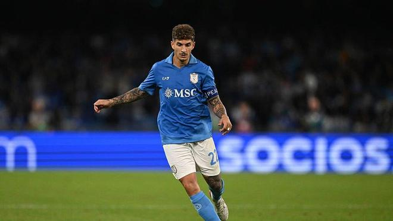

那不勒斯队长迪洛伦佐的伤情传来坏消息。俱乐部确认，这名后卫在皮内塔格兰德医院接受仪器检查后，被诊断为左大腿长收肌拉伤，目前已经开始康复治疗。

迪洛伦佐预计至少缺席三周。他将无缘主场对阵领头羊拉齐奥的比赛，随后还将缺席本周六主场迎战都灵的比赛、11月24日客场对阵曼城的欧冠比赛，以及11月29日对阵萨索洛的比赛。他有望在12月5日对阵莱切时复出。

迪洛伦佐在对阵尤文图斯的比赛中半场因内收肌不适被换下，随后也因此缺席了客场对阵波尔图的欧冠比赛。

相比之下，奥利韦拉的情况令人放心。这名乌拉圭后卫在安联球场比赛尾声阶段因疑似肌肉拉伤被比克马换下，不过目前已经恢复球队合练，可以出战对阵拉齐奥的比赛。

特别声明：以上内容(如有图片或视频亦包括在内)为自媒体平台“网易号”用户上传并发布，本平台仅提供信息存储服务。

Notice: The content above (including the pictures and videos if any) is uploaded and posted by a user of NetEase Hao, which is a social media platform and only provides information storage services.

日常碎碎念啊 2026-11-07 01:42:20

坠入温柔晚风 2026-11-07 03:50:24

懂球帝 2026-11-07 01:23:12

林间小温柔 2026-11-07 04:12:13

宇宙天文眼 2026-11-04 22:52:10

转会窗ProMax 2026-11-05 19:17:48

猫熊说体育 2026-11-05 08:44:20

坠入温柔晚风 2026-11-07 04:05:34

涩会小阿敏 2026-11-05 04:49:28

第X个想法 2026-11-05 10:04:36

左脚爆射得分 2026-11-04 10:54:27

脑洞编剧小剧场 2026-11-06 01:53:56

转会窗ProMax 2026-11-06 13:30:57

篮球人物故事会 2026-11-05 10:30:39

懂球帝 2026-11-07 03:43:27

足球印象CC 2026-11-04 13:48:22

足球记忆 2026-11-06 01:34:46

白沙体育 2026-11-05 11:51:35

落雪听梅a 2026-11-05 10:30:59

老何绿茵笔记 2026-11-07 04:00:03

超喜欢我 2026-11-03 01:23:49

显微镜下的人性 2026-11-07 05:27:21

篮球人物故事会 2026-11-05 10:25:49

懂球帝 2026-11-05 20:01:16

老周观体育 2026-11-06 21:50:26

足球印象CC 2026-11-05 20:30:04

懂球帝 2026-11-07 06:19:57

超话看世界 2026-11-02 14:58:11

火星猪同学 2026-11-05 11:21:40

安若浅溪b 2026-11-06 12:25:43

用伤口豢养白鸽z 2026-11-05 05:28:09

RT今日俄罗斯 2026-11-04 12:35:56

懂球帝 2026-11-06 20:14:32

几十年老球迷 2026-11-06 23:26:30

独特l 2026-11-04 12:52:45

米奇兔 2026-11-04 12:54:23

米奇兔 2026-11-05 12:38:08

AI绘千禧 2026-11-04 23:38:08

想温柔 2026-11-04 09:55:15

转会窗ProMax 2026-11-05 10:35:50

## 配图

图：综合（网易体育 · 2026-11-07）

## 来源

- [网易体育 · 原文](https://www.163.com/dy/article/LB45BCA80549BAP0.html)
