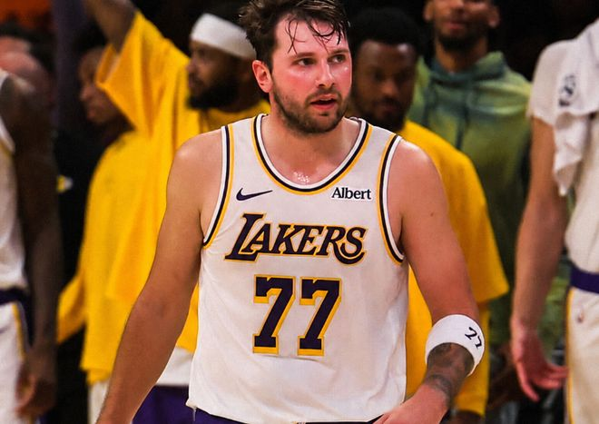

北京时间11月16日，NBA常规赛湖人客场对阵太阳，里夫斯缺席，湖人在东契奇出色表现引领下，持续压制太阳逐步扩大31分领先优势。太阳末节持续反扑追到个位数差距，格莱姆斯关键三分命中，湖人惊险挡住太阳的顽强追分，最终湖人131-123战胜太阳豪取8连胜，太阳结束2连胜。

湖人：东契奇5记三分43分9助攻，凯斯勒14分12篮板3助攻，格莱姆斯5记三分22分，塞克斯顿16分，拉拉维亚12分，塞布尔12分。

太阳：布克17分4篮板7助攻，布里奇斯14分，格林9分，吉莱斯皮5记三分26分，古德温14分，肯纳德18分。

东契奇攻传结合贡献出色表现，率领湖人拒绝太阳大逆转，豪取8连胜领跑全联盟。

东契奇本赛季7次单场轰下40+得分，本赛季10次单场轰下30+得分，领跑联盟得分榜。

东契奇连续10场比赛命中三分创湖人队史纪录。

东契奇本赛季两次首节轰下20+得分，其余球员仅1次。

东契奇生涯第35次单节轰下20+得分历史第三，仅逊色于库里45次与科比36次。

湖人核心之一的里夫斯缺席，格莱姆斯顶替里夫斯位置首发，太阳缺少马威。

湖人前13场11胜2负，太阳前11场5胜6负。本场首节开局，东契奇率先引领湖人打出梦幻10-0攻势，布里奇斯上篮命中太阳首球，格莱姆斯与布里奇斯对攻一记三分。东契奇里突外投再度引领一波10-0攻势，湖人扩大23-5领先太阳，太阳一波7-0攻势追分。东契奇两罚全中，布克引领一波9-4攻势追分，东契奇继续率队扩大优势，首节结束湖人33-24领先太阳。东契奇首节打满12分钟，10中5高效轰下20分。

次节比赛，双方均是单节得分30+展开对攻，湖人率先扩大41-29领先优势，太阳连追4分，湖人一波8-0攻势扩大16分优势。拉拉维亚三分命中率队扩大优势，东契奇接连助攻队友得分，湖人进一步扩大58-39领先优势。太阳内外开花一波15-6攻势追分，湖人单节31-30再赢1分，上半场结束湖人64-54领先太阳。前两节比赛，太阳三分17中5，布克10分6助攻；湖人三分24中9，东契奇4记三分25分与凯斯勒10+8、塞克斯顿10分。

中场休息回来，湖人进攻火力升级本场首次单节轰下40分，东契奇攻传结合扩大72-54领先优势。凯斯勒内线得分继续扩大79-59领先优势，湖人持续进攻碾压太阳，在第三节末段已经扩大101-70领先31分巨大优势。太阳一波8-0攻势追分，湖人继续扩大领先优势，东契奇单节再得12分，引领湖人单节40-26净胜14分，三节结束湖人扩大104-80领先太阳。前三节比赛，东契奇37+7引领4人得分上双，布克17+7引领3人得分上双。

湖人带着24分领先优势进入第四节比赛，太阳前2分钟连中4记三分打出12-4攻势追到差16分，古德温吃T送塞克斯顿罚中一球。塞布尔补篮与凯斯勒补扣扩大21分优势，太阳持续反扑追到差14分，塞布尔一度吃T。东契奇重新被换上场，皮特补篮命中，格莱姆斯两罚一中，皮特连续两次暴扣，邓恩三分命中追到差6分。拉拉维亚与肯纳德对攻一记三分，东契奇抛射命中，皮特内线命中。东契奇继续抛射命中，古德温造东契奇三分犯规三罚一中，塞布尔被犯规两罚全中。吉莱斯皮造塞布尔三分犯规三罚两中与抛射命中追到差5分，格莱姆斯关键三分命中。肯纳德上篮得分，东契奇两罚全中维持8分优势，比赛已经提前失去胜负悬念，最终湖人战胜太阳豪取8连胜，太阳结束2连胜。

湖人：塞布尔、拉拉维亚、凯斯勒、格莱姆斯、东契奇

太阳：狄龙、布里奇斯、伊戈达罗、格林、布克

特别声明：以上内容(如有图片或视频亦包括在内)为自媒体平台“网易号”用户上传并发布，本平台仅提供信息存储服务。

Notice: The content above (including the pictures and videos if any) is uploaded and posted by a user of NetEase Hao, which is a social media platform and only provides information storage services.

咪咕体育 2026-11-14 12:20:49

Tracy的篮球博物馆 2026-11-16 15:41:49

网文作者夏少斌 2026-11-16 19:17:39

正经球迷 2026-11-15 10:07:43

小轲搞笑解说 2026-11-15 00:34:05

董老师看竞技 2026-11-16 09:31:30

十三哥侃大山 2026-11-15 19:53:03

看球图一乐 2026-11-16 10:16:56

大眼睛看看 2026-11-16 01:35:23

看球图一乐 2026-11-16 14:36:36

精彩一网打尽 2026-11-16 15:28:13

篮球过人技巧 2026-11-16 16:28:11

小赖评球 2026-11-15 08:56:07

丁羂解说 2026-11-16 15:52:17

尺素a 2026-11-16 03:35:53

司峰阿道 2026-11-14 14:49:10

董老师看竞技 2026-11-16 08:57:31

禾三千体育 2026-11-16 17:40:27

篮球过人技巧 2026-11-16 18:28:50

老杨体评 2026-11-14 14:30:23

无人倾听无人倾听 2026-11-15 04:39:34

福娃谈体育 2026-11-14 19:04:41

马三看世界 2026-11-16 08:07:23

篮球盛世 2026-11-16 12:46:44

小熊回收站 2026-11-16 03:07:56

安养社Health 2026-11-15 00:52:17

紧跟时代脉搏 2026-11-16 02:43:50

马三看世界 2026-11-16 09:26:49

超级无敌美少女何 2026-11-15 15:03:08

众生的世界观 2026-11-15 07:23:36

最佳菜鸟 2026-11-16 10:49:16

此去经年y 2026-11-15 03:32:40

篮球大视野 2026-11-16 19:14:20

尺素a 2026-11-15 15:47:47

TITAN热吧 2026-11-14 16:05:31

山晚望晴r 2026-11-14 17:10:19

为了更好 2026-11-16 03:01:03

体育篮球弟 2026-11-15 00:34:53

搞笑脑洞研究所 2026-11-16 02:27:06

老杨体评 2026-11-16 12:00:00

## 配图

图：综合（网易体育 · 2026-11-16）

## 来源

- [网易体育 · 原文](https://www.163.com/dy/article/LBRE255I0529RKNN.html)
