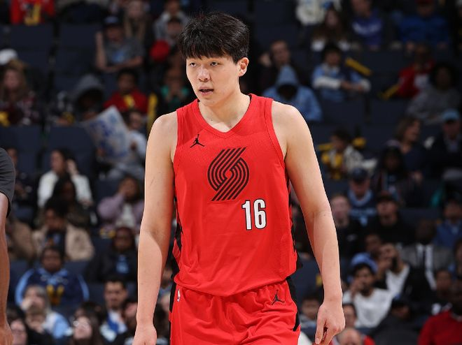

北京时间11月5日，NBA常规赛开拓者客场对阵太阳，开拓者在首节落后5分情况下，阿夫迪亚、利拉德与克林根给力表现，引领开拓者逐步反超20+优势。杨瀚森末节最后阶段才替补登场，最终开拓者132-119双杀太阳收获3连胜升西部第一，太阳遭遇4连败。

开拓者：阿夫迪亚21分8篮板12助攻，克林根24分10篮板3盖帽，利拉德25分5助攻，卡马拉11分，霍勒迪5记三分15分。

太阳：布克33分6犯规，格林22分，狄龙15分6篮板，布里奇斯4记三分18分7篮板5助攻。

开拓者前6场5胜1负，太阳前5场1胜4负，本赛季首次交锋开拓者主场124-83大胜太阳。本场开拓者缺少夏普与莫兰特，太阳缺少马威与古德温。首节开局开拓者8-6领先，太阳连得5分反超，双方随后缠斗至开拓者14-15落后。太阳冲击内线扩大5分优势，开拓者一波9-4攻势追到25-25，太阳回敬一波9-4攻势，首节结束开拓者29-34落后太阳。首节太阳23中13，其中三分7中2，布克12分与狄龙8分；开拓者23中9，其中三分11中3，阿夫迪亚7分4助攻与利拉德4中1得到5分。

次节比赛，开拓者进攻火力大幅升级本场首次单节得分40+，太阳进攻火力下滑不超过25分。前2分钟开拓者35-39落后，开拓者内外开花打出一波18-4攻势反超10分，阿夫迪亚与利拉德持续得分，开拓者继续扩大65-50领先优势。太阳连追4分，克林根内线得分，开拓者单节43-25狂胜18分，上半场结束开拓者72-59反超太阳。前两节比赛，开拓者三分22中9，阿夫迪亚13分8助攻、利拉德与克林根均14分；太阳三分14中3，布克19分与狄龙11分。

中场休息回来，开拓者连续两节单节轰下30+得分，且限制太阳连续两节不足30分。开拓者前3分半钟被追到78-71领先，阿夫迪亚与克林根内外开花，开拓者一波13-1攻势扩大19分优势。太阳反扑追到差15分，利拉德引领一波7-0攻势扩大22分领先优势，格林三分命中，开拓者单节32-26净胜6分，三节结束开拓者扩大104-85领先太阳。前三节比赛，开拓者三分31中12，阿夫迪亚21+5+11与利拉德21分，引领4人得分15+；太阳三分22中7，布克33分引领4人得分上双。

开拓者带着19分领先优势进入第四节比赛，太阳反扑缩小差距，克林根与罗威接连内线得分，开拓者扩大116-97领先优势。太阳连追4分，亨德森两罚全中，太阳一波6-2攻势追到差13分。克林根空接命中，布克6犯离场，利拉德两罚全中扩大17分优势。开拓者撤下主力，比赛已经提前失去胜负悬念，太阳继续追分已经无力回天，杨瀚森替补登场，最终开拓者双杀太阳，开拓者收获3连胜升西部第一。

开拓者：阿夫迪亚、卡马拉、克林根、利拉德、亨德森

太阳：狄龙、布里奇斯、马卢阿奇、格林、布克

特别声明：以上内容(如有图片或视频亦包括在内)为自媒体平台“网易号”用户上传并发布，本平台仅提供信息存储服务。

Notice: The content above (including the pictures and videos if any) is uploaded and posted by a user of NetEase Hao, which is a social media platform and only provides information storage services.

用冷眼洞悉世界 2026-11-05 17:17:44

篮视角 2026-11-03 03:43:43

包饺子ai剪辑 2026-11-05 16:48:02

科普印迹 2026-11-04 10:15:45

道曼凡 2026-11-05 01:02:28

泪之魂y 2026-11-03 23:07:31

薇说体育 2026-11-05 17:30:59

创造精彩剧情 2026-11-04 04:33:07

阿姗观世界 2026-11-05 02:19:16

云天之巅明 2026-11-03 00:40:21

大卫的篮球故事 2026-11-05 18:45:56

语妍视频剪辑 2026-11-05 15:31:30

一路荒凉如歌aa 2026-11-05 02:03:13

孤单是寂寞的毒 2026-11-05 04:44:00

枫树林 2026-11-05 05:21:54

左脚爆射得分 2026-11-04 11:03:24

至今 2026-11-03 19:35:39

篮球过人技巧 2026-11-05 15:42:59

法老不说教 2026-11-05 18:18:52

语妍视频剪辑 2026-11-05 15:21:53

司峰阿道 2026-11-03 15:39:58

阿嬍体育评论 2026-11-04 03:09:37

篮球大视野 2026-11-05 18:21:01

张硜卤说体育 2026-11-03 00:21:32

黄小仙的搞笑视频 2026-11-05 18:56:00

揭秘那些精彩 2026-11-04 04:02:31

脑洞编剧小剧场 2026-11-05 01:37:40

语妍视频剪辑 2026-11-04 12:16:25

老威头 2026-11-03 03:27:29

猫熊说体育 2026-11-05 14:38:36

一路荒凉如歌aa 2026-11-05 02:00:36

脑洞编剧小剧场 2026-11-05 01:36:51

黄小仙的搞笑视频 2026-11-05 18:55:28

董老师看竞技 2026-11-03 14:07:48

体育闲话说 2026-11-05 18:46:53

董老师看竞技 2026-11-03 18:17:22

语妍视频剪辑 2026-11-03 15:53:13

糖炒小栗子 2026-11-04 03:14:35

翻车选手小李 2026-11-05 02:21:07

马克餐饮日记 2026-11-05 04:12:42

## 配图

图：综合（网易体育 · 2026-11-05）

## 来源

- [网易体育 · 原文](https://www.163.com/dy/article/LAVKHML50529RKNN.html)
