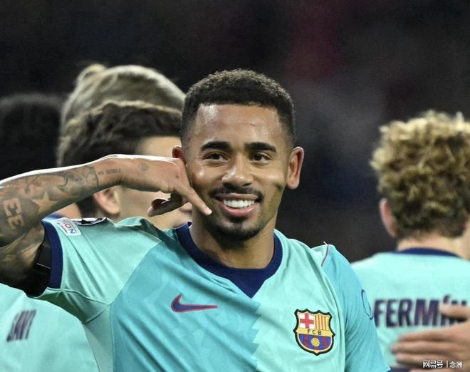

北京时间11月26日，昨夜今晨，足坛又有新的重大事件发生。欧冠继续进行，巴萨4-1大胜，曼联又没赢，拜仁爆冷输球，皇马5战全胜领跑积分榜。

欧冠：巴萨4-1沙巴巴库

欧冠联赛阶段第5轮，巴萨客场4-1沙巴巴库，取得欧冠两连胜+各项赛事五连胜。佩德里远射遭神扑，莱宾吉卡吊射中楣，戈登补射破门首开纪录，下半场再次补射破门完成双响，巴尔德助攻阿德耶米建功，热苏斯补射建功，米克尔斯替补扳回一城，阿德耶米爆射中楣。

曼联客场2-2战平葡萄牙体育，波切蒂诺上任1平1负未尝胜绩，红魔各赛事近13场仅1胜。利马和拉门斯3分钟两送点，苏亚雷斯点球两罚一中，阿玛德进球被吹无效，利马造点，B费3分钟双响反超，拉门斯逆天黄油手送礼，蒂莱曼斯染红。

拜仁客场1-2遭里尔逆转，遭遇本赛季欧冠首败+5轮仅积8分，里尔取得欧冠首胜。上半场于帕梅卡诺先拔头筹，比朔夫角球助攻，下半场上田绮世扳平比分，帕夫洛维奇离谱乌龙。

利物浦客场3-0完胜布鲁日。上半场，索博斯洛伊助攻伊萨克率先破门，穆尼奥斯伤退被恩古莫哈换下，下半场，维尔茨破门，伊萨克完成双响。

国米主场2-0击败斯图加特，取得欧冠三连胜。上半场双方均无建树，斯彭斯错失单刀，巴雷拉射门击中立柱，巴斯托尼伤退。下半场，迪马尔科造点，苏契奇点射命中，迪马尔科助攻劳塔罗破门。

欧冠联赛阶段第5轮全部结束，最新积分榜出炉。皇马5战全胜积15分领跑，卫冕冠军巴黎圣日耳曼本轮2-2罗马，4胜1平积13分位居次席，意甲大黑马科莫积12分排名第三。

知名转会记者罗马诺以标志性的Here we go确认，利物浦已经口头达成协议，签下16岁塞内加尔边锋西迪·恩迪亚耶，他将于2028年1月年满18岁时加盟利物浦。

特别声明：以上内容(如有图片或视频亦包括在内)为自媒体平台“网易号”用户上传并发布，本平台仅提供信息存储服务。

Notice: The content above (including the pictures and videos if any) is uploaded and posted by a user of NetEase Hao, which is a social media platform and only provides information storage services.

体育知多少 2026-11-26 06:22:50

钉钉陌上花开 2026-11-26 06:28:47

足球狗说 2026-11-26 06:31:35

我的护球最独特 2026-11-26 06:03:49

我们的足球记忆 2026-11-25 00:23:39

懂球帝 2026-11-26 02:33:01

猫熊说体育 2026-11-23 07:19:39

生活浩浩乐 2026-11-25 02:47:23

绿荫杂谈视频播客 2026-11-24 13:45:36

懂球帝 2026-11-26 04:35:16

风霜侃球 2026-11-25 12:49:39

狍子歪解体坛 2026-11-26 06:40:09

神秘研究院 2026-11-24 11:49:09

张硜卤说体育 2026-11-23 00:48:41

足球印象CC 2026-11-25 21:03:39

HC王楚淇 2026-11-25 03:21:57

第X个想法 2026-11-24 11:49:25

一个香蕉说球 2026-11-25 03:12:09

人间闲散客 2026-11-24 01:41:29

足球狗说 2026-11-26 06:17:09

艾辰体娱 2026-11-25 12:05:51

赛场速报局 2026-11-26 05:13:47

篮球过人技巧 2026-11-24 13:22:48

甜度百分百21 2026-11-26 06:06:59

足球印象CC 2026-11-25 13:53:44

詹妹侃体育 2026-11-25 10:37:45

你是佛的弟子 2026-11-24 12:00:04

爱足球的谢宇宁 2026-11-25 03:23:27

大海体娱 2026-11-25 12:06:24

风霜侃球 2026-11-24 13:08:21

一个香蕉说球 2026-11-25 03:13:08

精彩背后 2026-11-24 09:00:38

懂球帝 2026-11-26 05:51:22

懂球帝 2026-11-26 05:40:14

一路荒凉如歌aa 2026-11-24 02:12:59

一个香蕉说球 2026-11-25 03:12:21

足球印象CC 2026-11-24 07:13:16

一个香蕉说球 2026-11-25 03:06:38

元气满分吖 2026-11-26 06:21:02

奇聞空间 2026-11-25 12:05:38

## 配图

图：综合（网易体育 · 2026-11-26）

## 来源

- [网易体育 · 原文](https://www.163.com/dy/article/LCL2FT8V0553AOVQ.html)
