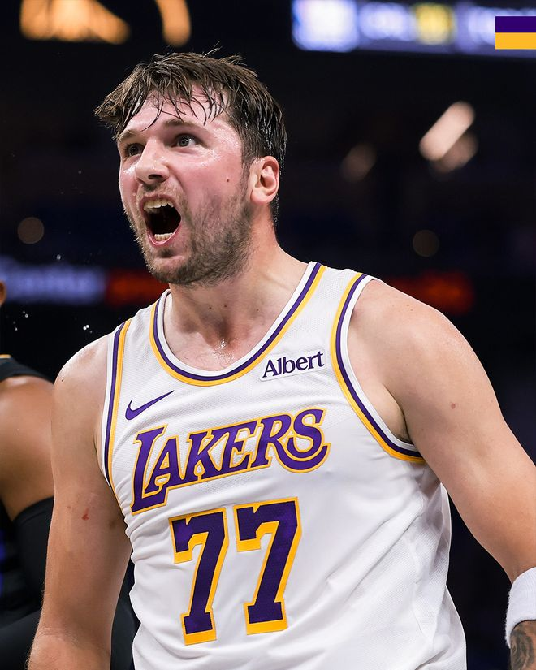

北京时间11月2日，NBA常规赛继续进行，洛杉矶湖人队（5胜2负）重拾胜利。东契奇得到45分、15个篮板、6次助攻和5次抢断，里夫斯得到19分，他们率队利用一三节攻势确立大比分领先，湖人队在主场以131-125战胜多伦多猛龙队（3胜3负）。猛龙队遭遇两连败。

湖人队的东契奇得到45分、15个篮板、6次助攻和5次抢断，里夫斯得到19分和4次助攻，凯斯勒得到16分、15个篮板和3次盖帽，塞克斯顿得到14分，马姆科拉什维利得到11分。猛龙队的巴恩斯得到29分、6个篮板和5次助攻，巴雷特得到22分、10个篮板和5次助攻，巴通得到20分和5个篮板，奎克利得到12分、6个篮板和7次助攻，沃尔特得到11分和4个篮板，谢德得到9分和6次助攻。

猛龙队的莱纳德继续缺席，珀尔特尔也缺阵，戴维斯顶替首发。开赛后沃尔特连拿5分，猛龙队以6-3领先。湖人队随后进攻全面开火，斯布尔、东契奇各中三分，他们率队连拿10分反超。戴维斯打3分暂时止血，东契奇罚中两球，里夫斯和马姆科拉什维利轮流投中三分，他们引领球队又是一波10-2的小高潮，首节还有3分55秒时湖人队以23-11领先。谢德三分命中还击，东契奇又中三分率队连得6分扩大优势。巴通和巴雷特各中三分试图追分，东契奇回应5分，首节结束时湖人队以36-23领先13分。东契奇单节得到16分。

巴恩斯和巴雷特联手5分开始第二节，猛龙队只落后10分。塞克斯顿单打得分，猛龙队外线开火，巴雷特和奎克利各中三分，他们追至36-44。湖人队暂停后塞克斯顿投中三分稳住局势，凯斯勒篮下得分，湖人队重新领先13分。谢德保持手感又拿6分，他率队打出10-2的反击波，半场前3分钟时猛龙队追至46-51。东契奇两罚稳住，拉拉维亚开火连进两个三分球，湖人队再次领先13分。猛龙队暂停后又追3分，东契奇三分回敬，巴恩斯和奎克利合取5分缩小差距，东契奇投中准压哨三分，半场结束时湖人队以66-54领先12分。

湖人队的东契奇上半场得到24分、8个篮板和4次助攻，塞克斯顿得到10分；猛龙队的巴恩斯得到14分，谢德得到9分。

凯斯勒补篮开启第三节，猛龙队追回4分，里夫斯迅速还击4分，东契奇保持手感又得6分，斯布尔翼侧命中三分，本节进行了3分钟时湖人队以81-60领先21分。猛龙队暂停后巴恩斯勾手暂时止血，东契奇又中三分，湖人队把优势拉开到22分。沃尔特和奎克利各中三分试图追分，里夫斯、东契奇和马姆科拉什维利合取7分，本节还有4分45秒时湖人队以93-70领先23分。之后两队各得几分，格里梅斯三分中的把分差拉开到26分。巴恩斯和巴雷特追回6分，塞克斯顿单打得手，三节结束时湖人队以104-82领先。

最后一节开始后湖人队连续投篮打铁，巴雷特命中两球率队打出9-2的反击波，猛龙队追至91-106。马姆科拉什维利三分回应，巴雷特保持手感又得5分，巴恩斯也命中两球，第四节还有6分55秒时猛龙队以100-109落后9分。东契奇突破打进，可他向裁判抱怨领到技犯，奎克利罚球命中，双方相差10分。可关键时刻猛龙队的进攻再次失准，里夫斯则突破打3分，东契奇造犯规两罚全中，第四节还有4分50秒时湖人队以116-101领先。

猛龙队暂停后仍防不住对手，里夫斯突破跳投命中，双方差距回到17分。马丁三分还击，凯斯勒空接扣篮，湖人队以120-104领先。猛龙队换下主力缴械并未缴械，巴通连中三分球拿下8分，布拉德利也打3分成功，第四节还有43.7秒时猛龙队追至120-125。东契奇、里夫斯等不得不回到场上，凯斯勒扣篮得手，东契奇两罚全中稳住局势。巴通再中三分无济于事，猛龙队以125-131落败。

猛龙队首发阵容：奎克利、沃尔特、巴恩斯、巴雷特、戴维斯

湖人队首发阵容：东契奇、里夫斯、拉拉维亚、斯布尔、凯斯勒

特别声明：以上内容(如有图片或视频亦包括在内)为自媒体平台“网易号”用户上传并发布，本平台仅提供信息存储服务。

Notice: The content above (including the pictures and videos if any) is uploaded and posted by a user of NetEase Hao, which is a social media platform and only provides information storage services.

老侃侃球 2026-11-02 12:37:16

老梁体育漫谈 2026-11-02 12:39:52

看尽人间百态 2026-11-02 15:43:43

工从昊懂球阿靖 2026-11-02 12:47:10

小路看球 2026-11-02 15:19:17

篮球大视野 2026-11-02 12:42:49

近史谈 2026-11-02 17:00:57

黑曼巴谈球 2026-11-01 02:19:01

司峰阿道 2026-10-31 14:46:32

看球图一乐 2026-10-31 13:43:56

肋骨雕刻成玫瑰d 2026-11-01 03:59:11

北青网-北京青年报 2026-11-02 16:48:02

曦言说 2026-10-31 15:20:37

各地精彩不容错过 2026-11-02 03:36:13

北青网-北京青年报 2026-11-02 16:56:03

正经球迷 2026-11-02 14:12:09

北青网-北京青年报 2026-11-02 16:48:04

凉了时光人 2026-11-02 01:19:43

马健 2026-11-01 05:37:29

一纸情书s 2026-11-01 07:10:02

篮球过人技巧 2026-11-01 00:36:03

一纸情书s 2026-11-01 07:11:18

精彩一网打尽 2026-11-01 06:49:50

董老师看竞技 2026-10-31 14:26:21

光影拾贝 2026-10-31 05:01:54

体育慢镜头 2026-11-02 19:21:26

董老师看竞技 2026-11-02 17:58:05

体坛速报局 2026-11-02 12:58:57

董老师看竞技 2026-11-02 14:26:19

篮球过人技巧 2026-11-02 17:34:24

曦言说 2026-11-02 18:30:19

雅儿姐爱追剧 2026-11-02 00:40:26

张硜卤说体育 2026-11-02 00:16:31

小木的不完美家 2026-11-01 04:39:58

马健 2026-11-01 05:27:23

马健 2026-11-01 05:38:45

咪咕体育 2026-10-31 04:31:54

篮球扫地僧 2026-11-02 19:16:34

输在感情刀 2026-11-01 10:18:45

咪咕体育 2026-11-02 13:52:38

## 配图

图：综合（网易体育 · 2026-11-02）

## 来源

- [网易体育 · 原文](https://www.163.com/dy/article/LANQVBSS0529AL9S.html)
