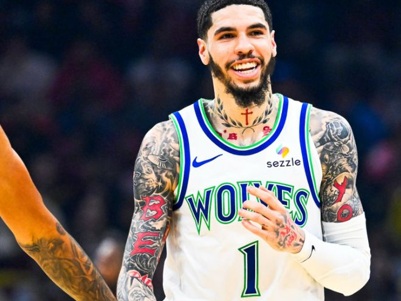

北京时间11月15日，NBA常规赛森林狼主场对阵公牛，公牛是背靠背第二场。森林狼遭公牛压制落后15分差距，森林狼持续反扑追到个位数差距，末节公牛扩大16分领先优势。森林狼再度反扑追到个位数差距功亏一篑，最终森林狼106-117爆冷输给公牛结束5连胜，公牛收获2连胜。

森林狼：三球4记三分19分7篮板6助攻4抢断6犯规，麦克丹尼尔斯18分，多森姆24分，库明加11分，戈贝尔7中0得到1分10篮板，海兰德12分，香农14分。

公牛：鲍威尔3记三分23分5篮板3助攻，吉迪8分8篮板5助攻，布泽利斯18分9篮板，帕威15分，琼斯16分，希尔德4记三分16分。

森林狼前12场9胜3负，公牛前11场2胜9负。本场森林狼缺少迪文琴佐与爱德华兹，公牛缺少威尔逊、克拉克斯顿、史密斯。首节前4分钟森林狼6-7落后，公牛一波9-0攻势拉开10分优势，森林狼连追4分。公牛回敬一波6-0攻势扩大12分优势，森林狼持续被公牛压制逐步拉开15-29落后，莱尔斯两罚全中，首节结束森林狼17-29落后公牛。首节公牛21中11，其中三分8中4；森林狼20中7，其中三分10中0，双方均没有球员得分上双。

次节比赛，双方连续两节单节不足30分，森林狼被拉开19-34落后15分差距，三球三分开火引领一波9-2攻势追分。公牛连得6分维持14分优势，森林狼连追5分，公牛持续压制保持两位数领先优势，森林狼单节28-29再输1分，上半场结束森林狼45-58落后公牛。前两节比赛双方均只有一人得分上双，公牛三分15中7，布泽利斯14+5；森林狼三分21中4，三球10分。

中场休息回来，双方均是单节得分30+展开对攻，第三节前3分钟森林狼51-65落后，森林狼随后打出一波13-0攻势追到仅差1分。公牛多点开花一波15-5攻势重新扩大11分优势，多森姆引领一波8-4攻势追分，双方之后陷入拉锯战缠斗，森林狼单节35-30追回5分，三节结束森林狼80-88落后公牛。前三节比赛，公牛三分22中10，布泽利斯与鲍威尔均16分，引领4人得分上双；森林狼三分28中7，多森姆与麦克丹尼尔斯均18分，引领5人得分上双。

进入第四节比赛，双方继续展开拉锯战缠斗，在前5分钟森林狼依然94-102落后8分。公牛很快打出一波7-0攻势拉开比分，三球两罚一中，米勒两罚全中扩大16分优势。森林狼一波7-0攻势追分，奥科罗暴扣，森林狼再得4分追到差7分打停公牛。琼斯压哨三分扩大10分优势锁定胜局，森林狼无力回天，最终森林狼爆冷输给公牛结束5连胜，公牛收获2连胜。

森林狼：麦克丹尼尔斯、库明加、戈贝尔、多森姆、三球

公牛：布泽利斯、鲍威尔、科林斯、奥科罗、吉迪

特别声明：以上内容(如有图片或视频亦包括在内)为自媒体平台“网易号”用户上传并发布，本平台仅提供信息存储服务。

Notice: The content above (including the pictures and videos if any) is uploaded and posted by a user of NetEase Hao, which is a social media platform and only provides information storage services.

微评体育圈 2026-11-15 18:56:08

弄月公子 2026-11-15 16:41:04

运动小看台 2026-11-15 12:28:14

多雨的天 2026-11-15 16:54:52

咪咕体育 2026-11-14 12:19:19

格斗联盟王大锤 2026-11-15 17:19:18

咪咕体育 2026-11-14 12:20:49

看球图一乐 2026-11-15 10:27:57

大眼睛看看 2026-11-14 01:13:49

阿兴爱生活 2026-11-15 14:33:36

简单清风 2026-11-14 11:44:32

篮球星播客 2026-11-14 13:26:30

梦仙境aa 2026-11-15 18:17:49

董老师看竞技 2026-11-12 21:20:22

品茶悟浮沉 2026-11-11 01:28:57

墨史轩 2026-11-15 18:07:06

篮球扫地僧 2026-11-15 19:02:35

兵哥篮球故事 2026-11-15 19:35:39

左脚爆射得分 2026-11-14 11:38:32

篮球的营地 2026-11-15 12:41:55

兵哥篮球故事 2026-11-15 19:36:48

颜小白的篮球梦 2026-11-15 19:17:48

网文作者夏少斌 2026-11-13 21:18:17

天注定 2026-11-15 07:21:07

左脚爆射得分 2026-11-14 11:36:26

好汉笑场 2026-11-14 14:21:22

咪咕体育 2026-11-14 12:21:27

一个香蕉说球 2026-11-15 14:04:49

头条刘博士看美国 2026-11-12 12:33:30

马克餐饮日记 2026-11-15 00:31:13

扬子晚报 2026-11-11 07:52:23

灼凉 2026-11-14 04:21:53

北青网-北京青年报 2026-11-12 21:26:04

澎湃新闻 2026-11-15 10:26:02

萌神木木 2026-11-12 20:43:37

麦芽看世界 2026-11-15 01:35:23

狍子歪解体坛 2026-11-15 04:05:06

海报新闻 2026-11-15 11:03:04

小飞侠动物 2026-11-11 17:24:21

小亿动物圈 2026-11-14 17:19:37

## 配图

图：综合（网易体育 · 2026-11-15）

## 来源

- [网易体育 · 原文](https://www.163.com/dy/article/LBP87OSM0529RKNN.html)
