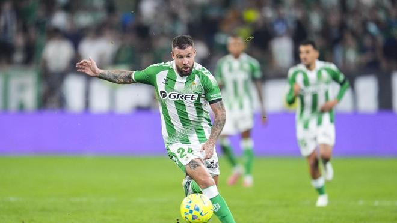

鲁伊瓦尔在皇家贝蒂斯战胜马拉加后，于拉卡图哈球场混采区接受了媒体采访。这位多面手球员没有掩饰自己在因伤缺阵五个月后重返赛场的喜悦，并把注意力放在佩莱格里尼率队接下来在多特蒙德的比赛上。

谈到比赛时，他表示：“贝蒂斯拿到了一场艰难的胜利。最后，比分有点被追回来了。我觉得这并不能反映球队的表现。足球就是这样，两支球队在踢，他们几乎只靠一次进攻就进了比赛。必须扛住，这就是贝蒂斯现在的样子。”

谈到贝蒂斯球迷的支持时，他表示：“我一直都很感谢大家的关爱，也总是这么说。这是我的家，希望我永远不要退役，一直留在这里，直到上帝说该停的时候。”

谈到下一场比赛时，他表示：“欧冠要来了，这是一场重要的比赛。9分，如果我们还能在那里拿分，那就太棒了。”

谈到在多特蒙德的挑战时，他表示：“现在球队做得太棒了。要是能在那里击败像多特蒙德这样的球队，那真的太爽了。”

谈到重返赛场时，他表示：“我有很多渴望、很多激动，也付出了很多努力，花了很多小时在健身房和独自训练。能回到这里踢球，我非常开心，也非常激动。”

谈到复出时的感觉，他表示：“主教练让我按该做的去做就行。对我来说，这就像是在球队里重新完成首秀。感觉和以前不一样，但我说过，我真的非常想踢球。”

谈到从小的梦想时，他表示：“我已经在替补席上坐了两三场。前几天，在这里主场踢欧冠时，我特别激动，因为那是我从小就梦想的事。我记得小时候，周二和周三我都会和祖父一起看很多比赛。最后真的会让人很感动。”

谈到伤病期间的支持时，他表示：“最重要的是我家里的人，尤其是我妻子，她一直经历着这一切。在竞技层面上，是队医团队，特别是俱乐部的康复师，他每天都在我身边，尤其是在事情没按预想发展的时候，还得忍受我。”

特别声明：以上内容(如有图片或视频亦包括在内)为自媒体平台“网易号”用户上传并发布，本平台仅提供信息存储服务。

Notice: The content above (including the pictures and videos if any) is uploaded and posted by a user of NetEase Hao, which is a social media platform and only provides information storage services.

懂球帝 2026-11-01 05:36:35

懂球帝 2026-11-01 03:49:31

体坛观察猿 2026-11-01 03:36:26

快乐加载中21 2026-11-01 03:54:21

墨史轩 2026-10-31 12:08:43

懂球帝 2026-11-01 05:47:27

懂球帝 2026-11-01 05:15:53

慢享生活集 2026-11-01 05:34:26

侧身凌空斩 2026-11-01 03:33:42

懂球帝 2026-11-01 05:57:10

绿荫杂谈视频播客 2026-10-30 10:29:25

咪咕体育 2026-10-31 04:30:29

足球印象CC 2026-10-31 20:31:22

清欢可期a 2026-11-01 01:45:05

安海客 2026-11-01 06:00:41

凉了时光人 2026-10-30 01:39:37

蜡笔足球 2026-10-29 07:29:39

晚风知我意21 2026-11-01 03:39:43

旧城旧巷a 2026-10-31 06:36:14

光辉与阴暗 2026-11-01 05:05:28

球事百科吖 2026-11-01 06:12:00

懂球帝 2026-11-01 05:15:53

曹操篮球解说 2026-10-30 13:04:48

田径人物志 2026-10-30 09:31:21

足球印象CC 2026-10-31 16:02:16

带你逛体坛 2026-10-31 11:19:05

阿超他的体育圈 2026-11-01 05:49:59

雷叔聊球 2026-10-30 03:30:00

球事百科吖 2026-11-01 06:18:33

足球印象CC 2026-10-30 06:00:25

足球故事GOAL 2026-11-01 03:37:31

蜡笔足球 2026-11-01 04:25:07

每日经济新闻 2026-07-09 20:56:34

严肃虾米 2026-10-29 22:08:12

足球故事GOAL 2026-11-01 03:58:25

足球故事GOAL 2026-10-28 20:17:44

CR7足球频道 2026-10-31 17:32:30

一个香蕉说球 2026-10-29 07:41:08

Shoot体育 2026-10-30 11:18:28

篮坛第一线 2026-11-01 06:18:08

## 配图

图：综合（网易体育 · 2026-11-01）

## 来源

- [网易体育 · 原文](https://www.163.com/dy/article/LAKMSM8T0549BAP0.html)
