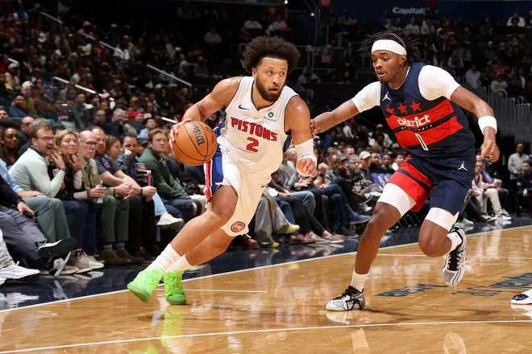

北京时间11月13日，NBA常规赛活塞客场对阵奇才，奇才是背靠背第二场。双方紧咬比分前三节活塞仅领先4分，第四节双方持续交替领先缠斗，特雷杨命中绝平三分。首个加时赛，迪班萨命中绝平中投，第二个加时赛坎宁安率队压制奇才，最终活塞144-140双加时双杀奇才收获2连胜，奇才遭遇6连败。

活塞：坎宁安52分5篮板11助攻创生涯得分新高纪录，詹金斯21分6犯规，奥萨尔17分11篮板11助攻3抢断3盖帽生涯首次三双，科林斯10分，里德13分11篮板，罗宾逊11分。

奇才：浓眉哥30分15篮板6犯规，特雷杨37分14助攻，萨尔30分8篮板，乔治14分5助攻6犯规，约翰逊13分。

坎宁安轰下生涯首次单场50+得分，打出生涯至今最强进攻表现，率领活塞双加时险胜奇才。

活塞前10场7胜3负，奇才前12场4胜8负，本赛季首次交锋活塞122-111战胜奇才。本场活塞缺少杜伦与乔，奇才缺少沃特金斯。首节开局活塞5-2领先，奇才一波9-0攻势反超比分，活塞随后持续被压制以12-20落后。坎宁安攻传结合追到19-24落后，奇才连得4分，赫尔特三分命中，奇才再得4分扩大10分优势。活塞一波11-0攻势反超比分，首节结束活塞33-32反超奇才。首节活塞22中13，其中三分9中4，坎宁安7分5助攻；奇才25中13，其中三分10中4，浓眉哥10+5+1与萨尔4中4得到10分。

次节比赛，双方缠斗至活塞40-39，活塞连得4分，浓眉哥引领一波7-0攻势反超2分。双方随后开启疯狂拉锯战缠斗，持续紧咬比分鏖战至55-55，并在之后继续维持59-59。詹金斯三分命中，萨尔上篮得分，坎宁安两罚全中。活塞单节31-29净胜2分，上半场结束活塞64-61领先奇才。前两节比赛，活塞三分16中6，詹金斯16分与坎宁安15分6助攻；奇才三分16中7，浓眉哥16+8、萨尔14分与特雷杨12+4。

中场休息回来，迪班萨率先三分命中，罗宾逊引领一波11-0攻势一度打停奇才。奇才连追4分，坎宁安大号两分命中，奇才一波7-1攻势追到差3分，活塞连得5分回敬。浓眉哥连追4分，科林斯空接暴扣，特雷杨与科林斯对攻一记三分，双方冲击内线接连得分，活塞单节30-29净胜1分，三节结束活塞94-90领先奇才。前三节比赛，活塞三分24中11，坎宁安22+8与詹金斯21分，引领4人得分上双；奇才三分22中10，浓眉哥22+9与萨尔21分，引领4人得分上双。

进入第四节比赛，特雷杨连投带罚引领一波13-7攻势反超1分，活塞一波8-0攻势夺回领先。浓眉哥罚球与三分接连得分追到差2分，坎宁安连得4分打停奇才，特雷杨两罚全中。里德反篮得分，萨尔三分追分，活塞打铁，特雷杨两罚全中追到差1分。奥萨尔两罚一中，乔治三分反超1分，坎宁安造犯规两罚全中夺回领先。坎宁安大帽特雷杨，坎宁安被犯规两罚全中扩大3分优势，特雷杨命中绝平三分，双方常规时间维持121-121。

首个加时赛，乔治三分与浓眉哥抛射得分，科林斯进攻犯规，萨尔暴扣扩大7分优势打停活塞。坎宁安连得4分与奥萨尔补篮追到差1分，浓眉哥暴扣，坎宁安三分命中追到130-130。坎宁安助攻罗宾逊大号两分命中反超2分，迪班萨绝平中投命中追到132-132。

进入第二个加时赛，坎宁安率先三分命中，浓眉哥6犯离场，奥萨尔补篮扩大5分优势，特雷杨两罚全中。奥萨尔抢断助攻罗宾逊上篮达成生涯首次三双，萨尔抛射得分，里德两罚一中。库利巴利暴扣追到差2分，坎宁安中投得分，特雷杨造犯规两罚全中，赫尔特两罚全中维持4分优势。奇才无力回天，最终活塞双加时险胜奇才收获2连胜，奇才遭遇6连败。

奇才：乔治、浓眉哥、萨尔、迪班萨、特雷杨

活塞：罗宾逊、奥萨尔、科林斯、坎宁安、詹金斯

特别声明：以上内容(如有图片或视频亦包括在内)为自媒体平台“网易号”用户上传并发布，本平台仅提供信息存储服务。

Notice: The content above (including the pictures and videos if any) is uploaded and posted by a user of NetEase Hao, which is a social media platform and only provides information storage services.

弄月公子 2026-11-13 13:50:09

石头不少 2026-11-12 13:12:03

纯白短裙n 2026-11-13 04:08:33

梧桐听雨l 2026-11-13 12:49:05

只关于篮球 2026-11-13 14:29:04

篮球实录 2026-11-13 17:27:32

咪咕体育 2026-11-12 03:08:24

咪咕体育 2026-11-12 03:05:10

咪咕体育 2026-11-12 03:08:22

随遇而安之心 2026-11-12 04:19:38

老汆古装影视解说 2026-11-12 00:17:39

阿帕生活酱 2026-11-12 14:14:59

禾三千体育 2026-11-13 18:19:12

咪咕体育 2026-11-12 03:08:23

不多不少 2026-11-12 05:30:13

语妍视频剪辑 2026-11-13 12:06:17

七堇年a 2026-11-11 02:32:47

董老师看竞技 2026-11-12 21:20:22

烈火战鹰 2026-11-13 04:48:44

董老师看竞技 2026-11-12 16:12:56

越桥说体育 2026-11-12 01:54:23

古籍翻页人 2026-11-13 14:02:29

体育小看台 2026-11-13 13:47:02

董老师看竞技 2026-11-13 16:36:48

董老师看竞技 2026-11-13 16:37:06

无人倾听无人倾听 2026-11-12 04:40:16

只若初见h 2026-11-13 03:49:06

久愛不變s 2026-11-13 05:51:44

猫咪妞妞 2026-11-13 04:52:18

乐享人生风雨 2026-11-12 00:36:06

篮球过人技巧 2026-11-13 18:09:19

孑孑动漫 2026-11-12 11:21:11

糖果手工问问 2026-11-13 01:08:35

鱼崖大话篮球 2026-11-13 12:38:33

我是汪汪妹 2026-11-12 11:20:10

小猫动漫 2026-11-12 11:58:14

离谱见闻收集社 2026-11-12 02:52:42

红星新闻 2026-11-12 22:51:26

观众视角 2026-11-11 22:29:20

临临唠生活 2026-11-10 06:40:29

## 配图

图：综合（网易体育 · 2026-11-13）

## 来源

- [网易体育 · 原文](https://www.163.com/dy/article/LBK2S3180529RKNN.html)
