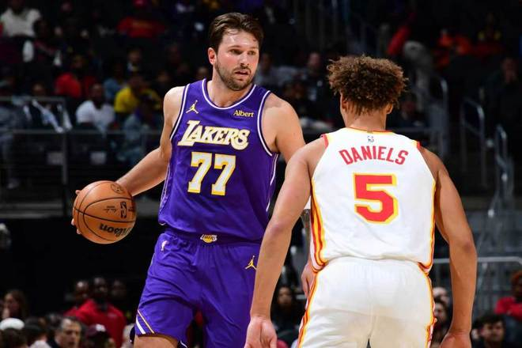

北京时间11月10日，NBA常规赛湖人客场对阵老鹰，湖人是背靠背第二场，东契奇休战一场后复出，里夫斯因病缺席。东契奇引领湖人打出过16-0攻击波，且率领湖人逐步扩大20分领先优势，老鹰持续顽强反扑追到差2分，湖人重新拉开比分，最终湖人124-114战胜老鹰豪取6连胜，湖人成为新赛季首支达成10胜球队高居联盟第一，老鹰结束4连胜。

湖人：东契奇32分8板10助5断2帽、马穆凯拉什维利23分8板3助、凯斯勒21分10板4助、塞克斯顿18分2板6助、威廉姆斯12分2板2助2断。

老鹰：麦科勒姆21分4助、沃克20分4板4助2断2帽、奥孔武16分9板3助、约翰逊15分7板4助2断、维金斯15分3板3助、丹尼尔斯10分6板8助4断。

东契奇复出之战表现全面率队取胜。

东契奇生涯三分命中数超越纳什，升至NBA历史三分命中榜第40名。

东契奇成为自从1962-63赛季的张伯伦后，赛季前10场比赛总得分最高的球员。

里夫斯上一场轰下43分创赛季新高，本场因病缺席，格莱姆斯因为手指伤势缺席，东契奇休战一场后复出。

麦科勒姆达成NBA生涯2200记三分里程碑，成为NBA历史第16人。

湖人前11场9胜2负西部第一，老鹰前11场7胜4负。本场老鹰缺少盖耶、吉尔伯特等，湖人迎来东契奇复出。首节开局，湖人被老鹰压制2-7落后，扎威与奥孔武对攻一记三分。凯斯勒上篮追分，老鹰连得5分扩大8分优势，塞克斯顿大号两分打破湖人得分荒。奥孔武勾手得分，湖人一波9-2攻势追到仅差1分，老鹰连得3分，东契奇攻传结合引领一波13-0攻势反超比分，首节结束湖人31-22领先老鹰。首节湖人21中11，其中三分10中3，东契奇9+3+5+3+1帽+4失误；老鹰20中7，其中三分10中2。

次节比赛，扎威三分命中，湖人攻击波扩大16-0，弗莱明斯中投得分，马穆与兰代尔各中一记三分。凯斯勒连续两次空接暴扣打停黄蜂，老鹰连追5分，凯斯勒再得5分已经一人连得9分，塞克斯顿连得5分扩大51-32领先打停老鹰。沃克两罚全中，塞克斯顿与沃克对攻一记三分，东契奇三罚全中扩大20分优势。奥孔武2+1追分，塞布尔三分命中，老鹰一波10-2攻势追分。东契奇与凯斯勒接连得分扩大14分优势，维金斯三分命中，湖人单节37-35再赢2分，上半场结束湖人68-57领先老鹰。前两节比赛，老鹰三分21中7，全队3人得分上双；湖人三分18中8，东契奇14+4+8与凯斯勒15+5，引领4人得分上双。

中场休息回来，扎威连续两记暴扣扩大15分优势，老鹰一波9-0攻势追到差6分。凯斯勒2+1得分，沃克连中两记三分，东契奇连得4分，奥孔武空接暴扣，马穆三分命中，杰伦空接暴扣追分。东契奇与麦科勒姆各中一记三分，马穆与多尔特也各中一记三分，东契奇再得2分。老鹰多点开花一波8-2攻势追到仅差3分，东契奇中投得分，湖人单节27-33输掉6分，三节结束湖人被追到仅95-90领先老鹰。前三节比赛，湖人三分28中12，东契奇28+7+9+5与凯斯勒18+8，引领湖人5人得分上双；老鹰三分33中13，沃克18分与杰伦15+7+4，引领4人得分上双。

进入第四节比赛，马穆率先三分命中，维金斯抛射得分，凯斯勒两罚一中，兰代尔中投追分。弗莱明斯与塞克斯顿均两罚一中，维金斯三分命中追到差2分，湖人连得4分，双方持续拉锯战缠斗。湖人逐步重新扩大两位数领先优势，最终湖人124-114战胜老鹰豪取6连胜，老鹰结束4连胜。

湖人：塞布尔、拉拉维亚、凯斯勒、扎威、东契奇

老鹰：丹尼尔斯、杰伦·约翰逊、奥孔武、沃克、弗莱明斯

特别声明：以上内容(如有图片或视频亦包括在内)为自媒体平台“网易号”用户上传并发布，本平台仅提供信息存储服务。

Notice: The content above (including the pictures and videos if any) is uploaded and posted by a user of NetEase Hao, which is a social media platform and only provides information storage services.

篮球扫地僧 2026-11-10 18:28:30

小齐说球 2026-11-10 15:06:31

咪咕体育 2026-11-09 17:49:12

懂球帝 2026-11-10 15:49:13

董老师看竞技 2026-11-10 14:05:08

主宰稳场 2026-11-09 00:13:59

你是佛的弟子 2026-11-10 03:26:55

山野探险家c 2026-11-08 03:38:27

黑曼巴谈球 2026-11-10 15:08:25

ChinaRain刘晓健 2026-11-10 03:06:54

黑曼巴谈球 2026-11-10 15:03:03

咪咕体育 2026-11-09 17:49:07

紧跟时代脉搏 2026-11-08 03:50:45

篮球盛世 2026-11-10 10:42:00

禾三千体育 2026-11-10 17:49:15

咪咕体育 2026-11-09 17:47:50

萌萌乐翔事 2026-11-09 04:46:39

体坛速报局 2026-11-10 11:31:12

篮球扫地僧 2026-11-10 18:31:46

德瀚文 2026-11-08 05:47:29

人间闲散客 2026-11-08 01:16:21

老汆古装影视解说 2026-11-09 02:59:29

看球图一乐 2026-11-08 08:59:51

体坛速报局 2026-11-10 12:21:47

宗介说体育 2026-11-09 13:49:26

酒话醉人 2026-11-10 04:40:09

上班摸鱼一级选手 2026-11-09 02:33:15

黑曼巴谈球 2026-11-08 05:56:14

后仰跳投绝杀 2026-11-10 17:12:02

孤单是寂寞的毒 2026-11-09 03:04:12

主宰稳场 2026-11-10 00:15:01

MELO的篮球频道 2026-11-10 06:27:13

马三看世界 2026-11-10 12:40:03

咪咕体育 2026-11-09 17:49:05

夜里的海风 2026-11-08 04:13:44

小轲搞笑解说 2026-11-10 00:57:20

乐享人生风雨 2026-11-09 00:30:56

弦泉说球 2026-11-09 13:52:06

铭记人类辉煌 2026-11-10 03:10:40

慕名而来只为你 2026-11-09 02:21:11

## 配图

图：综合（网易体育 · 2026-11-10）

## 来源

- [网易体育 · 原文](https://www.163.com/dy/article/LBC8OQ2V0529RKNN.html)
