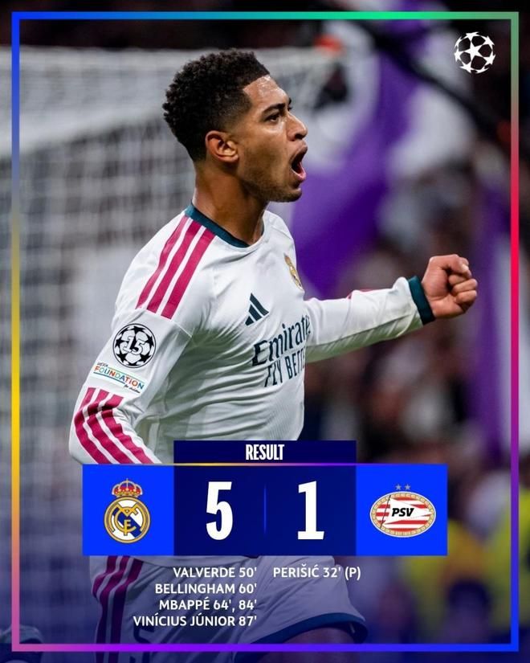

北京时间11月25日凌晨，2026-27赛季欧冠联赛阶段第5轮先赛9场。在1场焦点战中，皇马坐镇主场5-1逆转埃因霍温，欧冠5战全胜暂时领跑积分榜。

而本场比赛，皇马一度在主场半场落后，但63岁的穆帅再次展现过人胆识。中场休息时他直接做出了3人的调整，换下了两名中后卫吕迪格和米利唐，还有后腰楚阿梅尼，换上科纳特、赫伊森、贝林厄姆，而这直接改变了战局。

下半场，皇马防线再无丢球并且连进5球，轻松的完成了逆转。替补登场的贝林厄姆完成传射，成为球队逆转的重要功臣，穆帅再一次展现了自己出色的临场指挥应变能力。

随着本场逆转，穆帅已经率领皇马各项赛事10连胜，进31球丢10球。这波连胜中，穆里尼奥的球队多次上演逆转绝杀的好戏。

欧冠客场对阵罗马，皇马最后7分钟连进3球，凭借吕迪格第90分钟的绝杀，4-3逆转取胜；客战雅典AEK，巴尔韦德第92分钟完成绝杀，帮助皇马3-2逆转带走3分。

回到联赛，皇马上轮主场2-1逆转塞尔塔。此役面对埃因霍温，皇马半场0-1落后，下半场再次翻盘，把连胜场次推进到两位数。

除了逆转，皇马还在备受关注的国家德比中上演绝杀，终结对手联赛9连胜。重返伯纳乌的“Special One”，正带领皇马一次次在关键时刻拿下胜利。

特别声明：以上内容(如有图片或视频亦包括在内)为自媒体平台“网易号”用户上传并发布，本平台仅提供信息存储服务。

Notice: The content above (including the pictures and videos if any) is uploaded and posted by a user of NetEase Hao, which is a social media platform and only provides information storage services.

涵有话说 2026-11-25 14:41:08

福酱的小时光 2026-11-25 17:02:04

福酱的小时光 2026-11-25 16:25:23

福酱的小时光 2026-11-25 17:30:48

原谅你 2026-11-24 04:57:02

懂球帝 2026-11-25 18:21:07

精彩一网打尽 2026-11-25 16:17:20

福酱的小时光 2026-11-25 18:59:21

第X个想法 2026-11-25 11:46:44

生活浩浩乐 2026-11-25 02:47:23

足球印象CC 2026-11-25 13:53:44

静谧而安g 2026-11-25 03:22:23

翻车选手小李 2026-11-23 02:11:43

懂球帝 2026-11-25 18:31:55

左脚爆射得分 2026-11-24 12:05:26

足球印象CC 2026-11-23 17:59:34

奇聞空间 2026-11-25 11:47:52

揭秘那些精彩 2026-11-25 16:38:24

智慧教育空间站 2026-11-25 03:52:17

福酱的小时光 2026-11-25 18:43:05

家禽搞笑事务所 2026-11-23 02:07:28

魔法污A 2026-11-23 03:02:15

张硜卤说体育 2026-11-23 00:48:41

术之影 2026-11-23 05:12:27

孤酒老巷QA 2026-11-24 14:50:10

足球印象CC 2026-11-25 06:37:14

魔法污A 2026-11-25 03:04:08

痞子时代 2026-11-25 16:24:48

缪尚咖啡馆 2026-11-23 08:52:49

揭秘那些精彩 2026-11-25 16:35:51

林中小呜 2026-11-25 02:16:32

超级无敌美少女何 2026-11-24 05:20:16

胡又扯 2026-11-23 01:26:57

痞子时代 2026-11-25 16:27:22

精彩背后 2026-11-23 12:22:11

我们的足球记忆 2026-11-25 00:23:39

九清怡 2026-11-23 06:45:01

运动小看台 2026-11-24 08:08:20

全力说体育 2026-11-25 09:13:46

足球印象CC 2026-11-24 07:13:16

## 配图

图：综合（网易体育 · 2026-11-25）

## 来源

- [网易体育 · 原文](https://www.163.com/dy/article/LCIEOMIO0529CA1F.html)
