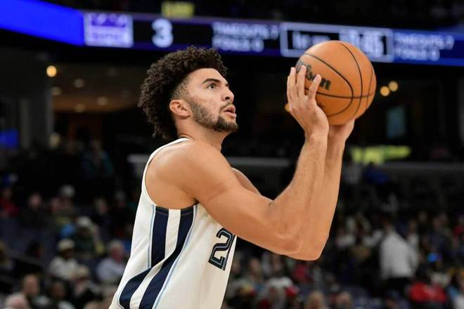

北京时间11月1日，NBA常规赛灰熊主场对阵国王，灰熊借助团队攻势一边倒碾压国王，且逐步扩大34分领先优势提前锁定胜局，最终灰熊136-105大胜双杀国王豪取开局6连胜，灰熊是唯一全胜球队高居联盟第一，国王遭遇开局6连败。

灰熊：布泽尔27分9板3助、斯图尔特24分4板、GG·杰克逊21分3板2助、格兰特14分2板1助2帽、科沃德10分7板2助2断、斯潘塞10分5板13助。

国王：阿卡夫9三分38分5板5助、亨特19分3板、萨博尼斯11分14板8助、拉文11分1助、蒙克8分3助2断。

灰熊前5场5胜0负保持不败，国王前5场0胜5负一胜难求，本赛季首次交锋灰熊客场123-112战胜国王。本场国王缺少穆雷、雷诺、西蒙斯，灰熊缺少杰罗姆、波斯特与小皮蓬。首节开局灰熊0-7落后，灰熊一波8-0攻势反超比分，双方之后缠斗至11-11。灰熊多点开花一波12-0攻势取得领先，灰熊继续维持27-15领先优势，国王连追6分，首节比赛结束灰熊27-21领先国王。

次节比赛，双方进攻火力提升均是单节轰下30+得分对攻，灰熊扩大36-23领先优势，国王一波6-0攻势追分。灰熊多点开花打出一波15-1攻势，灰熊已经扩大51-30领先国王，国王外线三分开火打出一波9-0攻势追分。灰熊维持58-46领先，阿卡夫三分命中再追6分，灰熊很快再度拉开比分。灰熊单节39-34净胜5分，上半场结束灰熊66-55领先国王。前两节比赛，阿卡夫5记三分21分创队史新秀纪录，杰克逊与斯图尔特均是15分。

中场休息回来，灰熊进攻火力进一步提升，本场首次单节得分40+。布泽尔三分命中引领灰熊扩大77-59领先，布泽尔继续造犯规罚球扩大82-60领先优势。国王反扑追到差18分，灰熊多点开花一波13-2攻势，已经扩大101-72领先优势。灰熊随后继续扩大30+领先优势，国王略有追分，灰熊单节42-25净胜17分，三节结束灰熊扩大108-80领先国王。前三节比赛，阿卡夫31+8三分引领3人得分上双，布泽尔27+8引领4人得分上双。

灰熊带着28分巨大领先优势进入第四节比赛，由于双方之间比分差距太大，比赛已经提前失去胜负悬念。年轻球队灰熊展现出惊人的战斗力，而摆烂大队国王依然是攻防崩盘，末节比赛彻底进入垃圾时间，最终灰熊轻松大胜国王豪取开局6连胜，灰熊6胜0负联盟唯一全胜领跑，国王0胜6负西部唯一全败垫底。

灰熊：伊迪、布泽尔、科沃德、韦尔斯、斯潘塞

国王：亨特、阿丘瓦、小萨博尼斯、拉文、阿卡夫

特别声明：以上内容(如有图片或视频亦包括在内)为自媒体平台“网易号”用户上传并发布，本平台仅提供信息存储服务。

Notice: The content above (including the pictures and videos if any) is uploaded and posted by a user of NetEase Hao, which is a social media platform and only provides information storage services.

大西体育 2026-11-01 13:39:58

咪咕体育 2026-10-31 04:31:54

港湾无船 2026-11-01 17:02:10

阿嬍体育评论 2026-10-31 03:36:24

咪咕体育 2026-10-31 04:30:37

艳儿说电影 2026-11-01 17:30:59

贵圈真乱 2026-11-01 12:20:00

林小湜体育频道 2026-11-01 16:55:56

包饺子ai剪辑 2026-11-01 18:42:30

超级无敌美少女何 2026-10-30 05:21:00

环球体坛啄木鸟 2026-10-30 18:52:10

破晓资讯 2026-11-01 15:38:24

懂球帝 2026-11-01 10:56:11

篮球盛世 2026-10-31 10:06:00

包饺子ai剪辑 2026-11-01 18:40:50

体坛风之子 2026-11-01 17:43:06

泪之魂y 2026-10-31 02:18:23

阿嬍体育评论 2026-10-31 03:37:49

体坛速评君 2026-11-01 17:36:30

马三看世界 2026-10-31 05:20:58

简单清风 2026-10-30 21:09:24

安若浅溪b 2026-10-31 04:49:22

小郭聊球 2026-10-31 17:29:23

暗香暗香 2026-11-01 18:43:37

探长影视解说 2026-11-01 17:47:35

探长影视解说 2026-11-01 17:46:27

南方的冬天 2026-10-30 03:19:35

董老师看竞技 2026-10-30 14:53:15

巫马晨辰z 2026-11-01 03:48:29

正经球迷 2026-10-30 15:54:36

董老师看竞技 2026-11-01 15:40:35

扶光看世界 2026-10-31 02:17:19

体坛周报 2026-11-01 19:12:14

你笑的好甜美 2026-11-01 11:20:39

吕谑极限手工 2026-11-01 13:26:57

老田说赛事 2026-11-01 17:13:27

篮球大图 2026-11-01 10:59:12

董老师看竞技 2026-11-01 14:30:04

雪里温柔z 2026-11-01 06:20:02

骄阳之夏明 2026-10-31 01:04:07

## 配图

图：综合（网易体育 · 2026-11-01）

## 来源

- [网易体育 · 原文](https://www.163.com/dy/article/LAL3QO2H0529RKNN.html)
