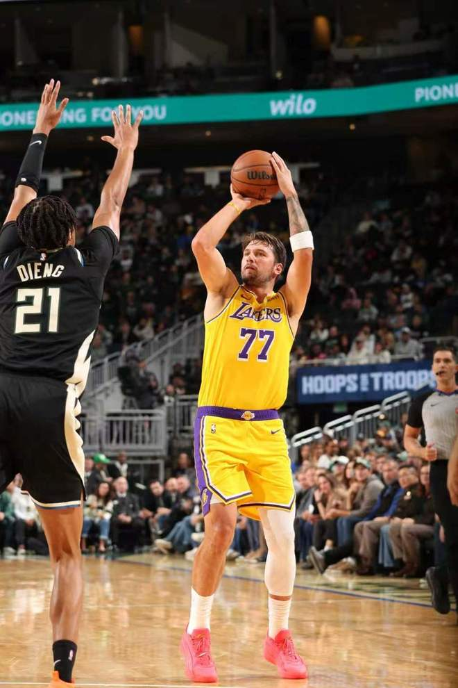

北京时间11月12日，NBA常规赛湖人客场对阵雄鹿，雄鹿是背靠背第二场，里夫斯与东契奇相继受伤。湖人在东契奇、里夫斯与马穆三叉戟给力表现引领下，持续压制雄鹿逐步扩大20+领先优势，最终湖人123-112战胜雄鹿豪取7连胜高居联盟第一，雄鹿遭遇8连败联盟垫底。

湖人：东契奇32分5板5助3断、马穆凯拉什维利23分3板2助、里夫斯18分3板5助3断、凯斯勒10分11板3助、塞克斯顿10分1板3助。

雄鹿：希罗27分2板7助、哈克斯25分5板3助2断、吉昂9分2板4助、库兹马9分。

东契奇32+5+5率队取胜高居联盟第一。

里夫斯休战一场后迎来复出，湖人缺少格莱姆斯，雄鹿缺少特纳。

东契奇、里夫斯与塞克斯顿相继受伤。

湖人前12场10胜2负联盟第一，雄鹿前11场1胜10负。本场首节开局湖人2-7落后，东契奇三分开火引领一波12-0攻势反超，马穆也三分命中扩大17-10领先。东契奇持续得分引领湖人扩大26-18领先优势，雄鹿回敬一波10-4攻势追分，首节结束湖人30-28领先雄鹿。首节湖人21中11，其中三分11中3，东契奇9中5得到16+1+1+2+3失误，塞布尔、拉拉维亚与凯斯勒3位首发0分；雄鹿24中11，其中三分11中4，哈克斯8分与希罗7分5助攻。

次节比赛，湖人连续两节单节得分30+，且限制雄鹿连续两节不足30分。东契奇单节4中1仅得到3分，湖人被这规定45-43仅领先2分，马穆与里夫斯持续得分，率领湖人重新扩大两位数领先优势。湖人单节31-22净胜9分，上半场结束湖人扩大61-50领先雄鹿。前两节比赛，湖人三分19中6，东契奇19+3+2+2、里夫斯与马穆均15分；雄鹿三分22中6，希罗18分7助攻与哈克斯16分。

中场休息回来，湖人连续三节单节得分30+，且限制雄鹿连续两节单节不足25分。马穆连续外线三分命中，东契奇与里夫斯攻传结合，湖人逐步扩大77-60领先优势。扎威也命中三分，东契奇继续率队扩大85-65领先20分优势，湖人继续扩大领先优势，湖人单节33-23净胜10分，三节结束湖人扩大94-73领先雄鹿。前三节比赛，湖人三分30中13，东契奇26+5+5+3、里夫斯18分与马穆21分；雄鹿三分29中8，希罗21+7与哈克斯21分。

进入第四节比赛，湖人继续扩大100-78领先优势，并在之后拉开115-92领先优势。东契奇受伤下场，湖人换上替补阵容，湖人继续掌控领先优势，最终湖人战胜雄鹿豪取7连胜高居联盟第一。

湖人：塞布尔、拉拉维亚、凯斯勒、里夫斯、东契奇

雄鹿：阿门特、库兹马、韦尔、希罗、伯里斯

特别声明：以上内容(如有图片或视频亦包括在内)为自媒体平台“网易号”用户上传并发布，本平台仅提供信息存储服务。

Notice: The content above (including the pictures and videos if any) is uploaded and posted by a user of NetEase Hao, which is a social media platform and only provides information storage services.

十三哥侃大山 2026-11-12 12:36:53

章民解说体育 2026-11-12 14:18:44

大西体育 2026-11-12 13:52:06

体育闲话说 2026-11-12 16:33:09

宗介说体育 2026-11-12 12:06:49

阿嬍体育评论 2026-11-11 04:11:08

一路荒凉如歌a 2026-11-11 02:46:45

篮球扫地僧 2026-11-12 19:19:00

咪咕体育 2026-11-12 03:08:24

你是佛的弟子 2026-11-10 03:26:55

篮球大视野 2026-11-12 15:18:56

咪咕体育 2026-11-12 03:05:10

激情与荣耀并存 2026-11-11 03:41:25

老王日常犯傻 2026-11-11 00:47:57

咪咕体育 2026-11-12 03:08:22

体坛速报局 2026-11-10 11:31:12

一路荒凉如歌a 2026-11-12 02:42:00

一路荒凉如歌aa 2026-11-12 02:09:42

ChinaRain刘晓健 2026-11-10 03:06:54

聚焦事件 2026-11-12 04:17:38

董老师看竞技 2026-11-10 14:05:08

原谅你 2026-11-11 04:33:11

泪之魂y 2026-11-12 01:59:16

激情与荣耀并存 2026-11-12 03:18:00

你是佛的弟子 2026-11-11 03:04:59

星耀球坛 2026-11-10 23:55:41

你是佛的弟子 2026-11-12 03:01:30

魔法污A 2026-11-11 03:10:26

孤单是寂寞的毒 2026-11-12 03:29:33

主宰稳场 2026-11-10 00:15:01

原谅你 2026-11-12 04:32:56

村里整活小分队 2026-11-12 00:03:32

水清云淡v 2026-11-11 12:22:05

丁铗惊悚影视解说 2026-11-11 00:17:03

体坛速报局 2026-11-12 11:43:50

黑曼巴谈球 2026-11-10 15:08:25

篮球扫地僧 2026-11-12 16:59:10

咪咕体育 2026-11-12 03:08:23

骄阳之夏明 2026-11-12 01:33:20

聚焦真实瞬间 2026-11-11 00:08:08

## 配图

图：综合（网易体育 · 2026-11-12）

## 来源

- [网易体育 · 原文](https://www.163.com/dy/article/LBHHK9RK0529RKNN.html)
