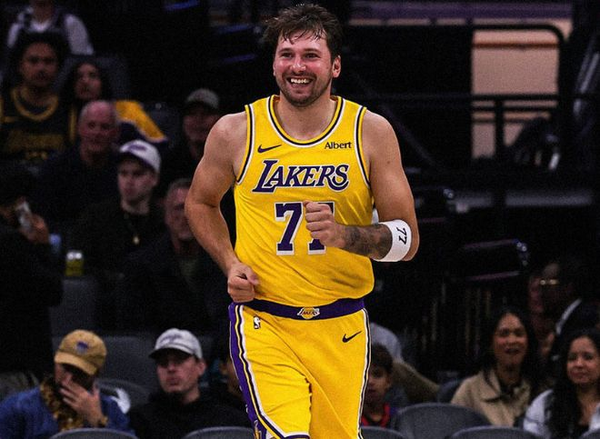

北京时间11月19日，NBA常规赛湖人主场对阵爵士，双方均是背靠背第二场，里夫斯继续缺席，凯斯勒迎来复出。湖人遭遇爵士顽强阻击，末节开局湖人追平比分，爵士一波15-0攻势拉开比分。湖人追到差8分，爵士一波小高潮重新拉开18分领先优势锁定胜局，最终湖人97-109爆冷输给爵士结束9连胜，爵士收获2连胜。

湖人：东契奇29分5篮板7助攻2抢断9失误，格雷姆斯20分7篮板4助攻，凯斯勒10分11篮板，塞克斯顿12分。

爵士：乔治5记三分30分10助攻，贝利19分8篮板，格林11分，彼得森11分，米哈伊柳克15分。

湖人15场13胜2负，爵士前15场2胜13负。本场爵士缺少贾伦·杰克逊、马尔卡宁与努尔基奇，湖人缺少里夫斯，凯斯勒迎来复出。首节开局湖人4-3领先，爵士一波6-0攻势反超，东契奇中投得分，双方之后缠斗至湖人8-13落后。格莱姆斯三分命中，海斯空接暴扣，湖人一波7-0攻势反超3分，爵士回敬一波10-2攻势反超5分。东契奇攻传结合引领一波14-1攻势反超8分，米哈伊柳克三分命中，首节结束湖人34-29领先爵士。首节爵士三分7中3，湖人三分10中4，东契奇12中6得到15+2+2。

次节比赛，湖人冲击内线扩大38-30领先，班巴空接暴扣，格莱姆斯中投得分。爵士一波13-3攻势反超2分，扎威空接暴扣，爵士连得4分，湖人反扑追到50-50。爵士连得4分，湖人连得4分追平，贝利两罚全中，湖人单节20-27输掉7分，上半场结束湖人54-56被爵士反超。前两节比赛，爵士三分18中8，乔治18+7与米哈伊柳克12分；湖人三分15中4，东契奇22+3+3（三分8中1）与塞克斯顿10分。

中场休息回来，双方第三节均是不足25分，爵士连得6分扩大8分优势，格莱姆斯三分开火引领一波9-0攻势反超1分。双方紧咬比分缠斗至69-69，格莱姆斯再中三分，爵士回敬一波7-0攻势反超4分。湖人连得4分追平比分，彼得森抛射命中，双方单节维持22-22，三节结束湖人76-78落后爵士。前三节比赛，湖人三分25中7，东契奇26+6（三分11中1）与格莱姆斯18分；爵士三分27中11，乔治21+7与米哈伊柳克12分。

进入第四节比赛，湖人率先追到79-79，并在之后缠斗至83-83，爵士多点开花一波15-0攻势拉开比分。凯斯勒暴扣与塞克斯顿上篮得分，东契奇三分命中引领一波7-0攻势打停爵士，爵士多点开花一波10-0攻势拉开18分优势，湖人请求暂停。还剩不到2分钟湖人90-108落后，湖人已经无力扭转局势，湖人撤下主力提前认输，最终湖人爆冷输给爵士结束9连胜。

湖人：塞布尔、扎威、凯斯勒、格莱姆斯、东契奇

爵士：乔治、贝利、格林、彼得森、班巴

特别声明：以上内容(如有图片或视频亦包括在内)为自媒体平台“网易号”用户上传并发布，本平台仅提供信息存储服务。

Notice: The content above (including the pictures and videos if any) is uploaded and posted by a user of NetEase Hao, which is a social media platform and only provides information storage services.

篮球大视野 2026-11-19 13:58:17

鱼崖大话篮球 2026-11-19 13:43:53

锐评利物浦 2026-11-19 18:46:09

体育闲话说 2026-11-19 18:55:44

罗说NBA 2026-11-19 07:09:13

咪咕体育 2026-11-19 06:58:54

锐评利物浦 2026-11-19 18:54:53

咪咕体育 2026-11-19 06:58:48

董老师看竞技 2026-11-19 14:32:02

夜白侃球 2026-11-19 18:57:04

夜白侃球 2026-11-19 18:55:31

咪咕体育 2026-11-19 06:58:51

咪咕体育 2026-11-19 06:58:53

咪咕体育 2026-11-19 06:59:00

曹操篮球解说 2026-11-19 13:05:20

董老师看竞技 2026-11-17 17:23:51

阿嬍体育评论 2026-11-18 03:34:17

众生的世界观 2026-11-19 03:26:19

咪咕体育 2026-11-19 06:59:00

篮球人物故事会 2026-11-17 18:01:24

咪咕体育 2026-11-19 06:57:23

6个果子说球 2026-11-18 15:52:22

看球图一乐 2026-11-18 08:51:09

23号球魁 2026-11-17 17:12:19

难寄期许w 2026-11-19 01:20:32

草莓信箱 2026-11-18 21:45:18

揭秘那些精彩 2026-11-19 16:00:53

仰卧撑FTUer 2026-11-19 18:51:05

罗吹终结者 2026-11-19 14:49:43

23号球魁 2026-11-18 20:24:18

董老师看竞技 2026-11-17 12:17:25

一纸情书s 2026-11-19 05:30:08

春若秋水 2026-11-19 12:17:49

正经球迷 2026-11-18 15:22:11

凯西的生活 2026-11-19 01:37:14

两重心事p 2026-11-19 03:46:56

篮球过人技巧 2026-11-18 17:32:23

紧跟时代脉搏 2026-11-19 03:18:22

看球图一乐 2026-11-19 13:33:28

紧跟时代脉搏 2026-11-19 03:19:46

## 配图

图：综合（网易体育 · 2026-11-19）

## 来源

- [网易体育 · 原文](https://www.163.com/dy/article/LC3OUDS70529RKNN.html)
