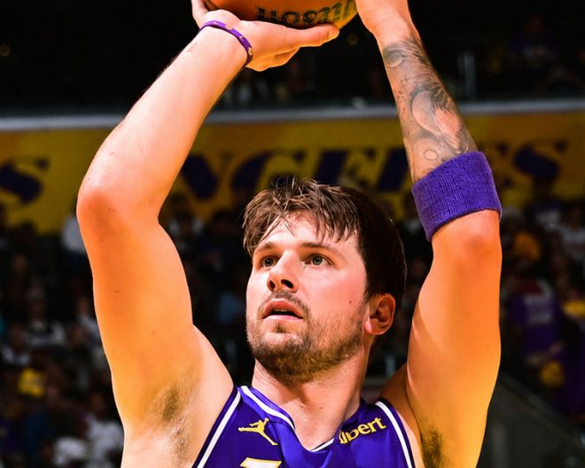

北京时间11月18日，NBA常规赛湖人主场对阵黄蜂，凯斯勒与里夫斯缺席，东契奇前两节4次犯规，湖人被黄蜂压制逐步拉开落后18分差距。格莱姆斯爆发帮助湖人反扑，第四节最后时刻格莱姆斯命中绝平三分。进入加时赛比拼，双方紧咬比分缠斗，湖人最后时刻贡献关键攻防表现，最终湖人118-114加时逆转战胜黄蜂豪取9连胜，湖人13胜2负独占联盟第一，黄蜂遭遇3连败。

湖人：里夫斯与凯斯勒缺席，东契奇5记三分36分6篮板7助攻。格莱姆斯10记三分47分6篮板，得分与三分命中数创生涯新高纪录。塞克斯顿10分。

黄蜂：米勒5记三分28分，里德23分11篮板，怀特19分，格威12分，奥尼尔13分。

东契奇成为本赛季突破500分首人。

东契奇前13场得分500+历史第4人，前三位是张伯伦（3次）、里克·巴里与哈登。

东契奇连续11场得分30+湖人队史第2人，前一位是贝勒。

格莱姆斯成为本赛季湖人第3位单场40+得分球员，前两位是东契奇与里夫斯。

格莱姆斯单场10记三分本赛季联盟首人。

格莱姆斯10记三分创生涯纪录。

格莱姆斯生涯第3次单场得分40+。

湖人前14场12胜2负，黄蜂前13场4胜9负。本场湖人缺少凯斯勒与里夫斯，黄蜂缺少阿伦、克努佩尔与施罗德。首节开局东契奇两罚不中，卢尼补篮得分，黄蜂一波9-2攻势取得领先，拉拉维亚连得4分。米勒与塞布尔对攻一记三分，里德中投得分，东契奇引领一波7-3攻势反超。黄蜂回敬一波7-2攻势，双方接连三分命中，东契奇早早身背3犯主动要求下场，首节结束湖人30-34落后黄蜂。首节黄蜂23中11，其中三分13中5，里德14分与米勒11分；湖人26中13，其中三分13中4，东契奇12中4得到9分3助攻2失误3犯规。

次节比赛，格莱姆斯连中两记三分反超，怀特连中三分引领一波8-0攻势打停湖人，塞克斯顿中投得分，黄蜂一波7-0攻势扩大11分优势。东契奇重新登场，塞布尔与米勒对攻一记三分，东契奇2+1追分，米勒与东契奇各中一记三分。米勒抛射命中，湖人逐步追到差7分，奥尼尔三分回敬，格莱姆斯抛射与东契奇三分命中。里德超远三分命中，东契奇第4犯，雷迪克不满吃T送奥尼尔罚中一球，东契奇两罚全中，上半场结束湖人59-66落后黄蜂。前两节比赛，东契奇22分4失误4犯规与格莱姆斯16分，米勒19分与里德19分。

中场休息回来，黄蜂逐步扩大10分优势，格莱姆斯2+1与三分命中连追6分，怀特与东契奇各得2分，米勒与东契奇对攻一记三分。黄蜂多点开花一波16-2攻势扩大18分优势，湖人多点开花回敬一波7-2攻势追分，怀特三分不中，东契奇超远三分不中。湖人单节22-28输掉6分，三节结束湖人81-94落后黄蜂。前三节比赛，湖人三分34中12，东契奇29分5助攻与格莱姆斯24分；黄蜂三分39中15，米勒26分与里德19+9+4，引领黄蜂4人得分上双。

进入第四节比赛，湖人一波6-3攻势追分，米勒抛射命中，格莱姆斯连中两记三分追到差6分。黄蜂连得3分，格莱姆斯两记三分与两罚全中连得8分，怀特中投回敬，东契奇三分命中追到104-104。奥尼尔三分命中，东契奇大帽米勒，东契奇两罚全中，怀特中投命中。东契奇三分不中，怀特被犯规两罚一中扩大4分优势，湖人出现致命失误，怀特请求暂停。格莱姆斯上篮命中追到差2分，怀特被犯规两罚一中，东契奇助攻格莱姆斯三分命中扳平，双方常规时间111-111。

进入加时赛，里德率先三分命中，塞克斯顿两罚全中，东契奇随后抛射命中反超比分。塞克斯顿连续两次被封盖，湖人连续三分不中，拉拉维亚大帽里德，双方连续三分不中。东契奇第5犯，里德嘴巴出血暂停处理，黄蜂出现失误。格莱姆斯被犯规两罚全中扩大3分优势，黄蜂出现致命失误，塞布尔抢断被犯规两罚一中，黄蜂无力完成翻盘，最终湖人加时逆转战胜黄蜂豪取9连胜，黄蜂遭遇3连败。

湖人：塞布尔、拉拉维亚、卢尼、格莱姆斯、东契奇

黄蜂：格威、里德、迪亚巴特、米勒、怀特

特别声明：以上内容(如有图片或视频亦包括在内)为自媒体平台“网易号”用户上传并发布，本平台仅提供信息存储服务。

Notice: The content above (including the pictures and videos if any) is uploaded and posted by a user of NetEase Hao, which is a social media platform and only provides information storage services.

环球体坛啄木鸟 2026-11-18 17:52:14

网文作者夏少斌 2026-11-16 19:17:39

兵哥篮球故事 2026-11-18 19:06:32

甜瓜唠生活 2026-11-17 07:16:02

球毛鬼胎 2026-11-18 18:45:13

精彩一网打尽 2026-11-16 15:28:13

23号球魁 2026-11-17 17:12:19

看球图一乐 2026-11-16 14:36:36

体育慢镜头 2026-11-16 23:21:40

6个果子说球 2026-11-18 15:52:22

老付聊体育 2026-11-18 11:49:34

小轲搞笑解说 2026-11-17 00:52:12

堂主撩車 2026-11-18 01:21:09

光影拾贝 2026-11-17 01:40:13

収起了底线 2026-11-17 01:53:35

体坛八点半的那些事儿 2026-11-18 19:12:42

马三看世界 2026-11-17 08:42:40

梦仙境aa 2026-11-17 20:16:58

环球体坛啄木鸟 2026-11-18 18:09:24

小赖评球 2026-11-17 18:10:42

咪咕体育 2026-11-16 21:36:04

十三哥侃大山 2026-11-18 00:38:11

淡然综艺 2026-11-16 11:25:14

老付聊体育 2026-11-17 20:59:00

篮球人物故事会 2026-11-17 18:01:24

精彩一网打尽 2026-11-17 18:53:28

大妹侃娱乐 2026-11-16 19:14:27

老付聊体育 2026-11-18 11:53:51

尺素a 2026-11-18 03:44:52

看球图一乐 2026-11-18 08:51:09

大卫的篮球故事 2026-11-18 19:39:37

老付聊体育 2026-11-17 21:00:07

曹操篮球解说 2026-11-18 11:18:02

一纸情书s 2026-11-15 21:34:29

冷饭说球 2026-11-17 17:19:03

翻车选手小李 2026-11-18 00:48:07

丁铗惊悚影视解说 2026-11-15 21:42:37

董老师看竞技 2026-11-17 12:17:25

阿嬍体育评论 2026-11-18 03:34:17

薛艳艳爱生活 2026-11-18 11:56:13

## 配图

图：综合（网易体育 · 2026-11-18）

## 来源

- [网易体育 · 原文](https://www.163.com/dy/article/LC1AD5SD0529RKNN.html)
