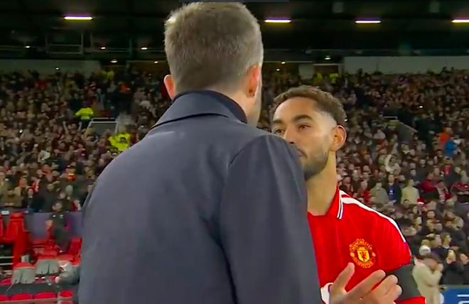

11月4日凌晨，曼联在主场3-2击败了罗马。赛后，场上出现了不和谐的一幕。卡里克催促染红的库尼亚赶快离场，后者非常不满，挥手发泄情绪。

本场比赛跌宕起伏，而库尼亚是曼联大逆转的头号功臣。上半场，曼联0-2落后。下半场，B费第一个站出来，打进点球，吹响反攻的号角。第83分钟，罗马防线失误，库尼亚推射命中。

第86分钟，库尼亚展现顶级射手的实力，小角度爆射破门。进球后，库尼亚超级激动，脱衣冲上看台，与球迷一起激情庆祝，他也因此被黄牌警告。伤停补时阶段，库尼亚铲球动作过大，被出示第二张黄牌。

染红之后，库尼亚应该立刻离场。不过，他并没有离开。很快，比赛结束，库尼亚依旧没有离开，留在场内庆祝。作为主帅，卡里克担心库尼亚被追罚，故而让他赶紧离开。

对于卡里克的催促，库尼亚很不满意，露出不悦表情。卡里克不愿再与之纠缠，有点不开心地走开了。接着，库尼亚慢慢走出球场，但挥手表达了不满。离场时，库尼亚的嘴里也一直在说着什么。

此役，库尼亚4次射门3次射正，6次尝试过人4次成功，14次丢失球权，拿到了8.8分的评分。曼联球迷认为他赛后对卡里克的这个举动反映出了更衣室的危机，此前多家媒体称卡里克已失去了大部分曼联球员的支持。

特别声明：以上内容(如有图片或视频亦包括在内)为自媒体平台“网易号”用户上传并发布，本平台仅提供信息存储服务。

Notice: The content above (including the pictures and videos if any) is uploaded and posted by a user of NetEase Hao, which is a social media platform and only provides information storage services.

坠入温柔晚风 2026-11-04 06:09:06

竞技风云录 2026-11-04 04:09:29

锁上的光v 2026-11-04 04:19:19

一个香蕉说球 2026-11-03 16:12:29

懂球帝 2026-11-04 06:25:24

曹操篮球解说 2026-11-02 12:43:51

慢享生活集 2026-11-04 03:47:57

足球印象CC 2026-11-03 15:00:01

狍子歪解体坛 2026-11-04 05:35:03

铭记人类辉煌 2026-11-03 02:44:20

大眼睛看看 2026-11-03 02:23:10

一个香蕉说球 2026-11-03 16:07:43

显微镜下的人性 2026-11-04 05:19:30

吟雪情枫y 2026-11-01 10:19:52

侧身凌空斩 2026-11-04 05:57:26

元气满分吖 2026-11-04 06:09:19

侧身凌空斩 2026-11-04 05:58:27

一个香蕉说球 2026-11-03 16:12:38

墨史轩 2026-11-03 03:50:26

蜡笔足球 2026-11-04 05:27:37

拾忆足球 2026-11-01 14:39:09

一个香蕉说球 2026-11-03 16:12:31

足球印象CC 2026-11-02 19:59:30

CR7足球频道 2026-11-02 13:41:57

一个香蕉说球 2026-11-03 16:07:38

阿超他的体育圈 2026-11-04 05:49:22

罗吹终结者 2026-11-02 11:11:05

罗氏看球 2026-11-01 12:28:46

足球印象CC 2026-10-31 20:31:22

足球狗说 2026-11-04 06:26:38

火星猪同学 2026-11-03 02:13:01

搞怪幽默家 2026-11-03 10:35:36

上班摸鱼一级选手 2026-11-04 03:23:28

火星猪同学 2026-11-03 02:08:30

雨果体育sss 2026-11-03 11:08:33

狍子歪解体坛 2026-11-04 05:11:05

一路荒凉如歌aa 2026-11-04 02:19:53

浣溪爱球 2026-11-03 10:30:42

转会窗ProMax 2026-11-02 14:10:05

火星猪同学 2026-11-03 02:15:18

## 配图

图：综合（网易体育 · 2026-11-04）

## 来源

- [网易体育 · 原文](https://www.163.com/dy/article/LASE7PAB05566VBM.html)
