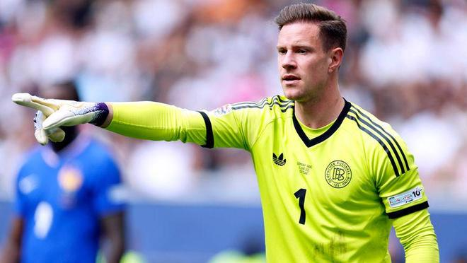

迪特马尔-哈曼主要谈到德国队大名单的征召，批评了几项人员决定，并讨论了国家队和俱乐部的门将问题。他还明确表态，谈到了诺伊尔、乌尔比希、哈里-凯恩和伦纳特-卡尔。

谈到克洛普是否因为征召菲尔克鲁格进入德国队大名单，而修正了自己“想培养新人”的说法：“我不觉得他是在修正自己的说法，因为他只征召了一名球员。他又没有一口气带上五个30岁球员。不过，没错，现在比赛要开始了。现在该拿出成绩了。等到春天的预选赛开始时，就必须交出结果。所以他现在征召的，都是他认为也会出现在预选赛中的球员，因为真正的关键阶段已经开始。”

谈到征召瓦伊勒-穆赫亚是否来得太早：“如果他们足够出色，那就已经足够成熟了。对门兴来说，他是在斯图加特赢下比赛的人，也是两粒进球的重要参与者。他是个不可思议的天才。我们现在就有几名这样的球员，比如赛义德-马拉或伦纳特-卡尔。他们踢的位置大致相同。所以我完全理解克洛普为什么想看看他。他有这个实力。”

谈到瓦伊勒-穆赫亚的特点：“技术出色，同时也很强硬。他去年已经踢了很多比赛。别忘了，门兴前六场全输了。然后他们去到斯图加特，没人觉得他们能赢，而他就是那个扭转比赛的人。这说明他在这么小的年纪就有实力和水平。他具备这种所需的韧性。所以我很期待看到他。”

谈到自己是否认为阿德耶米因落选，今后也不会再有位置：“这个只能由国家队主帅来回答。外界有不少批评声音。有人质疑弗里克，问他为什么要把阿德耶米带到巴塞罗那。他们为他花了很多钱，但到目前为止他做得非常出色。他打进过重要而精彩的进球，也在一定程度上作出了牺牲。当你加盟巴塞罗那这样的大俱乐部时，你就必须这么做。他有过几次高光时刻，但在多特蒙德也曾长时间沉寂。最近他相对稳定。所以克洛普没有带上他，让我有些意外。我们都知道，在现代足球里，速度是一件极其可怕的武器。看看这份阵容，真正具备这种速度的球员并不多。”

对德国队征召特尔施特根提出质疑：“我不明白为什么特尔施特根就配得上入选。没错，他曾严重受伤。这也是诺伊尔回归的原因之一。但也必须说，特尔施特根在国家队的表现并不好。主帅之所以把他当成一号门将，是因为我们已经没有诺伊尔或卡恩那样的人了。我看不出他配得上这个位置。”

谈到拜仁慕尼黑门将位置不断更换：“我上周就说过，把乌尔比希放进球门直到圣诞节前，是个合理的想法，这样他能先找到感觉。总有一天，你不能再顾及诺伊尔了。我认为赛季结束时多半也会这样。如果乌尔比希明年表现出色，我不排除他会在欧洲杯上担任门将。你也得考虑俱乐部。不能因为诺伊尔多年来一直是世界最佳门将、为俱乐部立下大功，就让他自己决定什么时候上场。没有这种反复摇摆，球队也许会更有安全感。”

谈到替诺伊尔做决定、转而长期让乌尔比希镇守拜仁球门：“如果他自己不作决定，你总有一天得替他做决定。如果俱乐部认为另一个人已经准备好了，而且表现不错，那即使面对诺伊尔，你也不能退让。我离那种‘只要诺伊尔健康就必须首发’的说法还差得远。现在已经到了这个节点。最近之所以没有再围绕一号门将或诺伊尔展开争论，就是因为乌尔比希表现得很好。这意味着，诺伊尔的伤病已经退到次要位置，因为乌尔比希把自己的工作做得无可挑剔。”

谈到哈里-凯恩的续约：“拜仁几乎别无选择，只能续约。他想留下，现在还拿到了金球奖。要是他拿了这个奖，俱乐部却还是放他走，那才会显得很奇怪。不过我还是认为，这次续约存在不小的风险。我不觉得英格兰那边有很多真正的追求者。所以这大概是他们没法做出其他决定的一次选择。至于他未来三年还能不能继续打进这么多球，还要看。这里面有一定风险。”

谈到围绕伦纳特-卡尔的讨论：“我们等了十年，才等到一个与众不同的球员。现在我们终于有了一个。可他们现在又想改变他。就让这个小伙子安静待着吧。这场讨论是从他的粉色西装开始的。这都已经过去六个月了。就让他穿粉色西装好了。他的队友肯定已经拿这事调侃过他很多次了。这些经历他迟早都得学会应对，这本来就是成长的一部分。年轻人就该让他们自己去做。至于庆祝动作，也是一样：就让他做吧。他用进球让所有争论都闭嘴了。”

特别声明：以上内容(如有图片或视频亦包括在内)为自媒体平台“网易号”用户上传并发布，本平台仅提供信息存储服务。

Notice: The content above (including the pictures and videos if any) is uploaded and posted by a user of NetEase Hao, which is a social media platform and only provides information storage services.

懂球帝 2026-11-05 20:09:47

懂球帝 2026-11-05 08:11:24

蜡笔小新爱体育 2026-11-05 18:24:54

懂球帝 2026-11-06 04:43:21

足球印象CC 2026-11-04 07:12:51

懂球帝 2026-11-06 05:35:11

懂球帝 2026-11-06 05:24:58

懂球帝 2026-11-06 01:39:27

一个香蕉说球 2026-11-03 16:12:38

左脚爆射得分 2026-11-04 10:54:27

懂球帝 2026-11-06 04:11:04

足球印象CC 2026-11-04 13:48:22

懂球帝 2026-11-06 05:46:37

猫熊说体育 2026-11-05 08:44:20

懂球帝 2026-11-05 23:32:17

神秘研究院 2026-11-05 10:41:55

左脚爆射得分 2026-11-04 11:05:40

阿超他的体育圈 2026-11-04 06:53:02

超喜欢我 2026-11-06 01:29:57

体坛观察猿 2026-11-06 06:03:59

一个香蕉说球 2026-11-03 16:12:31

超喜欢我 2026-11-06 01:34:30

第X个想法 2026-11-05 10:04:36

篮球人物故事会 2026-11-05 10:15:34

超喜欢我 2026-11-06 01:32:53

雷叔聊球 2026-11-04 03:41:00

泪之魂y 2026-11-06 01:55:34

超话看世界 2026-11-02 14:58:11

蜡笔足球 2026-11-04 05:27:37

RT今日俄罗斯 2026-11-03 19:47:53

用伤口豢养白鸽z 2026-11-05 05:28:09

一个香蕉说球 2026-11-06 01:33:27

超喜欢我 2026-11-03 01:23:49

落雪听梅a 2026-11-05 10:30:59

刘森森 2026-11-06 02:34:55

火星猪同学 2026-11-05 11:21:40

精彩背后的故事 2026-11-06 04:25:05

大海体娱 2026-11-05 10:11:49

脑洞编剧小剧场 2026-11-06 01:53:56

印星娱事Star 2026-11-03 17:30:33

## 配图

图：综合（网易体育 · 2026-11-06）

## 来源

- [网易体育 · 原文](https://www.163.com/dy/article/LB1ISRQL0549BAP0.html)
