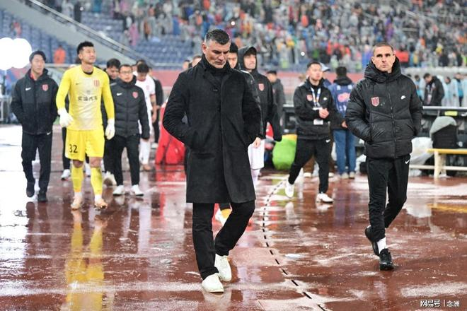

成都蓉城接连发布两则公告，宣布主教练离任、两名俱乐部高层辞职，媒体记者对此进行热议。

成都蓉城俱乐部官方宣布，主帅约翰·阿洛伊西下课、王磊辞去俱乐部董事长职务、吴博辞去俱乐部总经理职务。据悉，主教练、总经理在济南都没有跟着大部队一起行动，球迷等在酒店应该是没有等到他们。

记者丁旭表示：“成都蓉城连锅端～但，这不够吧…不足以泄民愤。”

媒体人韩乔生写道：“一纸简短公告，背后牵动不少球迷的心。赛季末一平四负的成绩摆在眼前，暴露的不只是场上球员的问题，上层决策层面的短板同样不容忽视。这次管理层核心同时离任，说句实在话，也算众望所归。至少能看出来俱乐部清楚病根在哪，找准了核心矛盾希望蓉城上下都好好总结这次失利的教训。赛季末这段糟糕的发挥，伤了不少球迷的心，也辜负了球队前中期打下的好局面。”

媒体人李璇表示：“阿洛伊西兄弟，同一天离任，说实话，俩人但凡早走几天，两个队的成绩都会好不少。”

记者申炜写道：“阿洛伊西兄弟一天之内双双下课，也算是倒霉到家了。”

记者肖赧表示：“成王败寇，职业足球不扯闲篇儿，这成绩要是，主教练不下课，是不是天理难容？成都球迷特别可爱，他们和大连球迷一样，应该收获一份家乡球队夺冠的幸福喜悦！再等等。”

记者马德兴认为：“不觉得太晚了吗？哪怕是早两周，可能情况就完全不一样了。但是，怕担责、不好交代、真拿不了冠军没有人当替罪羊，所以一拖再拖。现在真死翘翘了，反正有主教练当头号替死鬼。此乃其一。”

“其二，作为一个职业俱乐部，俱乐部的不职业性再一次显现无疑，哪怕是再不合作，起码的、礼节性的话，应该还是有个一两句吧，现在索性全部都省略了。真当是行政命令，就一句话了事。”

特别声明：以上内容(如有图片或视频亦包括在内)为自媒体平台“网易号”用户上传并发布，本平台仅提供信息存储服务。

Notice: The content above (including the pictures and videos if any) is uploaded and posted by a user of NetEase Hao, which is a social media platform and only provides information storage services.

阿库财经 2026-11-10 05:07:14

Leslie潘伟力 2026-11-08 21:11:01

流年顛簸 2026-11-10 04:39:40

走过海棠 2026-11-10 05:20:38

有范又有料 2026-11-10 04:49:41

蜡笔足球 2026-11-08 18:09:50

余生妩媚小妖精 2026-11-10 05:53:41

猫女的小树屋 2026-11-10 05:55:28

朴朴实实的情 2026-11-09 04:20:10

大嘴说台球 2026-11-10 01:15:58

时光在作祟 2026-11-10 04:55:46

体育吐槽 2026-11-09 21:43:28

纸短情长o 2026-11-09 05:18:47

蜡笔足球 2026-11-08 16:35:51

盛世论坛 2026-11-10 02:12:40

格林聊体育 2026-11-08 05:17:55

马三看世界 2026-11-09 21:13:50

智商已欠费啦 2026-11-10 06:03:58

话体坛 2026-11-09 21:46:17

咪咕体育 2026-11-09 17:49:06

日在落日打怪 2026-11-10 02:21:19

咪咕体育 2026-11-09 17:48:52

体坛周报 2026-11-10 00:28:48

科普印迹 2026-11-09 08:48:46

主持人老崔 2026-11-09 11:50:24

大宝的新家 2026-11-10 04:06:24

涩会小阿敏 2026-11-10 00:51:24

我很乖 2026-11-10 03:23:17

萌萌乐翔事 2026-11-10 00:49:47

名都阳光 2026-11-10 06:01:44

精彩背后的故事 2026-11-10 03:45:25

精彩背后的故事 2026-11-09 03:31:42

咪咕体育 2026-11-09 17:49:21

都市快报橙柿互动 2026-11-08 20:51:00

神秘研究院 2026-11-07 11:32:29

浅夏安然n 2026-11-07 07:35:12

一个香蕉说球 2026-11-08 10:33:05

随遇而安之心 2026-11-09 03:53:04

江西都市现场 2026-11-08 19:51:51

老白者乎 2026-11-09 13:32:34

## 配图

图：综合（网易体育 · 2026-11-10）

## 来源

- [网易体育 · 原文](https://www.163.com/dy/article/LBBSP0560553AOVQ.html)
