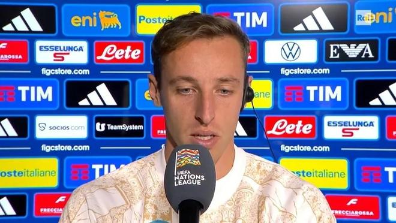

在欧国联小组赛第5轮打进一球帮助意大利主场3-1击败法国之后，弗拉泰西接受了来自意大利国家电视台的采访。

好了，达维德，你就是那位被称为“终结判官”的男人，因为你在场上就是一锤定音的判官，这是你在国家队的第10个进球，整整10个进球了，而且这个进球的分量非常重，我觉得这或许是你的所有进球当中分量最重的一个了……

这确实非常令人激动(笑)。或许当初对阵乌克兰时的那次梅开二度，在某种意义上更关系到另一个层面的目标，那是为了打进欧洲杯正赛。但是在这座球场取得进球始终是一种非常特别的感觉，因为我再说一遍，就在那个球门前，曾经诞生过我职业生涯当中最重要的进球之一——或许就是最重要的一个。我很高兴今天的这个进球能够切实地帮助球队赢得胜利，成就了这真正无比美好的一天。

是的，达维德，我想和你做一番类比探讨，因为在我看来，你现在无论是在拉齐奥俱乐部还是在意大利国家队，似乎正在经历着两种非常相似的处境。尽管两边的环境里有着两位截然不同的主教练，但是在这两支球队当中，我都看到了极大的热情、流畅的比赛内容、出色的质量以及团结一心的团队凝聚力，那么我想问你的是，如果抛开战术布置、抛开那些可以说比较偏物质和具体层面的东西不谈，积极乐观的心态以及全队上下齐心协力朝着同一个方向前进，这到底有多重要呢？因为在我看来，在如今这支意大利国家队身上，这一点体现得非常明显……

我觉得这大概能占到60%到70%的比重吧，而且我完全同意你的看法，这实际上就是两种非常类似的情况。也就是说，在拉齐奥，尽管我们最初经历过一场失利——就跟我们在国家队对阵比利时的时候可能遇到的那种挫折一样——但总而言之，我们成功地凝聚团结在了一起，重新找到了高昂的热情和斗志，并且所有人都坚定地站在同一边、朝同一个方向努力。

我认为，这正是我们在国家队重新找回的最为宝贵、最为重要的东西，这既要归功于主教练，也要归功于那些新加入的年轻小伙子们，我觉得他们为我们注入了一股当时急需的新鲜空气，也带来了另一种或许是更加轻松、放开包袱去看待事物的方式。

我再重复一遍，当球队处于一个健康良性的环境之中，每个人都充满热情，并且都甘愿为了彼此而一起咬牙吃苦拼搏的时候，一切都会变得容易得多。事实上，就我个人而言，比起今天晚上这场胜利本身，我更感到欣慰和开心的，是全队在场上所展现出的坚毅性格以及无私奉献的拼搏精神。

达维德，国家队生涯第10个进球，凑成了一个整数、迈进了两位数大关，不过我觉得我得承认你当时说得非常对，因为之前在客场战胜土耳其、你在土耳其打进那个进球之后，我们曾经连线聊过，当时的你就说过“我已经厌倦了外界仅仅根据我的进球能力来评判我，因为进球确实是一项很重要的天赋，但我是一名全面型的中场球员”，而现在在我看来，一场接着一场比赛踢下来，同时也得益于加图索正在开展的出色的工作——毕竟他当年自己就是一名极其硬朗、强悍而且全面的中场球员——你正在不断完善自己，在我眼里，你似乎正在真正成长为一名全方位、360度无死角的全能中场……

是的，其实我和他(加图索)在这个问题上时不时会有些小争论，因为他希望我在那些自己相对不那么擅长的环节上稍微有所提升，但同时他又叮嘱我要尽量把自身本就具备的优势特点最大限度地发挥出来。所以正因为如此，我反而是想把100%的精力都投入到补齐我原本不会、不擅长的那些方面上去，而他则会对我说“要不咱们各自折中一下，一半对一半吧”，所以有时候我们俩还会为此小小地拌拌嘴、争执一番。

不过我再重复一遍，这一直以来都是我的目标，就是摘掉外界贴在我身上的那些标签——倒不是说那些标签有多难听，只是不管怎么样，它们也许并不能真正反映出我到底是一名什么样的球员，对吧？要是一直被不停地贴上某种固定的标签，到最后搞不好连我自己都要信以为真了，你明白吗？所以，我非常开心能够得到两位主教练的充分信任，并且能够在球场上实实在在地证明自己究竟能做到些什么，就是这样。

对了，达维德，我猜你刚才提到的那个进球，应该就是欧冠半决赛对阵巴萨的时候打进的那个球吧？就在那个球门前，对不对？不过我现在想换个角度问你这样一个问题：如果你要向我们大家展示一下——尤其是向今天晚上正在收看我们节目的七八百万观众朋友们解释一下，对吧？如果要让你亲口说出来，像你这样的中场球员究竟是在什么时候知道自己接下来将要取得进球的——也就是说，抛开我们所有人从画面上直接看到的东西不谈，比如你总能在最恰当的时机前插到位、极其擅长凭借完美的时机把握去完成触球射门，用各种各样的方式把球打进——但你自己究竟是在哪一瞬间预感到进球马上就要发生了呢？因为你肯定必须提前在脑海里看到那个画面，否则你不可能每次都恰好在最对的时刻赶到那个位置，不是吗？

那么，好吧，这其实更多是一种从很远的地方就开始酝酿和启动的感觉，因为当我前面能够拥有那10到15米的助跑空间的时候，我就能加速冲刺起来，并且覆盖住更大一片球场区域——我的意思是，在高速奔跑当中，当队友把球传给我的时候，我或许正好能借着冲刺的势头抢出那三四米的距离，而就在这三四米的距离里，我就能够顺利完成触球射门。

不过拿今天这个球来举个例子吧，当时我是从后排插上赶过来的，就在防守球员的身后，我先是做了一个仿佛要继续往前插的假动作，紧接着突然后撤步拉开距离。就在我看到那名防守球员被带开、和我拉开空当的那一瞬间，我心里就对自己说了一句“球马上就会传到这里来，而且我能把球打进。”不过对我而言，最关键的一点始终是尽量保持从后方带起速度冲刺前插，因为在那种高速移动的状态下，我既可以选择直接绕到防守球员身后去抢点，也可以选择做一个假动作晃开他，然后拉开空间接球。

达维德，我能跟你说句实在话吗？你刚才这样自然而然、随口一聊的一番话，简直就是上了一堂大师级的教学课，全意大利所有的年轻中场球员都应该把你刚才这段讲解录下来、珍藏起来、单独剪辑保存好，反复去重温和聆听你的这番解释，实在太精彩、太美妙了……

因为要想打进之前对阵那不勒斯队的时候攻入的那个进球，你同样也得用某种特定的方式狂奔60米，而且冲到球门前的时候还得保持头脑无比清醒才行，是不是这样，达维德？

不，那全都要归功于里诺(加图索)，因为他在周中训练的时候把我们往死里狠练，所以体能和身体状态才能完全在线。

一如既往伟大的里诺，在跟你道别之前，我还想给你看这样一段画面：当时我们刚刚扳平比分的时候，主教练却没有去庆祝，而是拉着你长谈了好一会儿，就像叫了一次短暂停似的，他当时到底在跟你说些什么呢？我们之前一直在试着搞明白他的意图……

不，不，当时我们在讨论的其实是一个无球状态下防守端的问题，也就是当球不在我们脚下的时候，他希望我们采取一种和当时场面上正在执行的方式不同的防守轮转补位方案。不过你看，从这些细节也能看出我们的球队里确实有着一种健康良性的氛围，也就是说，他完全没有提高嗓门大喊大叫，而是极其冷静、心平气和地把事情解释清楚。

我相信，用这种方式，人们就完全能够把所有的事都做好，而且一个人——尤其是作为一名身处比赛激烈胶着时刻的球员——在听到这种沟通的时候，接受起来的心态和方式也会截然不同。所以，当时其实就只是这么一个防守轮转补位的小调整，但确实必须马上纠正过来，因为那个问题当时正在给我们制造不小的麻烦。

特别声明：以上内容(如有图片或视频亦包括在内)为自媒体平台“网易号”用户上传并发布，本平台仅提供信息存储服务。

Notice: The content above (including the pictures and videos if any) is uploaded and posted by a user of NetEase Hao, which is a social media platform and only provides information storage services.

晓肂爱八卦 2026-11-11 14:02:54

足球印象CC 2026-11-11 19:00:12

竞技风云录 2026-11-13 01:53:30

MUREDS 2026-11-13 02:37:19

界面新闻 2026-11-12 18:47:44

懂球帝 2026-11-13 04:37:02

足球印象CC 2026-11-10 19:11:23

左脚爆射得分 2026-11-12 11:38:02

赛场名场面 2026-11-13 02:26:09

咪咕体育 2026-11-12 03:08:05

懂球帝 2026-11-13 05:54:29

体育吐槽 2026-11-11 17:33:01

足球印象CC 2026-11-09 20:03:13

足球印象CC 2026-11-11 17:00:14

一个香蕉说球 2026-11-10 20:23:41

我的护球最独特 2026-11-13 05:50:40

秘密大爆炸 2026-11-11 16:16:47

一个香蕉说球 2026-11-10 20:24:21

我们的足球记忆 2026-11-13 02:05:51

赛场名场面 2026-11-13 01:53:28

爱打游戏的小哥 2026-11-13 05:31:37

美妙一箩筐 2026-11-11 09:48:02

一个香蕉说球 2026-11-10 20:24:26

陈赩爱体育 2026-11-11 18:41:05

杰出清莲 2026-11-12 11:04:34

一个香蕉说球 2026-11-10 20:03:38

赛场名场面 2026-11-13 06:24:52

彼岸雨露j 2026-11-12 02:22:22

一个香蕉说球 2026-11-10 20:24:22

球事百科吖 2026-11-13 06:32:33

日常碎碎念啊 2026-11-13 06:02:49

韭菜很陶醉 2026-11-12 11:37:39

超喜欢我 2026-11-11 01:25:59

线装史册 2026-11-13 03:10:08

一个香蕉说球 2026-11-10 19:42:53

一个香蕉说球 2026-11-13 04:55:42

狍子歪解体坛 2026-11-11 11:18:43

球事百科吖 2026-11-13 06:35:55

浅梦看世界 2026-11-12 12:58:06

一个香蕉说球 2026-11-13 04:55:30

## 配图

图：综合（网易体育 · 2026-11-13）

## 来源

- [网易体育 · 原文](https://www.163.com/dy/article/LBJJVTNB0549BAP0.html)
