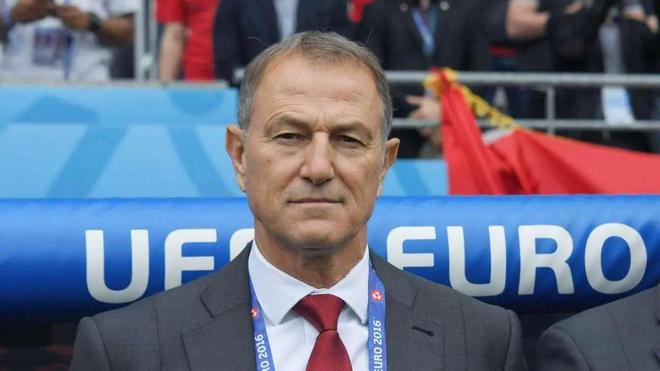

贾尼-德比亚西在Rai Radio 1上谈到了意大利国家队的成长。

他表示：“我认为，意大利在曼奇尼的带领下前景很好。他也会像前一晚对法国时那样，找到对阵比利时的最佳方案。那场比赛中，我们看到了一支充满自豪感的球队，球员们很出色、很有质量，也有很好的长期发展前景，因为队里有很多年轻球员，这一点最重要。我们战胜了一支强队，他们缺少几名重要球员，但我认为这并不会削弱我们的价值。”

特别声明：以上内容(如有图片或视频亦包括在内)为自媒体平台“网易号”用户上传并发布，本平台仅提供信息存储服务。

Notice: The content above (including the pictures and videos if any) is uploaded and posted by a user of NetEase Hao, which is a social media platform and only provides information storage services.

懂球帝 2026-11-15 04:51:07

懂球帝 2026-11-15 04:19:07

懂球帝 2026-11-15 05:22:06

奇聞空间 2026-11-14 11:43:39

浪迹天涯的猪 2026-11-15 03:46:50

全力说体育 2026-11-13 10:51:07

慢享生活集 2026-11-15 04:19:41

懂球帝 2026-11-15 04:08:06

懂球帝 2026-11-15 04:19:07

懂球帝 2026-11-15 04:40:28

小熊回收站 2026-11-15 03:19:09

温柔且自由 2026-11-15 03:57:55

神秘研究院 2026-11-14 11:19:29

篮球人物故事会 2026-11-14 11:19:14

懂球帝 2026-11-15 04:52:02

慢享生活集 2026-11-15 06:28:21

懂球帝 2026-11-15 01:18:09

篮球过人技巧 2026-11-13 19:31:36

浅梦看世界 2026-11-12 12:58:06

懂球帝 2026-11-15 06:26:09

Shoot体育 2026-11-14 11:11:38

陶衣柜 2026-11-15 06:11:12

全景体育V 2026-11-13 08:11:37

坠入温柔晚风 2026-11-15 06:34:52

快乐加载中21 2026-11-15 06:21:36

懂球帝 2026-11-15 06:26:10

好奇趣世界 2026-11-11 11:29:14

木子笑家 2026-11-11 16:03:35

都市观察 2026-11-14 10:22:25

生活松松乐 2026-11-12 03:38:30

参考消息 2026-11-13 20:26:04

天注定 2026-11-14 00:31:14

扬子晚报 2026-11-14 11:14:48

瞩望云霄 2026-11-13 11:31:59

音乐纵横 2026-11-10 14:30:17

轻武世界 2026-11-14 21:10:03

白鹿视频 2026-11-13 20:22:18

田先生篮球 2026-11-15 05:56:33

搞笑黄发妹 2026-11-14 19:34:36

蓝鲸新闻 2026-11-13 13:01:31

## 配图

图：综合（网易体育 · 2026-11-15）

## 来源

- [网易体育 · 原文](https://www.163.com/dy/article/LBOOR4CV0549BAP0.html)
